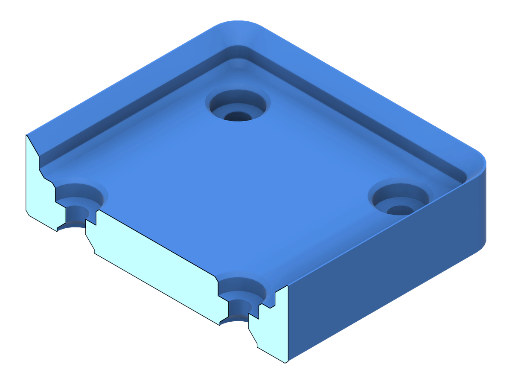
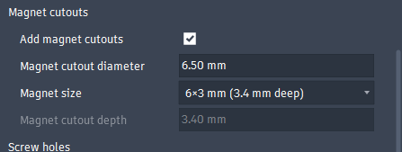
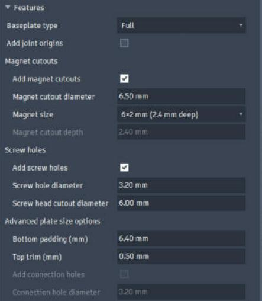
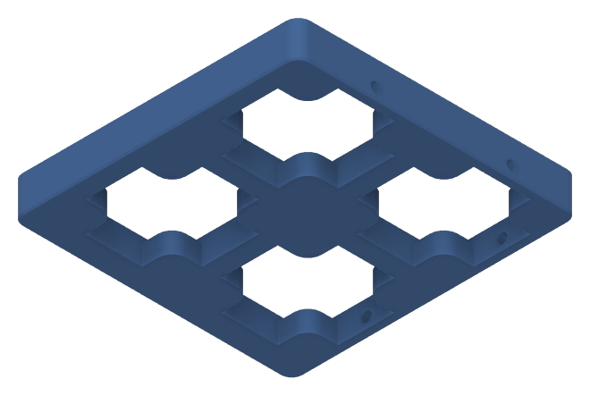

# Grundplatten { #baseplates }

**Volumenkörper › Erstellen › Gridkeeper Grundplatte** erzeugt eine Platte aus Steckplätzen, in die die Behälter
eingesetzt werden. Jede neue Grundplatte ist eine eigene Komponente im Container *Grid*, siehe
[Komponenten und Gelenke](working/components.md).

Der Dialog hat von oben nach unten diese Bereiche.

## Informationen { #info }

Ein Link zu dieser Seite und die Version des Add-ins. Wurde der Dialog über **Gridkeeper neu erstellen** geöffnet,
steht hier, welche Grundplatte an Ort und Stelle neu erstellt wird.

## Grundmaße { #basic-size }

| Eingabe | Vorgabe | Was sie bewirkt |
|---|---|---|
| **Rastereinheit Breite, X (mm)** | 42 mm | Größe einer Rasterzelle entlang X |
| **Rastereinheit Länge, Y (mm)** | 42 mm | Größe einer Rasterzelle entlang Y |
| **Spiel XY des Behälters (mm)** | 0,25 mm | Abstand auf jeder Seite zwischen einem Behälter und seiner Zelle, die Steckplätze werden um diesen Betrag größer. Wählen Sie denselben Wert wie beim Spiel XY der Behälter. 0,1 bis 0,5 mm |
| **Spiel am Plattenrand (mm)** | 0,05 mm | Wie weit der Rand einer Platte vor der Rasterlinie endet, an der sie auf eine andere Platte trifft; nebeneinander geklebte Platten lassen das Doppelte davon zwischen sich. 0,025 bis 0,25 mm. Vor dem 17.11.2026 gespeicherte Einstellungen hatten den ganzen Spalt, *Clearance between plates*, und werden als die Hälfte davon gelesen |

## Hauptmaße { #main-dimensions }

**Größenmodus** legt fest, wie die Größe angegeben wird: *Füllfläche* (die Vorgabe) oder *Rastereinheiten*.

### Rastereinheiten { #grid-units }

| Eingabe | Vorgabe | Was sie bewirkt |
|---|---|---|
| **Breite der Platte, X (u)** | 2 | Anzahl der Zellen entlang X, 1 bis 100 |
| **Länge der Platte, Y (u)** | 3 | Anzahl der Zellen entlang Y, 1 bis 100 |

### Füllfläche { #fill-area }

Geben Sie das Innenmaß einer Schublade oder einer anderen Fläche ein. Das Raster wird in sie eingepasst und in Stücke
aufgeteilt, die auf Ihr Druckbett passen.

| Eingabe | Vorgabe | Was sie bewirkt |
|---|---|---|
| **Breite der Füllfläche, X** | 400 mm | Breite der Fläche |
| **Länge der Füllfläche, Y** | 300 mm | Länge der Fläche |
| **Position des Rasters, X** | Mitte | *Links*, *Mitte* oder *Rechts*: die Seite, an die das Raster geschoben wird, der Rest wird aufgefüllt |
| **Position des Rasters, Y** | Mitte | *Vorne*, *Mitte* oder *Hinten* |
| **Lücken mit halben Zellen füllen** | an | Wo der Platz hinter dem Raster für eine Reihe Steckplätze in halber Größe reicht, wird eine eingefügt statt einer massiven Auffüllung |

In der Gruppe **Druckbett** wählen Sie Ihren **Drucker** aus der Liste oder *Benutzerdefiniert*, dann geben Sie
**Breite des Druckbetts, X** und **Länge des Druckbetts, Y** selbst ein. Die Liste: Bambu Lab A1 mini (180 x 180 mm),
Bambu Lab A1 (256 x 256), Bambu Lab A2L (330 x 320), Bambu Lab P1P, P1S, X1, X1 Carbon, X1E (je 256 x 256),
Bambu Lab P2S, X2D (je 256 x 256), Bambu Lab H2C (330 x 320), Bambu Lab H2D, H2D Pro (je 350 x 320), Bambu Lab H2S
(340 x 320), Bambu Lab H3C (330 x 320), Prusa MINI (180 x 180), Prusa MK3, MK4 (250 x 210), Prusa CORE One
(250 x 220), Prusa XL (360 x 360), Creality Ender-3 (220 x 220), Creality K1, K1C (220 x 220), Creality K1 Max
(300 x 300), Elegoo Neptune 4 (225 x 225), Voron 0 (120 x 120), Voron 250, 300 und 350. Der Drucker, den Sie zuletzt
gewählt haben, hier oder im Exportdialog, ist beim nächsten Öffnen des Dialogs voreingestellt. Der **Rand des
Druckbetts** (5 mm) bleibt an jeder Seite des Druckbetts frei. **Ergebnis** zeichnet die Fläche, das Raster und die
Aufteilung in Stücke.

<picture><source media="(prefers-color-scheme: dark)" srcset="../../assets/gif/baseplate-fill-area-dark.gif"></picture>

## Funktionen { #features }

**Typ der Grundplatte**

| Typ | Was es ist |
|---|---|
| **Leicht** | Eine dünne Platte aus Steckplätzen, mit dem wenigsten Filament. Eingaben für Magnet-, Schrauben- und Verbindungslöcher werden ignoriert. |
| **Skelettiert** | Eine dicke Platte, deren Unterseite zur Gewichtsersparnis ausgespart ist und Platz für Magnete, Schrauben und Verbindungslöcher lässt. |
| **Voll** | Eine dicke Platte mit Platz für Magnete und Schrauben unter jedem Steckplatz. |

<picture><source media="(prefers-color-scheme: dark)" srcset="../../assets/gif/baseplate-types-dark.gif"></picture>

**Gelenkursprünge hinzufügen** setzt in die Mitte des Bodens jedes Steckplatzes einen Gelenkursprung, um Behälter per
Gelenk in die Platte zu setzen: Der Behälterdialog setzt einen neuen Behälter in einen davon
([Gelenkursprung in einem Dialog wählen](working/components.md#picking-a-joint-origin-in-a-dialog)), von Hand siehe
[Gelenkursprünge](working/components.md#jointing-by-hand). Eine neu erstellte Grundplatte behält die in ihre Steckplätze
gesetzten Behälter, solange sie diese Steckplätze und deren Gelenkursprünge noch hat.

### Magnetaussparungen { #magnet-cutouts }

Nur für volle und skelettierte Platten. **Magnetaussparungen hinzufügen** (an), **Durchmesser der Magnetaussparung**
(6,5 mm, bis 10 mm), **Magnetgröße** (Magnete 6×2 mm brauchen 2,4 mm, Magnete 6×3 mm 3,4 mm, oder *Benutzerdefiniert*)
und **Tiefe der Magnetaussparung** (2,4 mm, mehr als 0, mit *Benutzerdefiniert* einzugeben). Gespeichert wird nur die
Tiefe; Einstellungsdateien mit anderen Tiefen werden als *Benutzerdefiniert* geladen. Jeder Magnetsteckplatz hat rund
um seine Öffnung eine Fase von 0,5 mm, damit die Magnete leichter hineingehen; sie ist immer vorhanden (aus
GridfinityGenerator 2.5 von Le0Michine).

### Schraubenbohrungen { #screw-holes }

Nur für volle und skelettierte Platten. **Schraubenbohrungen hinzufügen** (an), **Durchmesser der Schraubenbohrung**
(3,2 mm, bis 10 mm) und **Durchmesser der Schraubenkopf-Aussparung** (6 mm, größer als die Schraubenbohrung, bis
15 mm).

### Auffüllung an den Seiten { #side-padding }

**Auffüllung an den Seiten hinzufügen** mit **Auffüllung links**, **Auffüllung oben**, **Auffüllung rechts** und
**Auffüllung unten**: massiver Rand um das Raster, 0 oder mehr. Die Auffüllungen sind Benutzerparameter der Platte,
siehe [Parameter ändern](working/parameters.md).

### Erweiterte Optionen zur Plattengröße { #advanced-plate-size-options }

| Eingabe | Vorgabe | Was sie bewirkt |
|---|---|---|
| **Zusätzliche Bodendicke (mm)** | 6,4 mm | Massive Schicht unter den Steckplätzen voller und skelettierter Platten, in der die Magnetsteckplätze und Schraubenbohrungen liegen |
| **Abschnitt oben (mm)** | 0,5 mm | Schneidet die Oberseite der Platte ab, damit ein Behälter mit seinen Füßen in den Steckplätzen sitzt und nicht auf den Stegen dazwischen. 0 bis 3 mm |
| **Verbindungslöcher hinzufügen** | aus | Skelettierte Platten: Löcher zwischen den Platten für eine Schraube oder einen eingeklebten Stift. Bei leichten und vollen Platten ausgegraut. Eine Seite mit Auffüllung oder halben Zellen bekommt keine, dort stößt keine andere Platte an; Nähte zwischen den Stücken einer Füllfläche behalten ihre |
| **Durchmesser der Verbindungslöcher** | 3,2 mm | Bis 5 mm, ohne Verbindungslöcher ausgegraut |

<picture><source media="(prefers-color-scheme: dark)" srcset="../../assets/gif/baseplate-connection-holes-dark.gif"></picture>

## Eingaben { #inputs }

Schaltflächen für die Vorgaben des Dialogs und für Einstellungsdateien, in jedem Gridkeeper-Dialog gleich, siehe
[Einstellungen speichern und laden](working/save-load.md).

## Vorschau { #preview }

**Vorschau anzeigen (langsam)** erzeugt die Platte, während Sie die Eingaben ändern; **Letzte Vorschau** zeigt, wie
lange die letzte gedauert hat.

Die Platte wird nach ihrer Größe benannt, *Gridfinity baseplate 3x2* oder *Gridfinity baseplate fill 400x300 mm*.
**OK** bleibt gesperrt, solange eine Eingabe außerhalb des zulässigen Bereichs liegt, siehe
[Meldungen und gesperrtes OK](help/messages.md#ok-stays-locked).
