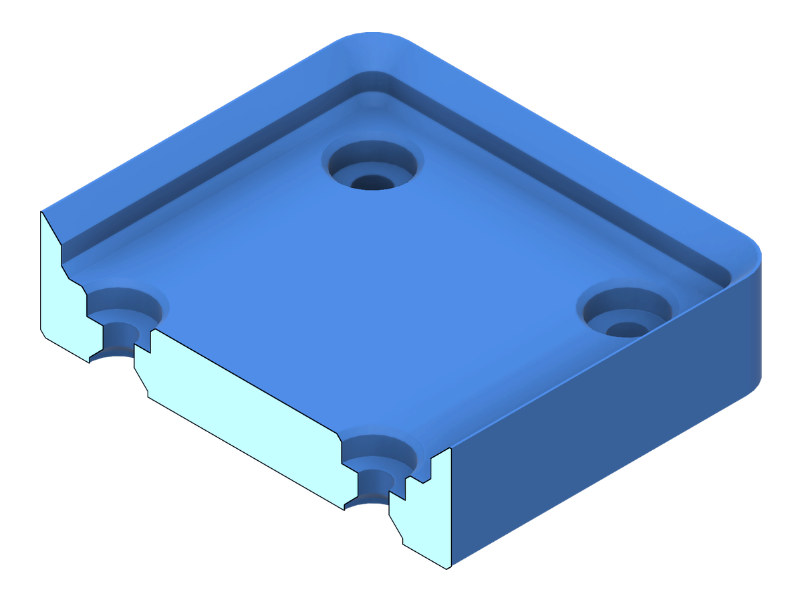
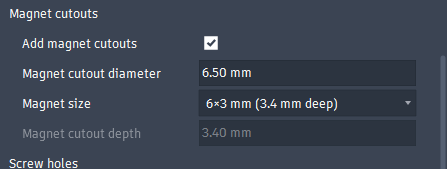
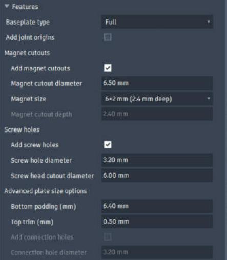
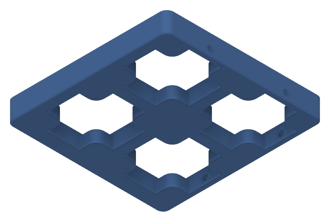

# Baseplates

**Solid › Create › Gridkeeper baseplate** builds a plate of sockets the bins sit in. Every new baseplate is a
component of its own in the container *Grid*, see [Components and joints](working/components.md).

The dialog has these sections, from top to bottom.

## Info

A link to this page and the version of the add-in. When the dialog was opened by **Gridkeeper rebuild**, it says which
baseplate is rebuilt in place.

## Basic size

| Input | Default | What it does |
|---|---|---|
| **Base width unit, X (mm)** | 42 mm | Size of one grid cell along X |
| **Base length unit, Y (mm)** | 42 mm | Size of one grid cell along Y |
| **Bin xy clearance (mm)** | 0.25 mm | Gap on each side between a bin and its cell, the sockets are made larger by it. Keep it the same as the bins' xy clearance. 0.1 to 0.5 mm |
| **Plate edge clearance (mm)** | 0.05 mm | How far the edge of a plate stops short of the grid line where it meets another plate; plates glued side by side leave twice it between them. 0.025 to 0.25 mm. Settings saved before 17.11.2026 had the whole gap, *Clearance between plates*, and are read as half of it |

## Main dimensions

**Sizing mode** chooses how the size is given: *Fill area* (the default) or *Grid units*.

### Grid units

| Input | Default | What it does |
|---|---|---|
| **Plate width, X (u)** | 2 | Number of cells along X, 1 to 100 |
| **Plate length, Y (u)** | 3 | Number of cells along Y, 1 to 100 |

### Fill area

Enter the inner size of a drawer or any other area, the grid is fitted into it and split into pieces that fit your
print bed.

| Input | Default | What it does |
|---|---|---|
| **Area width, X** | 400 mm | Width of the area |
| **Area length, Y** | 300 mm | Length of the area |
| **Grid position, X** | Center | *Left*, *Center* or *Right*: the side the grid is pushed to, padding fills the rest |
| **Grid position, Y** | Center | *Front*, *Center* or *Back* |
| **Fill gaps with half cells** | on | Where the space left past the grid fits a row of half size sockets, adds one instead of solid padding |

In the **Print bed** group pick your **Printer** from the list or *Custom*, then **Bed width, X** and **Bed length, Y** are yours to enter. The list: Bambu Lab A1 mini (180 x 180 mm), Bambu Lab A1 (256 x 256), Bambu Lab A2L (330 x 320), Bambu Lab P1P, P1S, X1, X1C, X1E (256 x 256), Bambu Lab P2S, X2D (256 x 256), Bambu Lab H2C (330 x 320), Bambu Lab H2D, H2D Pro (350 x 320), Bambu Lab H2S (340 x 320), Bambu Lab H3C (330 x 320), Prusa MINI
(180 x 180), Prusa MK3, MK4 (250 x 210), Prusa CORE One (250 x 220), Prusa XL (360 x 360), Creality Ender-3
(220 x 220), Creality K1, K1C (220 x 220), Creality K1 Max (300 x 300), Elegoo Neptune 4 (225 x 225), Voron 0
(120 x 120), Voron 250, 300 and 350. **Bed margin** (5 mm) is kept clear on every
side of the bed. **Result** draws the area, the grid and how it is split into pieces.

<picture><source media="(prefers-color-scheme: dark)" srcset="../assets/gif/baseplate-fill-area-dark.gif"></picture>

## Features

**Baseplate type**

| Type | What it is |
|---|---|
| **Light** | A thin plate of sockets, the least filament. Magnet, screw and connection hole inputs are ignored. |
| **Skeletonized** | A thick plate with its bottom cut away to save weight, leaving room for magnets, screws and connection holes. |
| **Full** | A thick plate with room for magnets and screws under every socket. |

<picture><source media="(prefers-color-scheme: dark)" srcset="../assets/gif/baseplate-types-dark.gif"></picture>

**Add joint origins** puts a joint origin at the bottom center of every socket, to joint bins into the plate: the bin
dialog puts a new bin into one ([Picking a joint origin in a dialog](working/components.md#picking-a-joint-origin-in-a-dialog)),
by hand see [Joint origins](working/components.md#jointing-by-hand). A rebuilt baseplate keeps the bins jointed into
its sockets, as long as it still has those sockets and their joint origins.

### Magnet cutouts

Full and skeletonized plates only. **Add magnet cutouts** (on), **Magnet cutout diameter** (6.5 mm, up to 10 mm),
**Magnet size** (6×2 mm magnets need 2.4 mm, 6×3 mm ones 3.4 mm, or *Custom*) and **Magnet cutout depth** (2.4 mm,
more than 0, typed with *Custom*). Only the depth is saved; settings files with other depths load as *Custom*.
Every magnet socket has a 0.5 mm chamfer around its opening, so magnets go in easier; it is always there (from
GridfinityGenerator 2.5 by Le0Michine).

### Screw holes

Full and skeletonized plates only. **Add screw holes** (on), **Screw hole diameter** (3.2 mm, up to 10 mm) and
**Screw head cutout diameter** (6 mm, larger than the screw hole, up to 15 mm).

### Side padding

**Add side padding** with **Padding left**, **Padding top**, **Padding right** and **Padding bottom**: solid border
around the grid, 0 or more. The paddings are user parameters of the plate, see [Changing parameters](working/parameters.md).

### Advanced plate size options

| Input | Default | What it does |
|---|---|---|
| **Bottom padding (mm)** | 6.4 mm | Solid layer under the sockets of full and skeletonized plates, where the magnet sockets and screw holes go |
| **Top trim (mm)** | 0.5 mm | Cut off the top of the plate, so a bin sits on its feet in the sockets rather than on the ridges between them. 0 to 3 mm |
| **Add connection holes** | off | Skeletonized plates: holes between the plates for a screw or a glued-in pin. Greyed out for light and full plates. A side with padding or half cells gets none, it isn't an edge another plate meets; seams between the pieces of a filled area keep theirs |
| **Connection hole diameter** | 3.2 mm | Up to 5 mm, greyed out without connection holes |

<picture><source media="(prefers-color-scheme: dark)" srcset="../assets/gif/baseplate-connection-holes-dark.gif"></picture>

## Inputs

Buttons for the dialog's defaults and for settings files, the same in every Gridkeeper dialog, see
[Saving and loading settings](working/save-load.md).

## Preview

**Show preview (slow)** builds the plate while you change the inputs; **Last preview** shows how long the last one took.

The plate is named after its size, *Gridfinity baseplate 3x2* or *Gridfinity baseplate fill 400x300 mm*. **OK** stays locked while an input is out of range, see
[Messages and locked OK](help/messages.md#ok-stays-locked).
