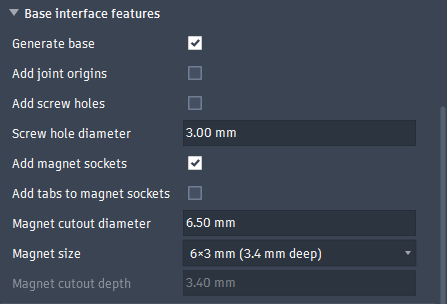
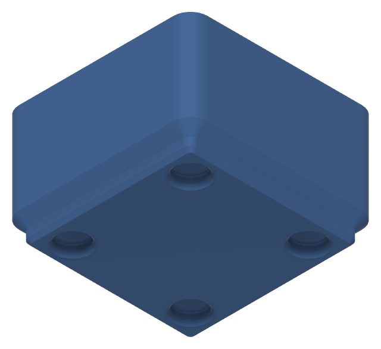
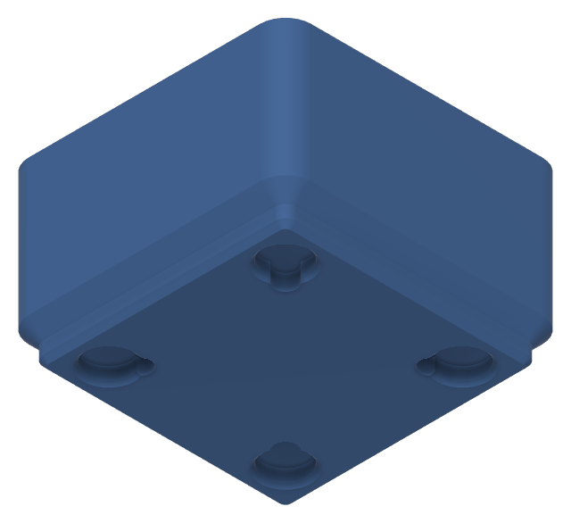
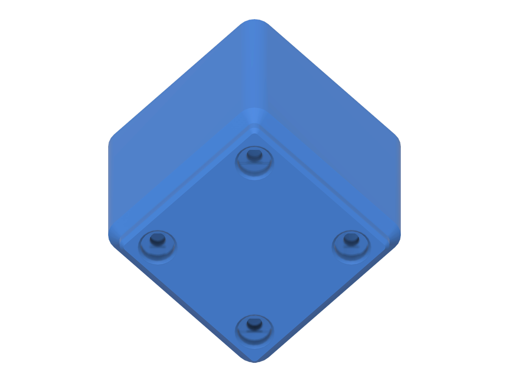

# Füße, Magnete und Schrauben { #base-magnets-and-screws }

Der Abschnitt **Füße** des Behälter-Dialogs: die Füße, die in den Steckplätzen der
Grundplatte sitzen.

| Eingabe | Vorgabe | Wirkung |
|---|---|---|
| **Füße erzeugen** | an | Aus erzeugt nur den Körper, ohne Füße |
| **Gelenkursprünge** | aus | Ein Gelenkursprung in der Mitte des Bodens jedes Fußes, um den Behälter per Gelenk in Steckplätze einer Grundplatte oder in die Zellen einer Aufbewahrungsbox einzusetzen ([so geht es](../working/components.md#jointing-by-hand)); nur mit den Füßen |
| **Schraubenbohrungen** | aus | Eine Schraubenbohrung in jedem Fuß |
| **Ø Schraubenbohrung** | 3 mm | 1 bis 10 mm; bei Magnetaussparungen kleiner als die Magnetaussparung |
| **Magnetaussparungen** | aus | Eine Magnetaussparung in jedem Fuß |
| **Laschen an Magneten** | aus | Öffnet jede Magnetaussparung zur Seite, damit sich der Magnet herausdrücken lässt |
| **Ø Magnetaussparung** | 6,5 mm | 1 bis 10 mm |
| **Magnetgröße** | 6×2 mm (2,4 mm tief) | Legt die Tiefe für Magnete von 6 × 2 mm oder 6 × 3 mm (3,4 mm) fest; *Benutzerdefiniert*, um die Tiefe selbst einzugeben |
| **Tiefe Magnetaussparung** | 2,4 mm | Mindestens 1 mm, bei *Benutzerdefiniert* einzugeben |

Bei Magnetaussparungen und Schraubenbohrungen zusammen verbindet eine Rille jede Magnetaussparung mit ihrer
Schraubenbohrung, damit sich das Teil drucken lässt; sie entfällt, wo die Aussparungen dafür zu tief sind. Halbe Füße
haben keine Magnet- oder Schraubenlöcher: beim **Halbraster** sind die Eingaben für die Löcher gesperrt, ebenso wie
ohne **Füße erzeugen**.

Jede Magnetaussparung hat eine 0,5 mm große Fase rund um ihre Öffnung an der Unterseite des Behälters, damit die Magnete
leichter hineingehen und die erste Schicht nicht in das Loch gequetscht wird. Sie ist immer da, es gibt dafür keine
Eingabe (aus GridfinityGenerator 2.5 von Le0Michine).

Magnetaussparungen | Zur Seite geöffnete Magnetaussparungen | Magnete und Schrauben mit Rille
:-------------------------:|:-------------------------:|:-------------------------:
 |  | 

<picture><source media="(prefers-color-scheme: dark)" srcset="../../../assets/gif/bin-bottom-options-dark.gif"></picture>
