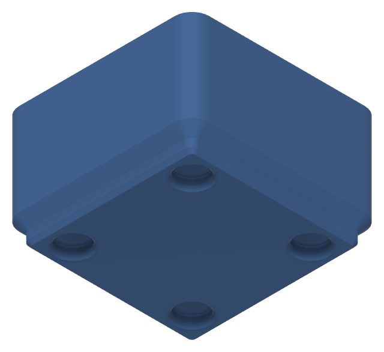
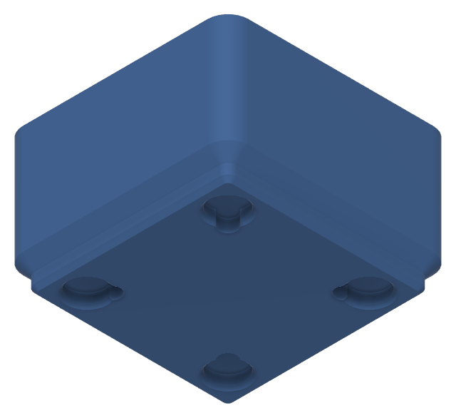
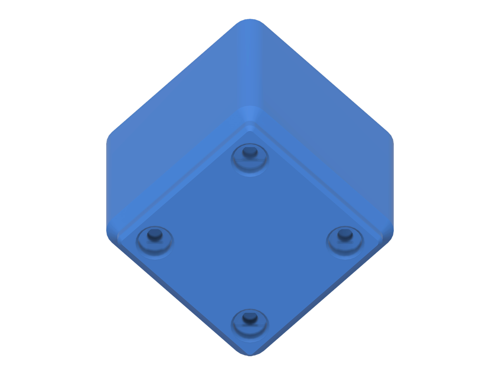

# Base, magnets and screws

The **Base interface features** section of the bin dialog: the feet that sit in the baseplate sockets.

| Input | Default | What it does |
|---|---|---|
| **Generate base** | on | Off builds the body alone, without feet |
| **Add joint origins** | off | A joint origin at the bottom center of every foot, to joint the bin into baseplate sockets; only with the base |
| **Add screw holes** | off | A screw hole in every foot |
| **Screw hole diameter** | 3 mm | 1 to 10 mm |
| **Add magnet sockets** | off | A magnet socket in every foot |
| **Add tabs to magnet sockets** | off | Opens each magnet socket to the side, to pull the magnet out |
| **Magnet cutout diameter** | 6.5 mm | 1 to 10 mm |
| **Magnet cutout depth** | 2.4 mm | At least 1 mm |

With magnet sockets and screw holes together, a groove bridges each magnet socket to its screw hole for
printability; it is left out where the sockets are too deep for it. Half size feet have no magnet or screw holes.

Magnet sockets | Magnet sockets opened to the side | Magnets and screws with a groove
:-------------------------:|:-------------------------:|:-------------------------:
 |  | 

<picture><source media="(prefers-color-scheme: dark)" srcset="../../assets/gif/bin-bottom-options-dark.gif"></picture>
