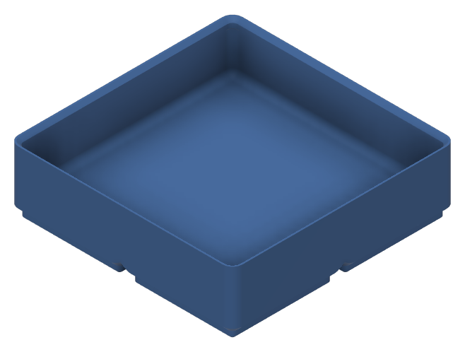
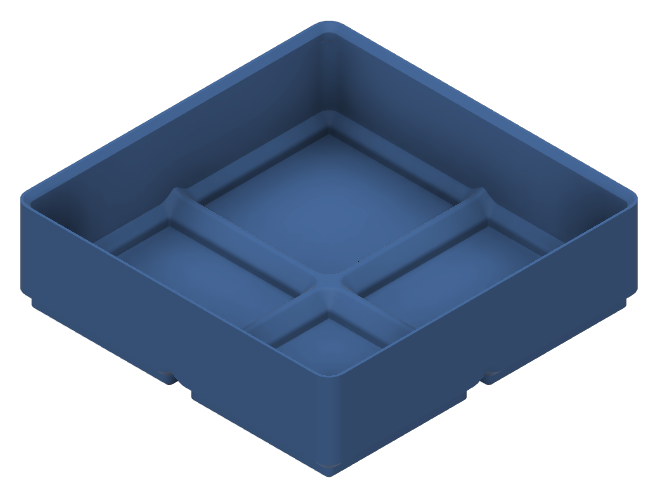
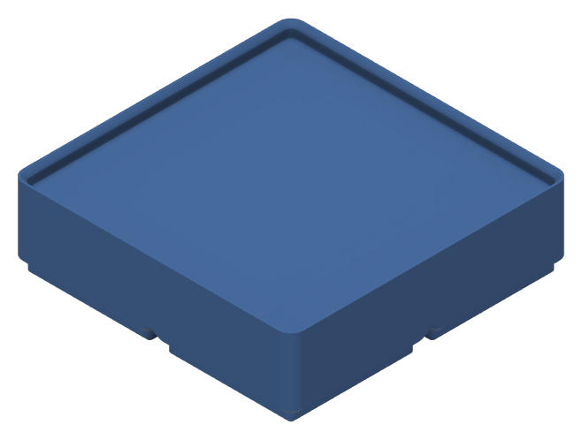
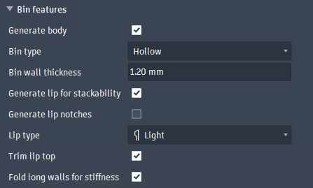
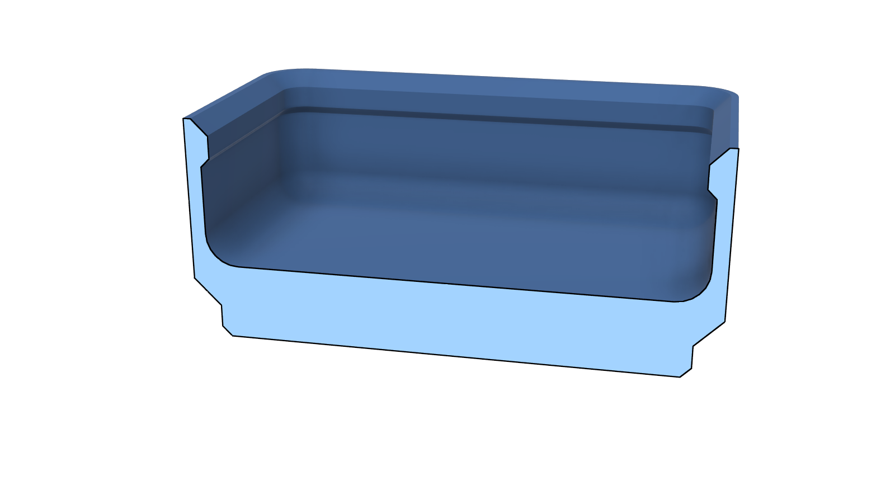
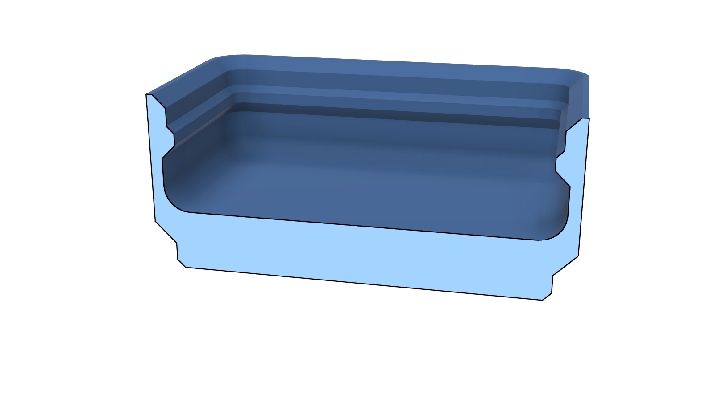
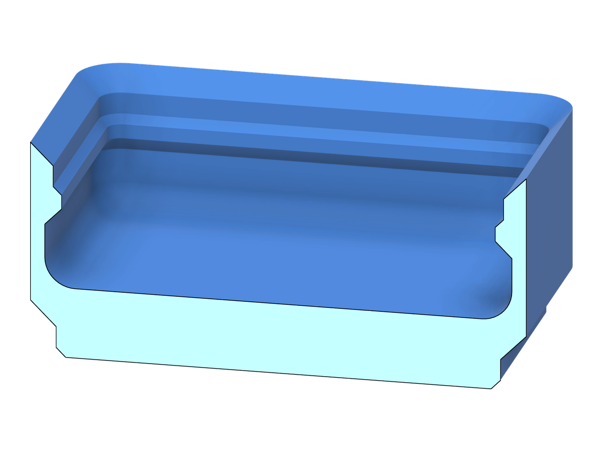

# Körper, Wände und Stapelrand { #body-walls-and-lip }

Der Abschnitt **Merkmale des Behälters** des Behälter-Dialogs.

| Eingabe | Vorgabe | Wirkung |
|---|---|---|
| **Körper erzeugen** | an | Aus erzeugt nur die Füße, um sie unter ein eigenes Modell zu setzen |
| **Behältertyp** | Hohl | *Hohl*, *Schale* oder *Voll*, siehe unten |
| **Wandstärke** | 1,2 mm | 0,4 bis 2 mm. Nicht für volle Behälter. Cullenect-Aufnahmen brauchen mindestens 1,2 mm |
| **Stapelrand erzeugen** | an | Der Rand oben, auf dem ein anderer Behälter steht. Aus ergibt eine gerade Wand |
| **Kerben im Stapelrand** | aus | Kerben im Stapelrand, die gestapelte Behälter am Verrutschen hindern; nur mit dem Stapelrand |
| **Stapelrandtyp** | Leicht | *Leicht* oder *Voll*, siehe unten; nur mit dem Stapelrand |
| **Stapelrand oben kürzen** | an | Schneidet die Oberseite des Stapelrands flach ab, 0,6 mm tiefer; aus lässt die scharfe Kante des ursprünglichen Profils stehen. Nur mit dem Stapelrand |
| **Lange Wände falzen** | an | Falze, siehe unten. Nur für hohle Behälter und Behälter als Schale, mit Körper |

Ist **Füße erzeugen** im Abschnitt [Füße](base.md) ausgeschaltet, wird der Körper allein
erzeugt, um ihn mit einem vorhandenen Modell zu kombinieren.

## Behältertypen { #bin-types }

Hohler Behälter | Behälter als Schale | Voller Behälter
:-------------------------:|:-------------------------:|:-------------------------:
 |  | 

- **Hohl:** Wände in der angegebenen Stärke auf einem massiven Boden, der übliche Behälter.
- **Schale:** Der Behälter wird mit gleichbleibender Wandstärke ausgehöhlt, das spart Filament und Druckzeit. Die
  Beschriftungslasche eines Behälters als Schale ist standardmäßig hohl.
- **Voll:** ein massiver Block, ein Ausgangspunkt für Werkzeugbehälter: Schneiden Sie die Form Ihrer Werkzeuge hinein.

<picture><source media="(prefers-color-scheme: dark)" srcset="../../../assets/gif/bin-solid-tool-dark.gif"></picture>

## Stapelrandtypen { #lip-types }

Der Stapelrand ist der Steckplatz, in dem die Füße eines darauf gestapelten Behälters sitzen.

- **Leicht** (Vorgabe): Die Innenseite des Stapelrands geht gerade nach unten bis zur Oberkante des Behälters. Er
  braucht am wenigsten Material und lässt im Behälter am meisten Platz.
- **Voll:** das ursprüngliche Gridfinity-Profil. Der Stapelrand verjüngt sich im 45-Grad-Winkel zu einer inneren Spitze,
  wie die Unterseite eines Fußes, und eine Stütze unter der Spitze führt erst gerade nach unten und dann im
  45-Grad-Winkel nach außen in die Wand, sodass die Spitze nicht ins Innere des Behälters überhängt. Die Wand einer
  Griffmulde reicht bis zur Spitze. Auf Rasterlinien bis nach oben geführte Trennwände (siehe
  [Fächer](compartments.md)) folgen demselben Profil.
- **Stapelrand oben kürzen:** standardmäßig an, die Oberseite des Stapelrands wird flach abgeschnitten, 0,6 mm
  tiefer, die Form, die Gridkeeper-Behälter schon immer hatten. Aus behält die scharfe Oberkante des ursprünglichen
  Profils; der Behälter ist dann 0,6 mm höher.

Leicht | Voll | Voll, Oberseite nicht gekürzt
:---: | :---: | :---:
 |  | 

Ohne **Stapelrand erzeugen** geht die Wand gerade nach oben, und beide Eingaben sind gesperrt.

## Gefalzte Wände { #creased-walls }

Lange Wände hoher hohler Behälter und Behälter als Schale werden im Origami-Stil entlang flacher Falze nach innen
gefaltet, damit sie sich weniger durchbiegen. Behälter ab der Mindesthöhe mit einer Wand ab der Mindestlänge bekommen
sie; die Wände werden in gleichmäßige Felder bis zur maximalen Feldlänge geteilt, Wände, die kürzer sind als ein Feld
der längsten Wand, bleiben flach. Die Wand der Griffmulde bleibt flach, die Griffmulde stützt sie. Ein gefalzter
Behälter hat ein einziges Fach und eine massive Beschriftungslasche: **Fächer bearbeiten** und **Hohle
Lasche** sind für ihn gesperrt, die Fachaufteilung bleibt erhalten, für den Fall, dass der Behälter keine Falze mehr
bekommt.

Die vier folgenden Eingaben sind gesperrt, solange **Lange Wände falzen** aus ist.

| Eingabe | Vorgabe | Wirkung |
|---|---|---|
| **Falztiefe** | 2 mm | Wie weit ein Falz nach innen faltet, mindestens 0,5 mm |
| **Falzen ab Wandlänge (u)** | 2,85 | Kürzere Wände bleiben flach, etwa 120 mm bei 42-mm-Einheiten |
| **Max. Falzfeldlänge (u)** | 4,75 | Längstes Feld zwischen Falzen, etwa 200 mm |
| **Falzen ab Höhe (u)** | 10 | Niedrigere Behälter bleiben flach, 70 mm bei 7-mm-Einheiten |

<picture><source media="(prefers-color-scheme: dark)" srcset="../../../assets/gif/bin-creases-dark.gif"></picture>
