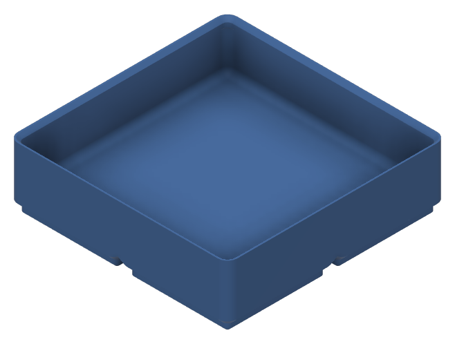
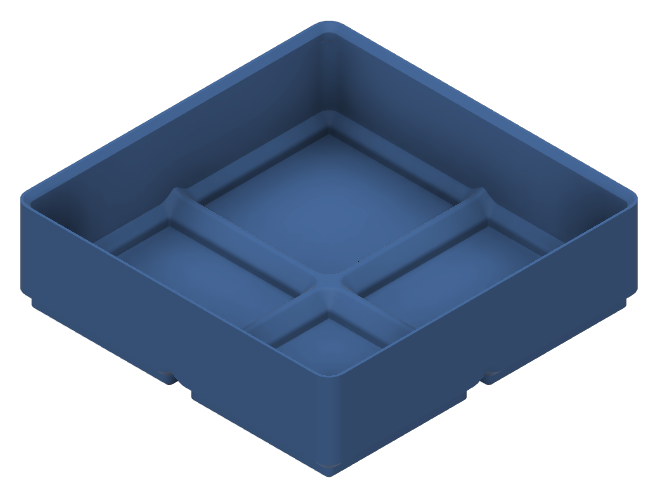
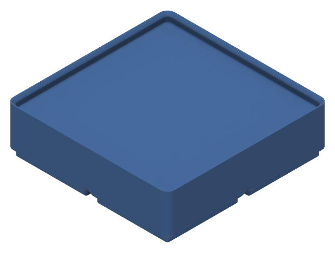

# Body, walls and lip

The **Bin features** section of the bin dialog.

| Input | Default | What it does |
|---|---|---|
| **Generate body** | on | Off builds the base alone, to put under a model of your own |
| **Bin type** | Hollow | *Hollow*, *Shelled* or *Solid*, see below |
| **Bin wall thickness** | 1.2 mm | 0.4 to 2 mm. Not for solid bins. Cullenect pockets need at least 1.2 mm |
| **Generate lip for stackability** | on | The lip at the top another bin stacks on. Off gives a straight wall |
| **Generate lip notches** | off | Notches in the lip that keep stacked bins from sliding; only with the lip |
| **Fold long walls for stiffness** | on | Creases, see below. Hollow and shelled bins with a body only |

With **Generate base** off in [Base interface features](base.md) the body is built alone, to combine it with an
existing model.

## Bin types

Hollow bin | Shelled bin | Solid bin
:-------------------------:|:-------------------------:|:-------------------------:
 |  | 

- **Hollow:** walls of the given thickness on a solid bottom, the usual bin.
- **Shelled:** the bin is shelled with a constant wall thickness, which saves filament and printing time. A
  shelled bin's label tab is hollow by default.
- **Solid:** a solid block, a start for tool bins: cut the shape of your tools into it.

<picture><source media="(prefers-color-scheme: dark)" srcset="../../assets/gif/bin-solid-tool-dark.gif"></picture>

## Creased walls

Long walls of tall hollow and shelled bins are folded in along shallow creases, origami style, so they bow less. Bins
from the min height with a wall from the min length get them; walls are split into even panels up to the max panel
length, walls shorter than a panel of the longest one stay flat. The scoop wall stays flat, the scoop braces it. A
creased bin has a single compartment and a solid label tab: **Edit compartment layout** and **Hollow tab** are locked
for it, the compartment layout is kept for when the bin no longer gets creases.

The four inputs below are locked while **Fold long walls for stiffness** is off.

| Input | Default | What it does |
|---|---|---|
| **Crease depth** | 2 mm | How far a crease folds in, at least 0.5 mm |
| **Creased wall min length (u)** | 2.85 | Shorter walls stay flat, about 120 mm with 42 mm units |
| **Crease panel max length (u)** | 4.75 | Longest panel between creases, about 200 mm |
| **Creased bin min height (u)** | 10 | Lower bins stay flat, 70 mm with 7 mm units |

<picture><source media="(prefers-color-scheme: dark)" srcset="../../assets/gif/bin-creases-dark.gif"></picture>
