# Fächer und Griffmulde { #compartments-and-scoop }

Der Abschnitt **Fächer des Behälters** des Behälter-Dialogs.

## Fachraster { #compartment-grid }

Das kleine Raster oben legt fest, wie viele Fächer der Behälter hat: **X**, die Zellen entlang der Behälterbreite, und
**Y**, die Zellen entlang der Behälterlänge, alle gleich groß.

## Fachaufteilung { #compartment-layout }

Schalten Sie **Fachaufteilung bearbeiten** ein, um eine Zeichnung des Rasters zu erhalten:

- **Ziehen Sie über Zellen**, um sie zu einem größeren Fach zusammenzufassen. **Teilen** macht aus einem Fach wieder
  einzelne Zellen.
- **Klicken Sie auf ein Fach**, um ihm einen eigenen Text für **Beschriftung**, ein **Symbol** und eine **Tiefe**
  zu geben. Eine leere Beschriftung übernimmt den Text aus dem [Abschnitt Beschriftungslasche](labels.md); die Tiefe
  wird ab der Oberkante des Behälters gemessen, leer bedeutet volle Tiefe. **Fertig** beendet die Bearbeitung dieses
  Fachs, Änderungen werden sofort übernommen.
- **Griffmulden** eines Fachs: ohne **Eigene** übernimmt es die Wände, die im Abschnitt [Griffmulde](#scoop)
  angekreuzt sind; mit **Eigene** bestimmen die Schalter **Vorne**, **Hinten**, **Links** und **Rechts** allein seine
  Griffmulden. **Hinten** ist gesperrt, solange die Beschriftungslasche an ist. Die Zeichnung markiert jede Wand mit
  einer Griffmulde durch einen kurzen Strich; beim Zusammenfassen bleibt die Wahl des Fachs erhalten, bei dem das
  Ziehen begann, beim Teilen erhält sie jede Zelle.
- **Alle zurücksetzen** geht zurück zu einzelnen Zellen, ohne eigene Beschriftungen, Tiefen oder Griffmulden.

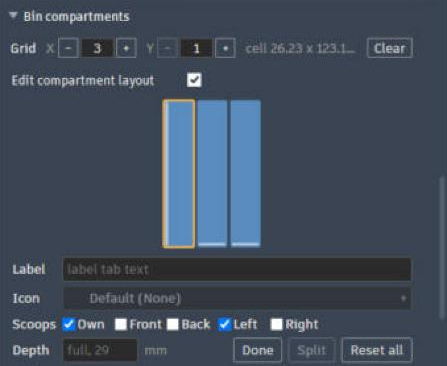

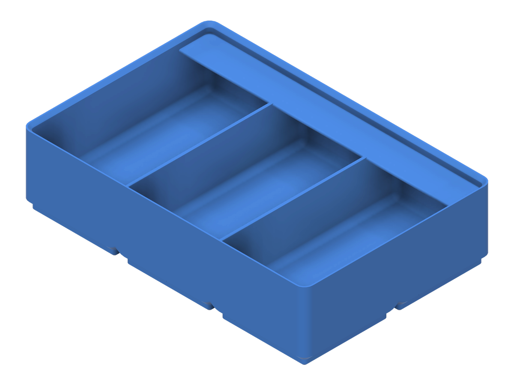

Schalten Sie **Fachaufteilung bearbeiten** aus, werden die Fächer auf das gleichmäßige Raster zurückgesetzt. Behälter
mit [eigener Form](size.md#custom-shape) oder [gefalzten Wänden](body.md#creased-walls) haben ein einziges Fach: das
Raster und die Aufteilung sind ausgeblendet und behalten ihre Werte für später. Zellen unter der Größe, die die
Fachecken brauchen, werden gemeldet.

Gleichmäßige Fächer | Eigene Fächer A | Eigene Fächer B
:-------------------------:|:-------------------------:|:-------------------------:
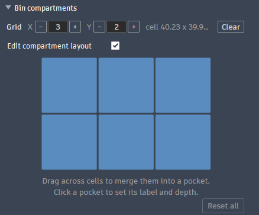 | 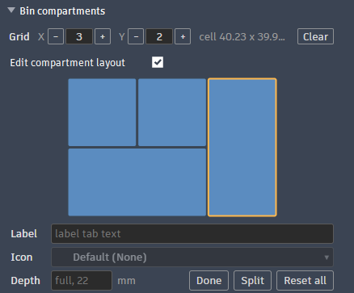 | 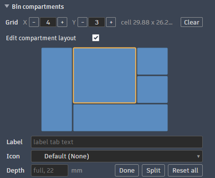
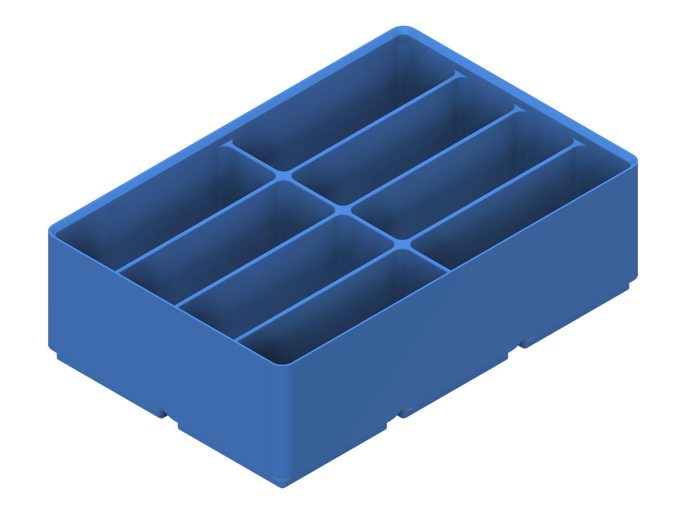 | 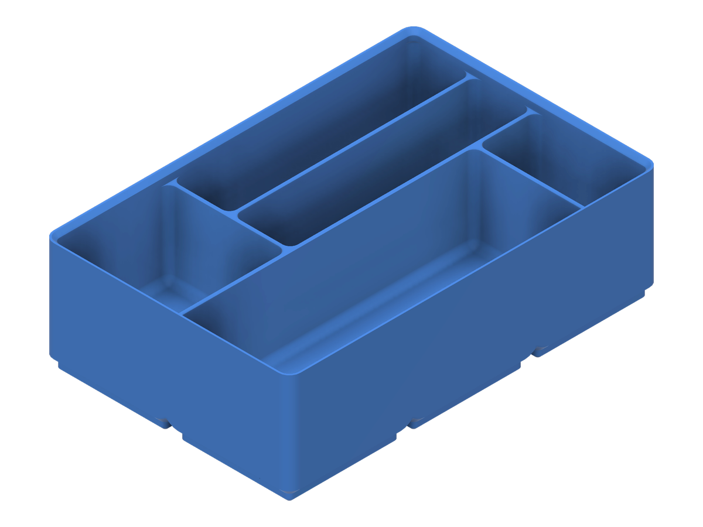 | 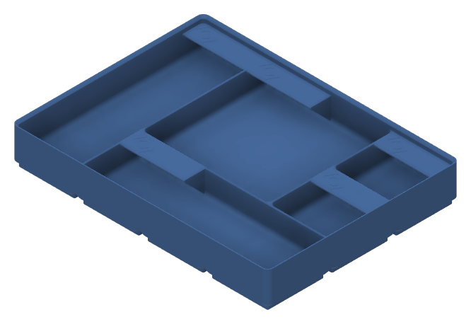

<picture><source media="(prefers-color-scheme: dark)" srcset="../../../assets/gif/bin-compartments-dark.gif"></picture>

!!! note "Bilder des ursprünglichen Zusatzmoduls"
    Die Bilder auf dieser Seite stammen aus GridfinityGenerator, die Aufteilung funktioniert in Gridkeeper genauso.

## Trennwände bis oben { #dividers-up-to-the-top-on-grid-lines }

**Trennwände bis oben** (aus): Trennwände zwischen Fächern, die auf einer Rasterlinie liegen,
gehen gerade bis zur Oberkante des Stapelrands. Ihre Oberseite nimmt die Form des Stapelrands an: ein Dach mit den
Schrägen des Stapelrands, oder bei **Stapelrand oben kürzen** eine flache Oberseite, die auf beiden Seiten
angefast ist. Die Füße eines darauf gestapelten Behälters haben dort eine Nut und sitzen darüber so, wie sie am
Außenrand im Stapelrand sitzen, sodass ein Behälter beliebiger Größe weiterhin darauf stapelbar ist. Trennwände
zwischen Rasterlinien bleiben unter dem Stapelrand. Nur für hohle Behälter mit Stapelrand und mehr als einem Fach.

- Die Trennwände bleiben auch neben einer Wand mit Griffmulde auf ihren Rasterlinien; die Fächer entlang dieser Wand
  sind stattdessen um den Einzug der Griffmulde kürzer.
- Die Ecken, an denen eine hochgezogene Trennwand auf eine Wand oder eine andere Trennwand trifft, sind bis zur
  Oberkante des Stapelrands abgerundet.

## Griffmulde { #scoop }

Eine Griffmulde rundet den Boden zu einer Wand hin hoch, sodass Teile herausrutschen, statt in der Ecke hängen zu
bleiben. Jede Wand hat ein eigenes Kontrollkästchen: **Vorne (Breite)**, **Hinten (entlang der
Behälterbreite)**, **Links (Länge)** und **Rechts (Länge)**. Jedes Fach
bekommt an jeder angekreuzten Wand eine Griffmulde, auch seine Trennwände, es sei denn, es hat in der
[Fachaufteilung](#compartment-layout) eigene Griffmulden. Zwei Griffmulden an gegenüberliegenden Wänden lassen lange
Teile in beide Richtungen herausrollen, vier erreichen kleine Teile von allen Seiten.

- **Hinten** ist gesperrt, solange die Beschriftungslasche an ist, die Lasche jedes Fachs sitzt an dessen hinterer
  Wand; das Häkchen bleibt für den Fall erhalten, dass die Lasche ausgeschaltet wird. Mit Lasche hat ein Fach höchstens
  drei Griffmulden.
- Mit Stapelrand reicht eine Behälterwand, an der irgendein Fach eine Griffmulde hat, bis zur Innenkante des
  Stapelrands, sodass die Griffmulde ohne Stufe in ihn übergeht.
- Zwei einander gegenüberliegende Griffmulden in einem Fach teilen es sich: Ihr Radius bleibt unter der Hälfte seiner
  Breite oder Länge, sodass zwischen ihnen ein Streifen flacher Boden von mindestens 1 mm bleibt.
- Die abgerundete Kante zwischen Boden und Wand, die ein Fach sonst hat, entfällt, sobald es mehr als eine
  Griffmulde hat: Sein Boden trifft die Wände ohne Griffmulde an einer scharfen Kante.
- Eine Wand mit Griffmulde bekommt keine Falze, die Griffmulde stützt sie bereits.
- Eine linke oder rechte Griffmulde läuft unter den Enden der Beschriftungslasche hindurch, die Lasche folgt dort der
  Griffmulde.

**Max. Muldenradius (mm)** (25 mm, mehr als 0) begrenzt die Größe jeder Griffmulde, eine Griffmulde ist nie
tiefer als ihr Fach; er ist gesperrt, solange keine Wand eine hat.
Nur hohle Behälter bekommen Griffmulden, Behälter mit eigener Form keine. Ältere Behälter und gespeicherte
Einstellungen mit Griffmulde haben sie an der vorderen Wand, wie zuvor.

Griffmulde an | Griffmulde aus
:-------------------------:|:-------------------------:
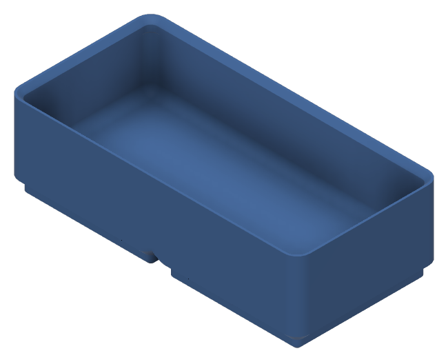 | 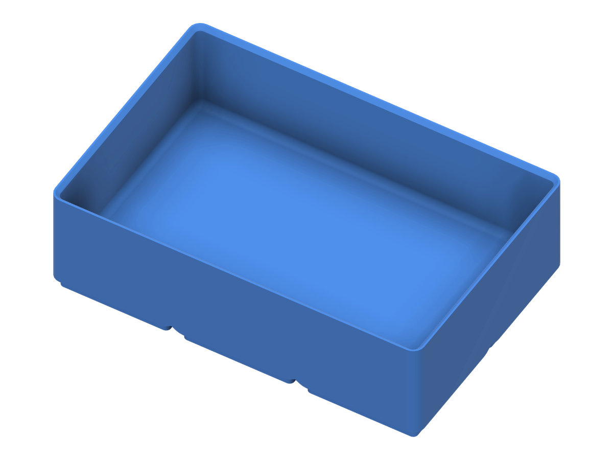

Vier Griffmulden, keine Beschriftungslasche | Vorne, links und rechts, mit Beschriftungslasche
:-------------------------:|:-------------------------:
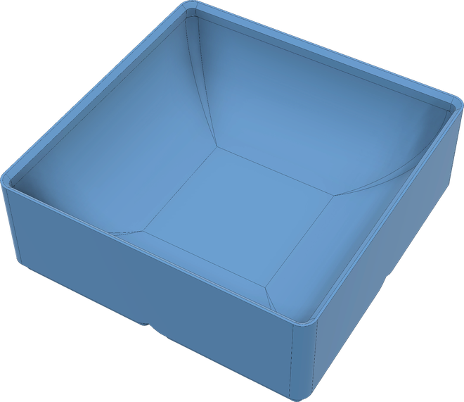 | 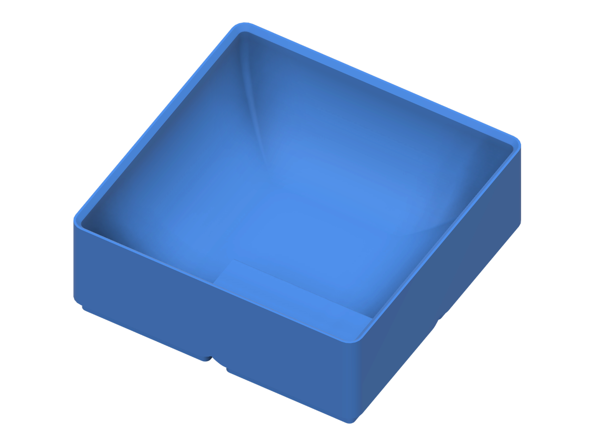
