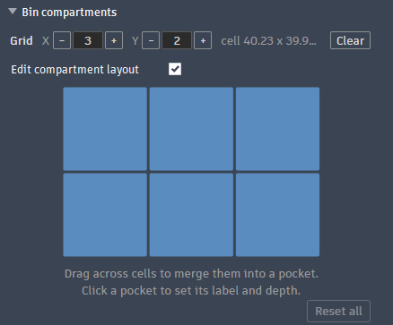
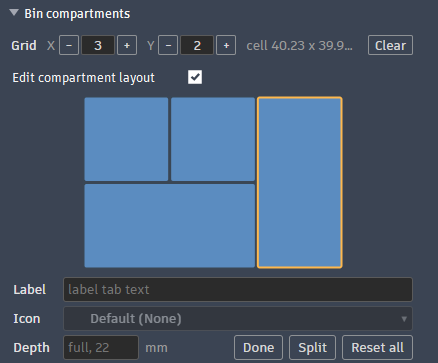
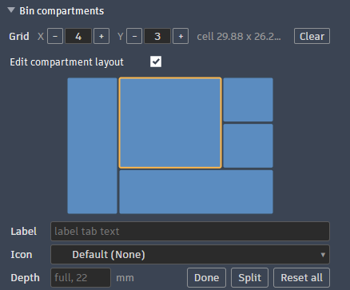
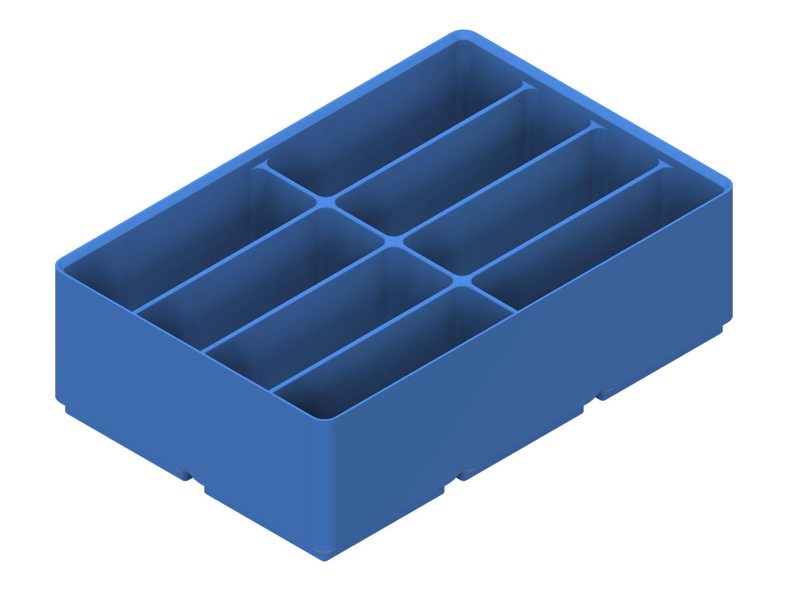
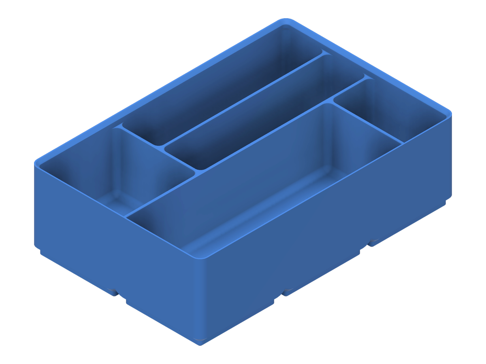
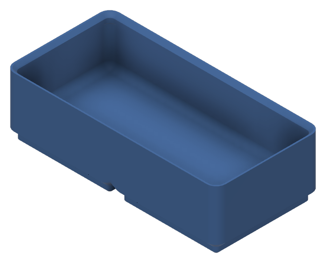
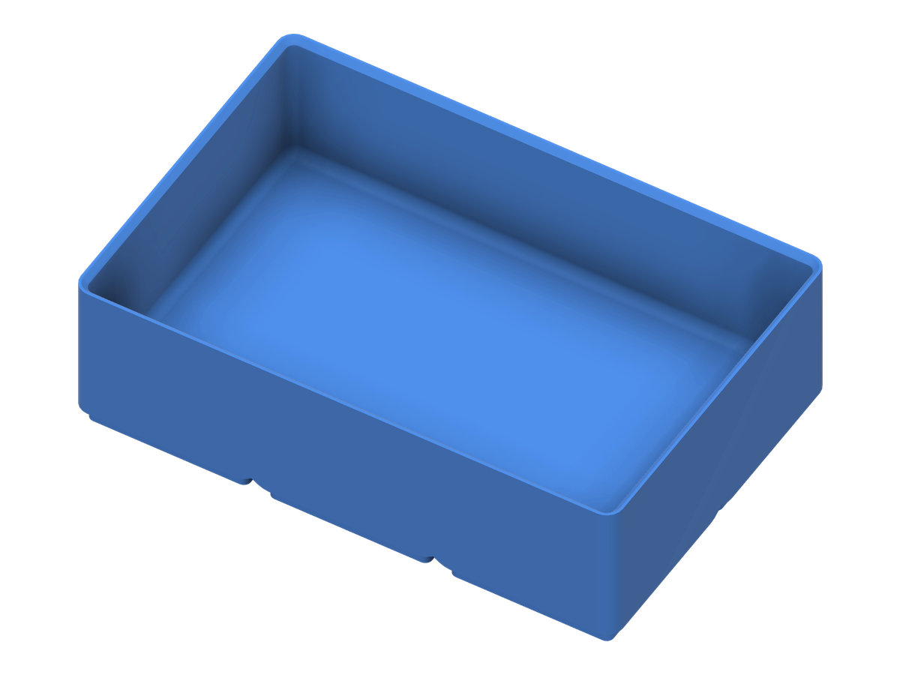

# Compartments and scoop

The **Bin compartments** section of the bin dialog.

## Compartment grid

The small grid at the top sets how many compartments the bin has: **X**, the cells along the bin width, and **Y**,
the cells along the bin length, all the same size.

## Compartment layout

Tick **Edit compartment layout** for a drawing of the grid:

- **Drag across cells** to merge them into a larger pocket. **Split** takes a pocket back to single cells.
- **Click a pocket** to give it its own **Label** text, **Icon** and **Depth**. An empty label takes the text of the
  [label tab section](labels.md); the depth is measured from the top of the bin, empty for the full depth.
  **Done** finishes editing that pocket, changes are applied right away.
- **Reset all** goes back to single cells, without labels or depths.

Unticking **Edit compartment layout** resets the compartments to the uniform grid. Cells under the size the
compartment corners need are reported.

Uniform compartments | Custom compartments A | Custom compartments B
:-------------------------:|:-------------------------:|:-------------------------:
 |  | 
 |  | 

<picture><source media="(prefers-color-scheme: dark)" srcset="../../assets/gif/bin-compartments-dark.gif"></picture>

!!! note "Pictures of the original add-in"
    The pictures on this page come from GridfinityGenerator, the layout works the same in Gridkeeper.

## Dividers up to the top on grid lines

**Dividers up to the top on grid lines** (off): compartment dividers lying on a grid line go up to the top of the lip
and run out in its profile. The feet of a bin stacked on top have a groove there, so a bin of any size still stacks
on it. Dividers between grid lines stay below the lip. Hollow bins with a lip and more than one compartment only.

## Scoop

**Add scoop (along bin width)** adds a rounded scoop along the bin width, so small parts slide out. **Scoop max radius
(mm)** (25 mm) limits its size.

Scoop enabled | Scoop disabled
:-------------------------:|:-------------------------:
 | 
