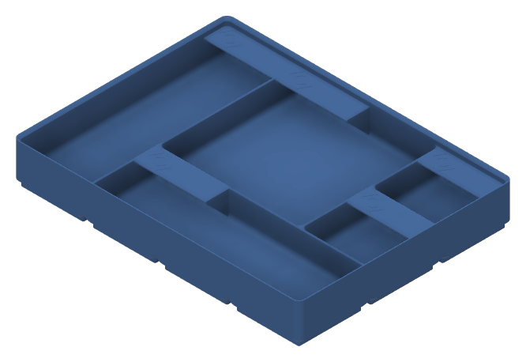
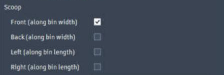
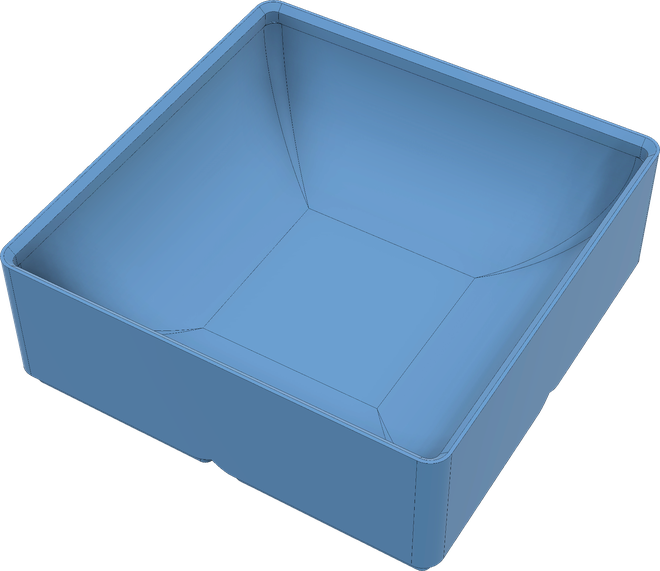

# Compartments and scoop

The **Bin compartments** section of the bin dialog.

## Compartment grid

The small grid at the top sets how many compartments the bin has: **X**, the cells along the bin width, and **Y**,
the cells along the bin length, all the same size.

## Compartment layout

Tick **Edit compartment layout** for a drawing of the grid:

- **Drag across cells** to merge them into a larger pocket. **Split** takes a pocket back to single cells.
- **Click a pocket** to give it its own **Label** text, **Icon** and **Depth**. An empty label takes the text of the
  [label tab section](labels.md); the depth is measured from the top of the bin, empty for the full depth.
  **Done** finishes editing that pocket, changes are applied right away.
- **Scoops** of a pocket: without **Own** it takes the walls checked in the [Scoop](#scoop) section; with **Own** its
  **Front**, **Back**, **Left** and **Right** toggles choose its scoops alone. **Back** is locked while the label tab is
  on. The drawing marks every wall with a scoop by a short line; merging keeps the choice of the pocket the drag
  started on, splitting gives it to every cell.
- **Reset all** goes back to single cells, without labels, depths or scoops of their own.

Unticking **Edit compartment layout** resets the compartments to the uniform grid. Bins with a
[custom shape](size.md#custom-shape) or [creased walls](body.md#creased-walls) have a single compartment: the grid and
the layout are hidden and keep their values for later. Cells under the size the
compartment corners need are reported.

Uniform compartments | Custom compartments A | Custom compartments B
:-------------------------:|:-------------------------:|:-------------------------:
 |  | 
 |  | 

<picture><source media="(prefers-color-scheme: dark)" srcset="../../assets/gif/bin-compartments-dark.gif"></picture>

!!! note "Pictures of the original add-in"
    The pictures on this page come from GridfinityGenerator, the layout works the same in Gridkeeper.

## Dividers up to the top on grid lines

**Dividers up to the top on grid lines** (off): compartment dividers lying on a grid line go up to the top of the lip
as a ridge with the lip's profile on both sides. The feet of a bin stacked on top have a groove there and sit in it
the way they sit in the lip at the outer wall, so a bin of any size still stacks on it. Under the ridge a support
(full lip) or a chamfer (light lip) runs at 45 degrees into the divider, so nothing overhangs the compartments.
Dividers between grid lines stay below the lip. Hollow bins with a lip and more than one compartment only.

- The dividers stay on their grid lines also beside a wall with a scoop; the compartments along that wall are shorter
  by the scoop's inset instead.
- A label tab, and its Cullenect pocket, in front of a ridge starts at the ridge's tip; a compartment with a scoop on
  a ridge starts at the tip on that side, so the scoop runs up into it without a step.
- Compartments beside a ridge have slightly tighter corners (about 2.3 mm instead of 2.6 mm under a full lip), so the
  ridge covers them at the top.

## Scoop

A scoop rounds the floor up into a wall, so parts slide out instead of getting caught in the corner. Each wall has
its own checkbox: **Front (along bin width)**, **Back (along bin width)**, **Left (along bin length)** and **Right
(along bin length)**. Every compartment gets a scoop at each wall that is checked, its dividers too, unless it has
scoops of its own in the [compartment layout](#compartment-layout). Two scoops on opposite walls let long parts roll
out either way, four reach small parts from every side.

- **Back** is locked while the label tab is on, every compartment's tab sits on its back wall; its tick stays for
  when the tab goes off. With a tab a compartment has at most three scoops.
- With a lip, a bin wall where any compartment has a scoop reaches up to the inner edge of the lip, so the scoop runs
  into it without a step.
- Two scoops facing each other in one compartment share it: their radius stays under half its width or length, so a
  strip of flat floor of at least 1 mm stays between them.
- The rounded edge between floor and wall that a compartment has elsewhere is left out once it has more than one
  scoop: its floor meets the walls without a scoop at a sharp edge.
- A wall with a scoop gets no creases, the scoop braces it already.
- A left or right scoop runs under the ends of the label tab, the tab follows the scoop there.

**Scoop max radius (mm)** (25 mm, more than 0) limits the size of every scoop, a scoop is never deeper than its
compartment; it is locked while no wall has one.
Only hollow bins get scoops, bins with a custom shape get none. Older bins and saved settings with a scoop have it on
the front wall, as before.

Scoop enabled | Scoop disabled
:-------------------------:|:-------------------------:
 | 

Four scoops, no label tab | Front, left and right, with a label tab
:-------------------------:|:-------------------------:
 | 
