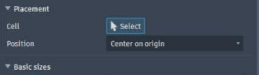
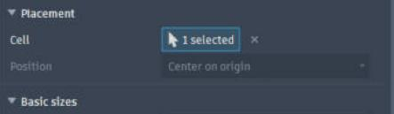

# Behälter { #bins }

**Volumenkörper › Erstellen › Gridkeeper Behälter** erzeugt einen Behälter, der in eine Grundplatte passt. Jeder neue
Behälter ist eine eigene Komponente im Container *Bins*, siehe [Komponenten und Gelenke](../working/components.md).

Der Dialog ist lang, seine Abschnitte werden auf diesen Seiten beschrieben:

| Abschnitt | Seite |
|---|---|
| **Platzierung**: **Position** und **Zelle** (nur mit einer Grundplatte oder Box in der Konstruktion, für einen neuen Behälter) | [Platzierung](#placement) weiter unten, [Ein Gelenkursprung in einem Dialog auswählen](../working/components.md#picking-a-joint-origin-in-a-dialog) |
| **Informationen**, **Grundmaße**, **Hauptmaße** mit der Tabelle **Tatsächliche Maße** | [Größe und Form](size.md) |
| **Merkmale des Behälters**: Körper, Typ, Wände, Stapelrand, Falze | [Körper, Wände und Stapelrand](body.md) |
| **Fächer des Behälters**: Aufteilung, Trennwände, **Griffmulde** | [Fächer und Griffmulde](compartments.md) |
| **Fächer des Behälters › Beschriftungslasche** | [Beschriftungslasche und Beschriftungen](labels.md), für den Cullenect-Stil auch [Aufnahmen in Behältern](../cullenect/pockets.md) |
| **Füße** | [Füße, Magnete und Schrauben](base.md) |
| **Änderungen** | [Einstellungen speichern und laden](../working/save-load.md) |
| **Vorschau** | weiter unten |

<picture><source media="(prefers-color-scheme: dark)" srcset="../../assets/gif/bin-features-dark.gif"></picture>

## Platzierung { #placement }

| Eingabe | Vorgabe | Wirkung |
|---|---|---|
| **Position** | Am freien Platz einrasten | *Am freien Platz einrasten* setzt einen neuen Behälter auf den freien Rasterplatz, der dem Ursprung am nächsten liegt, neben die bereits vorhandenen Behälter. *Auf dem Ursprung zentrieren* zentriert den Behälter auf dem Ursprung; ein zentrierter Behälter wird beim Neuerstellen wieder zentriert, auch mit einer neuen Größe, und seine Gelenkursprünge gehen mit. Er bleibt auch zentriert, wenn seine Rastereinheiten in Fusions Parametertabelle geändert werden (seit 1.2.1); ein mit einer früheren Version zentrierter Behälter tut das erst, nachdem er mit dem Behälter-Befehl neu erstellt wurde |
| **Zelle** | keine | Eine Zelle einer Grundplatte oder Box, in die der neue Behälter per Gelenk eingesetzt wird, siehe [Ein Gelenkursprung in einem Dialog auswählen](../working/components.md#picking-a-joint-origin-in-a-dialog). Eine gewählte Zelle hat Vorrang: **Position** ist dann ausgegraut |

Ein an Ort und Stelle neu erstellter Behälter bleibt, wo er war, außer er ist zentriert. Einstellungsdateien und
Behälter älterer Versionen ohne diese Einstellung werden als *Am freien Platz einrasten* geladen, so wie sie erzeugt
wurden. Die Positionsoption stammt aus GridfinityGenerator 2.5 von Le0Michine.

## Vorschau { #preview }

Einen Behälter zu erzeugen dauert einige Sekunden, deshalb ist die Vorschau standardmäßig aus.

- **Vorschau laufend (langsam)** erzeugt den Behälter nach jeder Änderung neu.
- **Vorschau aktualisieren** erzeugt ihn einmal mit den aktuellen Eingaben; die Schaltfläche ist ausgeblendet,
  solange die automatische Aktualisierung an ist.
- **Letzte Vorschau** zeigt, wie lange die letzte Vorschau gedauert hat, und weist auf Text hin, der zu dünn zum
  Drucken ist.

**OK** erzeugt den Behälter. Manche Eingaben sperren **OK**, und der Dialog nennt den Grund, zum Beispiel zu dünne
Wände für eine Cullenect-Aufnahme oder eine benutzerdefinierte Farbe, die nicht `#rrggbb` ist. Schlägt das Erzeugen
fehl, zum Beispiel bei einem Beschriftungstext, der nicht auf seine Beschriftung passt, zeigt ein Fenster den Fehler
mit den Einstellungen an, damit Sie sie in einen Fehlerbericht kopieren können.
