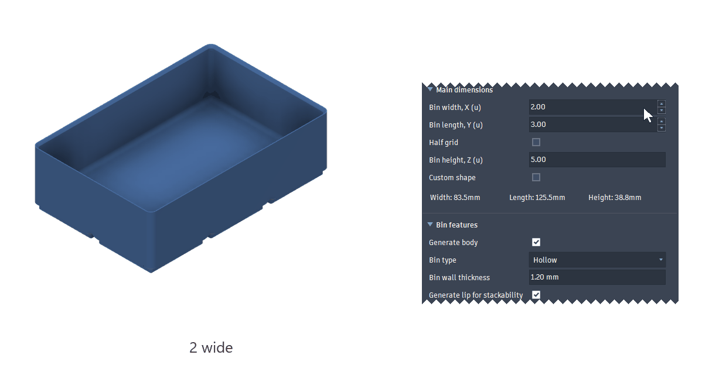
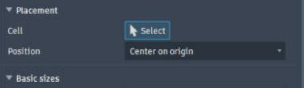
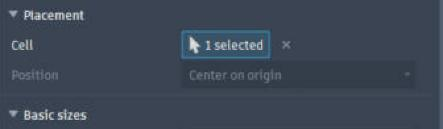

# Bins

**Solid › Create › Gridkeeper bin** builds a bin that drops into a baseplate. Every new bin is a component of its
own in the container *Bins*, see [Components and joints](../working/components.md).

The dialog is long, its sections are described on these pages:

| Section | Page |
|---|---|
| **Placement**: **Position**, and **Cell** (only with a baseplate or box in the design, for a new bin) | [Placement](#placement) below, [Picking a joint origin in a dialog](../working/components.md#picking-a-joint-origin-in-a-dialog) |
| **Info**, **Basic sizes**, **Main dimensions** with the **Actual dimensions** table | [Size and shape](size.md) |
| **Bin features**: body, type, walls, lip, creases | [Body, walls and lip](body.md) |
| **Bin compartments**: layout, dividers, **Scoop** | [Compartments and scoop](compartments.md) |
| **Bin compartments › Label tab** | [Label tab and labels](labels.md), for the Cullenect style also [Pockets in bins](../cullenect/pockets.md) |
| **Base interface features** | [Base, magnets and screws](base.md) |
| **Inputs** | [Saving and loading settings](../working/save-load.md) |
| **Preview** | below |

<picture><source media="(prefers-color-scheme: dark)" srcset="../assets/gif/bin-features-dark.gif"></picture>

## Placement

| Input | Default | What it does |
|---|---|---|
| **Position** | Snap to free spot | *Snap to free spot* puts a new bin on the free grid spot closest to the origin, beside the bins already there. *Center on origin* centers the bin on the origin; a centered bin is centered again when it is rebuilt, also with a new size, and its joint origins go with it. It also stays centered when its base units are changed in Fusion's parameter table (since 1.2.1); a bin centered with an earlier version does so once it has been rebuilt with the bin command |
| **Cell** | none | A cell of a baseplate or box to joint the new bin into, see [Picking a joint origin in a dialog](../working/components.md#picking-a-joint-origin-in-a-dialog). A picked cell wins: **Position** is greyed out then |

A bin rebuilt in place stays where it was, unless it is centered. Settings files and bins of older versions without
the setting load as *Snap to free spot*, as they were built. The position option is from GridfinityGenerator 2.5 by
Le0Michine.

## Preview

Building a bin takes a few seconds, so the preview is off by default.

- **Show auto update preview (slow)** builds the bin again after every change.
- **Update preview once** builds it once with the inputs as they are; it is hidden while the auto update is on.
- **Last preview** shows how long the last preview took and notes text that is too thin to print.

**OK** builds the bin. Some inputs lock **OK** and the dialog says why, for example walls too thin for a Cullenect
pocket or a custom color that isn't `#rrggbb`. If a build fails, for example on a label text that doesn't fit its
label, a panel shows the error with the settings, to copy them into a bug report.
