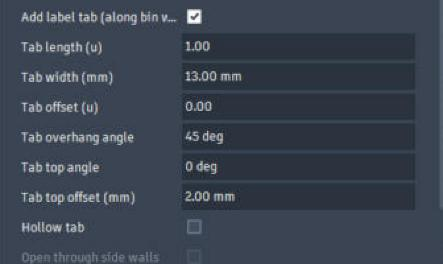
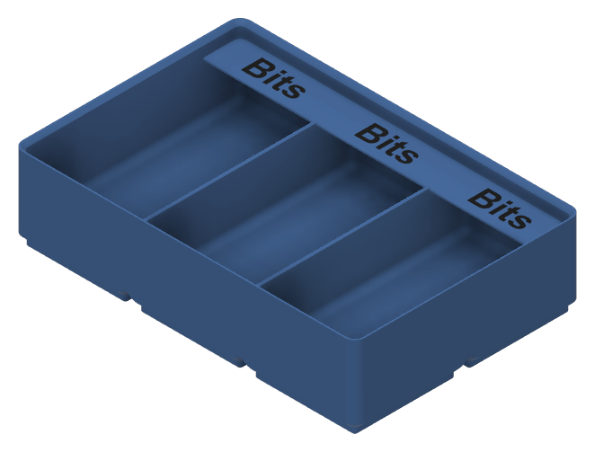

# Beschriftungslasche und Beschriftungen { #label-tab-and-labels }

Die Gruppe **Beschriftungslasche** im Abschnitt **Fächer des Behälters**. Die Lasche ist ein Absatz an der Rückseite
des Behälters, unter seiner Oberkante, für eine Beschriftung. Bei mehreren Fächern bekommt jedes Fach seine eigene
Lasche.

## Die Lasche { #the-tab }

| Eingabe | Vorgabe | Wirkung |
|---|---|---|
| **Beschriftungslasche** | aus | Fügt die Lasche hinzu; die übrigen Eingaben der Gruppe sind ohne sie gesperrt |
| **Länge der Lasche (u)** | 1 | Länge entlang der Behälterbreite, in Rastereinheiten |
| **Breite der Lasche (mm)** | 13 mm | Wie weit die Lasche von der hinteren Wand absteht |
| **Versatz der Lasche (u)** | 0 | Wo die Lasche entlang der Behälterbreite beginnt |
| **Überhangwinkel Lasche** | 45° | Schräge unter der Lasche, 30° bis 65° |
| **Laschenwinkel oben** | 0° | Neigt die Laschenoberseite nach vorn, sodass die Beschriftung zur Vorderseite zeigt, bis 45° |
| **Versatz oben (mm)** | 0,5 mm | Wie weit die Laschenoberseite unter der Oberkante des Behälters liegt, 0 bis 2 mm; die Beschriftung geht mit nach unten. Die Trennwände zwischen den Fächern werden um denselben Betrag abgesenkt, bis nach oben geführte Trennwände beginnen dort, und eine Cullenect-Aufnahme wird in die abgesenkte Lasche geschnitten. Einstellungen ohne diesen Wert werden mit 0,5 mm geladen. Aus GridfinityGenerator 2.5 von Le0Michine |
| **Hohle Lasche** | aus | Höhlt die Lasche mit der Wandstärke aus. Bei einem einzigen Fach wird sie durch die hintere Wand des Behälters geöffnet, bei mehreren Fächern bleibt sie geschlossen. Für Behälter als Schale standardmäßig an, für Behälter mit gefalzten Wänden gesperrt und aus |
| **Seitlich offen** | aus | Öffnet eine hohle Lasche zusätzlich durch die Seitenwände, wo sie auf diese trifft. Nur bei einem einzigen Fach |

<picture><source media="(prefers-color-scheme: dark)" srcset="../../assets/gif/bin-label-tab-options-dark.gif"></picture>

## Die Beschriftung { #the-label }

| Eingabe | Vorgabe | Wirkung |
|---|---|---|
| **Beschriftungstext** | leer | Text auf der Beschriftung jedes Fachs; Fächer der [Aufteilung](compartments.md#compartment-layout) können einen eigenen haben |
| **Beschriftungssymbol** | Ohne | Ein Symbol vor dem Text, siehe unten |
| **Beschriftungsstil** | Umriss | *Umriss*, *Eingraviert*, *Erhaben* oder *Cullenect*, siehe unten |
| **Beschriftungstext fett** | an | Arial fett oder normal |
| **Beschriftungsfarbe** | Ohne | Eine Farbe für die Beschriftungskörper, siehe [Farben und mehrfarbiger Druck](../working/colors.md) |
| **Eigene Farbe** | | Wird bei *Beschriftungsfarbe* *Benutzerdefiniert* angezeigt: `#rrggbb`, z. B. `#D02020`. Jeder andere Wert sperrt **OK** |
| **Steckplatzspiel (mm)** | 0,3 mm | Nur beim Cullenect-Stil angezeigt, 0 bis 1 mm, siehe [Aufnahmen in Behältern](../cullenect/pockets.md) |

### Beschriftungsstile { #label-styles }

| Stil | Wirkung |
|---|---|
| **Umriss** | Teilt die Laschenfläche entlang der Buchstaben, sodass ein Slicer sie in einer anderen Farbe einfärben kann |
| **Eingraviert** | Schneidet die Buchstaben in die Lasche |
| **Erhaben** | Hebt die Buchstaben von einer abgesenkten Lasche ab |
| **Cullenect** | Eine Aufnahme für einen austauschbaren [Cullenect](../cullenect/index.md)-Einleger statt einer gedruckten Beschriftung. Die Lasche wird auf mindestens 14 mm verbreitert und bleibt flach; Text, Symbol, Fett, Beschriftungsfarbe und Laschenwinkel oben sind abgeschaltet, behalten aber ihre Werte |

<picture><source media="(prefers-color-scheme: dark)" srcset="../../assets/gif/bin-label-options-dark.gif"></picture>

### Symbole { #icons }

**Beschriftungssymbol** listet die Symbole nach Art gruppiert auf: Schrauben (Zylinderkopf, Flachkopf, Senkkopf,
Schlitz, Kreuzschlitz, Blechschraube, Gewindestift), Muttern (Sechskantmutter, Sechskant-Sicherungsmutter,
Vierkantmutter), Unterlegscheiben und die Cullenect-Symbole für Befestigungsmaterial (Unterlegscheiben, Muttern,
T-Nuten, Gewindeeinsatz, Magnet und Kabelschuhe). Das Symbol behält seine volle Höhe; nur der Text wird auf die nach
ihm verbleibende Breite verkleinert.

Eine SVG-Datei, die in einen Ordner unter `lib/gridfinityUtils/labelIcons/` des Zusatzmoduls gelegt wird, erscheint
nach einem Neustart des Zusatzmoduls in der Liste.

### Textgröße { #text-size }

Der Text wird der Beschriftung angepasst: so hoch, wie die Lasche es zulässt, kleiner, wenn er lang ist. Er schrumpft
nie unter die Höhe, bei der sein dünnster Strich noch eine Linie einer 0,4-mm-Düse ist: 4,43 mm bei normalem, 3,42 mm
bei fettem Text. Ein Text, der auch dann nicht passt, lässt das Erzeugen mit einer Meldung fehlschlagen, die ihn nennt:
Kürzen Sie ihn oder machen Sie den Behälter breiter.

Eine Lasche, die niedriger ist als diese Grenze, behält für den Text ihre eigene Höhe; nach dem Erzeugen schlägt eine
Meldung vor, die Lasche breiter zu machen oder bei normalem Text Fett zu verwenden.

### Den Text später ändern { #changing-the-text-later }

Jeder Beschriftungstext ist ein Benutzerparameter des Behälters, `gfBin1_label`, oder `gfBin1_label1`, `gfBin1_label2`
… bei mehreren Fächern. Ändern Sie ihn unter **Ändern › Parameter ändern**, und die Beschriftung folgt, ohne dass der
Behälter neu erzeugt wird. Ein länger gemachter Text behält die Höhe seiner Buchstaben und kann über die Lasche
hinausragen; **Gridkeeper neu erstellen** passt ihn wieder an. Siehe [Parameter ändern](../working/parameters.md).
