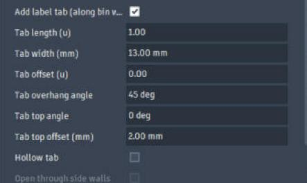
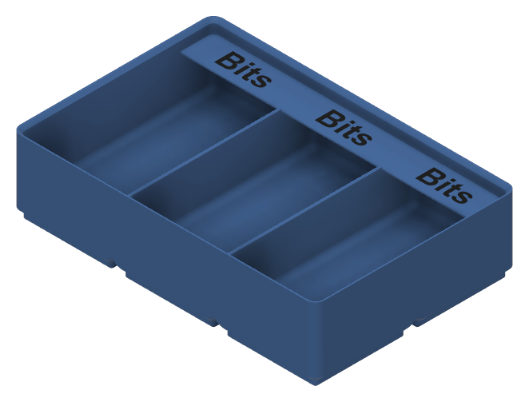

# Label tab and labels

The **Label tab** group in the **Bin compartments** section. The tab is a shelf along the back of the bin, under its
top, for a label. With several compartments every compartment gets its own tab.

## The tab

| Input | Default | What it does |
|---|---|---|
| **Add label tab (along bin width)** | off | Adds the tab; the other inputs of the group are locked without it |
| **Tab length (u)** | 1 | Length along the bin width, in base units |
| **Tab width (mm)** | 13 mm | How far the tab reaches from the back wall |
| **Tab offset (u)** | 0 | Where the tab starts along the bin width |
| **Tab overhang angle** | 45° | Slope under the tab, 30° to 65° |
| **Tab top angle** | 0° | Tilts the tab top down towards the front, so the label faces the front, up to 45° |
| **Tab top offset (mm)** | 0.5 mm | How far the tab top is below the top of the bin, 0 to 2 mm; the label goes down with it. The dividers between compartments are lowered as much, dividers up to the top start there, and a Cullenect pocket is cut into the lowered tab. Settings without it load as 0.5 mm. From GridfinityGenerator 2.5 by Le0Michine |
| **Hollow tab** | off | Shells the tab with the wall thickness. With a single compartment it is opened through the back wall of the bin, with more compartments it is left closed. On by default for shelled bins, locked off for bins with creased walls |
| **Open through side walls** | off | Also opens a hollow tab through the side walls where it runs into them. Single compartment only |

<picture><source media="(prefers-color-scheme: dark)" srcset="../../assets/gif/bin-label-tab-options-dark.gif"></picture>

## The label

| Input | Default | What it does |
|---|---|---|
| **Label text** | empty | Text on every compartment label; compartments of the [layout](compartments.md#compartment-layout) can have their own |
| **Label icon** | None | An icon before the text, see below |
| **Label style** | Outline | *Outline*, *Engraved*, *Embossed* or *Cullenect*, see below |
| **Bold label text** | on | Bold or regular Arial |
| **Label color** | None | A color for the label bodies, see [Colors and multicolor printing](../working/colors.md) |
| **Custom label color** | | Shown for *Label color* *Custom*: `#rrggbb`, e.g. `#D02020`. Another value locks **OK** |
| **Socket play (mm)** | 0.3 mm | Shown for the Cullenect style only, 0 to 1 mm, see [Pockets in bins](../cullenect/pockets.md) |

### Label styles

| Style | What it does |
|---|---|
| **Outline** | Splits the tab face along the letters, so a slicer can paint them in another color |
| **Engraved** | Cuts the letters into the tab |
| **Embossed** | Raises the letters from a lowered tab |
| **Cullenect** | A pocket for an exchangeable [Cullenect](../cullenect/index.md) insert instead of a printed label. The tab is widened to at least 14 mm and kept flat; text, icon, bold, label color and tab top angle are switched off but keep their values |

<picture><source media="(prefers-color-scheme: dark)" srcset="../../assets/gif/bin-label-options-dark.gif"></picture>

### Icons

**Label icon** lists the icons grouped by kind: screws (socket head, button head, countersunk, slotted, Phillips,
self-tapping, grub screw), nuts (hex nut, hex locknut, square nut), washers, and the Cullenect hardware symbols
(washers, nuts, T-nuts, threaded insert, magnet and crimp terminals). The icon keeps its full height; only the text
shrinks to the width left after it.

An svg file put into a folder under `lib/gridfinityUtils/labelIcons/` of the add-in shows up in the list after the
add-in is restarted.

### Text size

The text is fitted to the label: as high as the tab allows, smaller when it is long. It never shrinks below the height
where its thinnest stroke is still one 0.4 mm nozzle line: 4.43 mm for regular, 3.42 mm for bold text. A text that
doesn't fit even then makes the build fail with a message naming it: shorten it or make the bin wider.

A tab lower than that limit keeps its own height for the text; after building, a message suggests to make the tab
wider, or to use bold for regular text.

### Changing the text later

Each label text is a user parameter of the bin, `gfBin1_label`, or `gfBin1_label1`, `gfBin1_label2` … with several
compartments. Change it in **Modify › Change Parameters** and the label follows without building the bin again. A text
made longer keeps the height of its letters and can run past the tab; **Gridkeeper rebuild** fits it again. See
[Changing parameters](../working/parameters.md).
