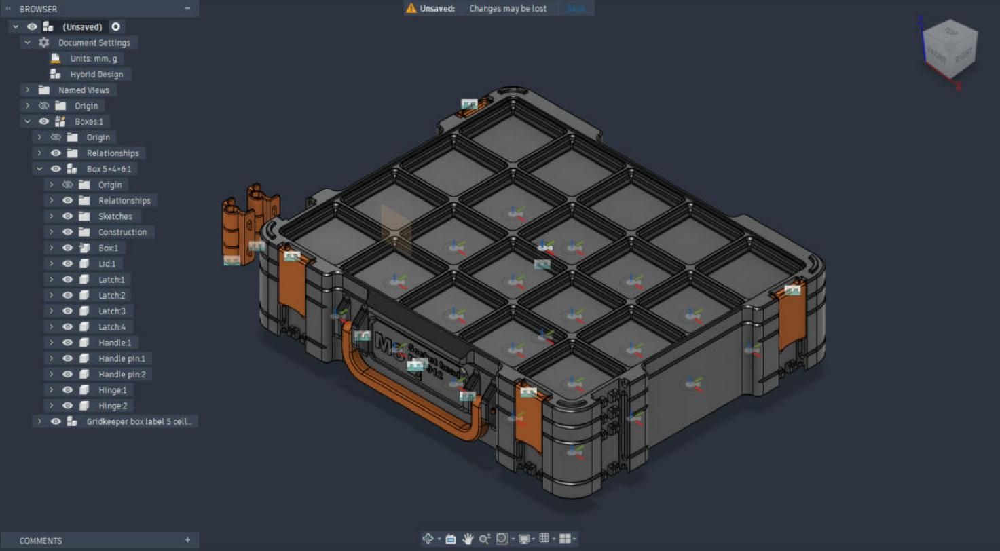
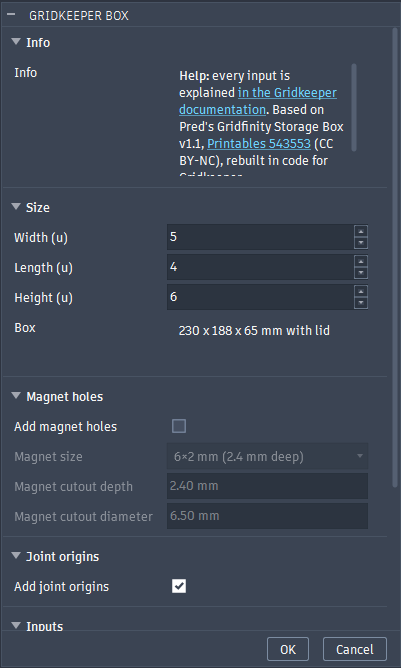
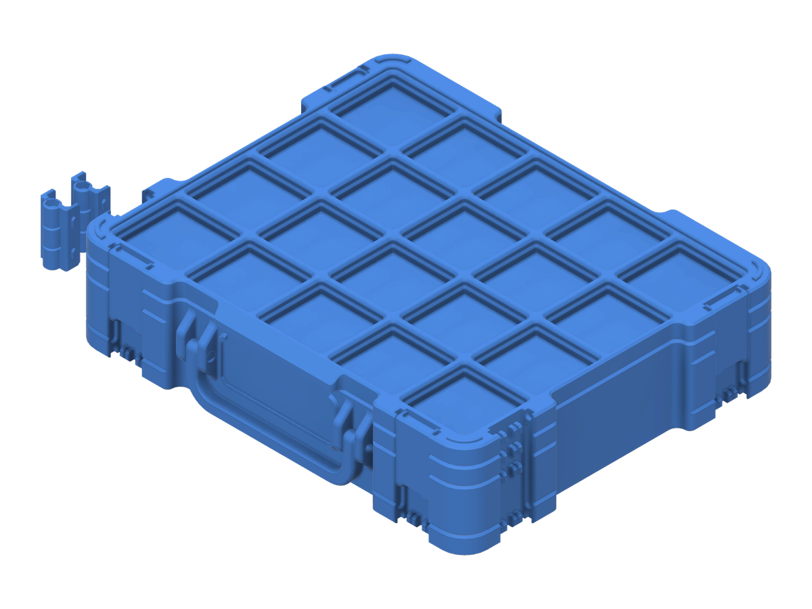
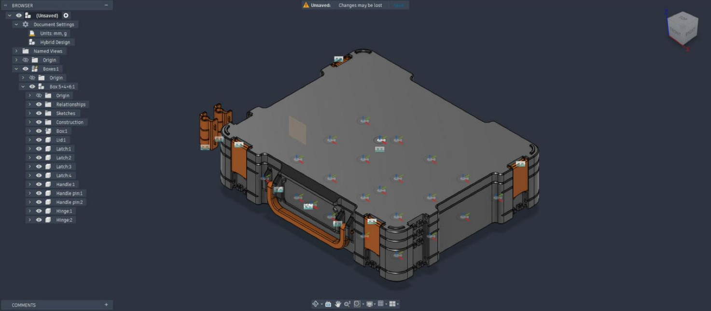
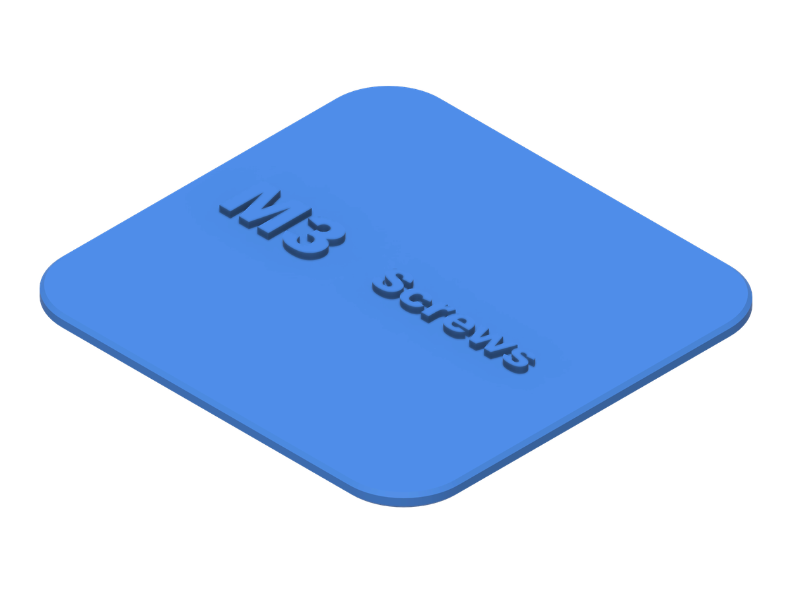
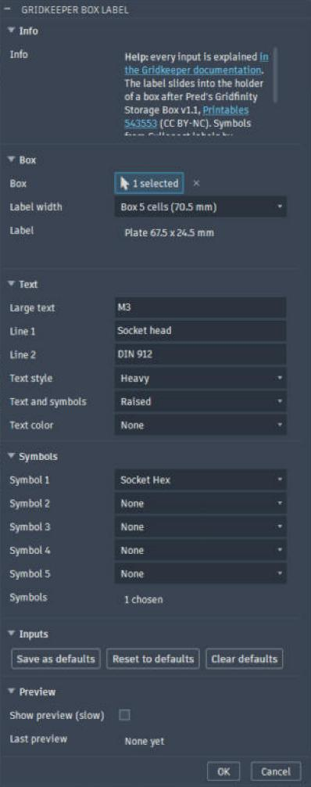

# Aufbewahrungsboxen { #storage-boxes }

**Volumenkörper › Erstellen › Gridkeeper Box** erzeugt eine Aufbewahrungsbox mit Deckel nach
[Preds parametrischer Gridfinity Storage Box v1.1](https://www.printables.com/model/543553-gridfinity-storage-box-by-pred-now-parametric)
(CC BY-NC). Die Box nimmt Gridfinity-Behälter in ihrem Boden auf, trägt auf ihrem Deckel ein Gridfinity-Raster (oder eine
geschlossene Oberseite, siehe [Deckel](#lid)) und lässt sich mit Boxen, die nach Preds eigener Datei gedruckt wurden,
stapeln und verschließen: Außenmaß, Nuten, Verschlussnasen, Scharniersitze, Griff, Etikett-Halter und Stapelrand sind
auf den Millimeter die von Pred.

Jede neue Box ist eine eigene Komponente im Container *Boxes*. Sie enthält die Komponenten *Box* und *Lid* sowie die
Kleinteile (Verschlüsse, Griff, Griffstifte, Scharniere, siehe [Kleinteile](#small-parts)); der Deckel ist per Gelenk
geschlossen auf die Box gesetzt, siehe [Komponenten und Gelenke](working/components.md).



!!! note "Magnetaussparungen"
    Magnetaussparungen sind nur für Magnete 6 × 2 mm gedacht: Magnete 6 × 3 mm würden den Boden durchbrechen.

## Informationen { #info }



Ein Link zu dieser Seite, der Hinweis auf Pred und die Version des Add-ins. Wurde der Dialog über
**Gridkeeper neu erstellen** geöffnet, steht hier, welche Box an Ort und Stelle neu erstellt wird.

## Größe { #size }

| Eingabe | Vorgabe | Was sie bewirkt |
|---|---|---|
| **Breite (u)** | 5 | Rasterzellen von je 42 mm in der Breite, mindestens 4 |
| **Länge (u)** | 4 | Rasterzellen von je 42 mm von vorne nach hinten, mindestens 3 |
| **Höhe (u)** | 6 | Höheneinheiten von 7 mm, vorerst mindestens 6 (Preds Datei geht bis 5 herunter, das kommt später); der Deckel fügt 10 mm hinzu |

Die Zeile darunter zeigt das Außenmaß: Breite und Länge sind die Zellen plus ein Rand von 10 mm an jeder Seite
(5 × 4 → 230 × 188 mm).



## Magnetaussparungen { #magnet-holes }

| Eingabe | Vorgabe | Was sie bewirkt |
|---|---|---|
| **Magnetaussparungen** | aus | Ein Loch im Sockel an jeder Ecke jeder Zelle |
| **Magnetgröße** | 6×2 mm (2,4 mm tief) | Setzt die Tiefe für Magnete 6 × 2 mm, oder *Benutzerdefiniert*, um sie einzugeben |
| **Magnettiefe** | 2,4 mm | Bis 2,6 mm: Der Sockel unter dem Loch ist 2,8 mm dick, Magnete 6 × 3 mm gingen durch den Boden |
| **Ø Magnetaussparung** | 6,5 mm | 3 bis 8,5 mm, der Sockel um das Loch wächst mit |

## Gelenkursprünge { #joint-origins }

Jede Zelle des Bodens hat einen Gelenkursprung, *Cell joint origin column-row*, um Behälter wie auf eine Grundplatte per
Gelenk in die Box zu setzen: Der Behälterdialog setzt einen neuen Behälter in einen davon
([Gelenkursprung in einem Dialog wählen](working/components.md#picking-a-joint-origin-in-a-dialog)), von Hand siehe
[Gelenkursprünge](working/components.md#jointing-by-hand). Früher gab es dafür ein Kontrollkästchen
**Gelenkursprünge**; eine Box, die ohne sie gebaut wurde, bekommt sie beim Neuerstellen, sonst ändert sich
nichts an ihr. Diese sind außerdem immer vorhanden:

| Gelenkursprung | Wo |
|---|---|
| *Stack bottom joint origin* | Mitte der Unterseite der Box |
| *Stack top joint origin* | Mitte der Oberseite des Deckels: Setzen Sie den Boden einer anderen Box per Gelenk darauf, um sie zu stapeln |
| *Lid joint origin* | In Box und Deckel in der Mitte der Verbindung zwischen ihnen, vom Gelenk *Lid on box* verwendet |
| *Label joint origin* | Im Etikett-Halter vorne, die Mitte der Rückseite des Etiketts; **Gridkeeper Box-Etikett** setzt das Etikett dort per Gelenk ein |

*Lid on box* gehört zur Box: Ein Neuerstellen erzeugt es als starres Gelenk neu, Änderungen von Ihnen daran bleiben
nicht erhalten.

## Deckel { #lid }

**Deckeloberseite** legt fest, was die Oberseite des Deckels ist:

| Deckeloberseite | Was es ist |
|---|---|
| **Raster** (Vorgabe) | Preds Deckel: oben ein Gridfinity-Raster, auf das Behälter gestellt werden können |
| **Geschlossen** | Eine flache, geschlossene Oberseite von Rand zu Rand, stabiler |

Beide Deckel sind darunter gleich und halten die Behälter in der Box daher gleich; beide behalten die vier Stapellaschen
in den Ecken der Oberseite. Die Laschen greifen in die Nuten unter der darüber stehenden Box, daher lassen sich Boxen
gleicher Größe auf einem geschlossenen Deckel ebenso stapeln wie auf einem Raster. Ein geschlossener Deckel wird wie der
mit Raster so gedruckt, wie er gebaut ist: mit der Oberseite nach oben.



Boxen, die vor der Auswahlmöglichkeit gespeichert wurden, werden beim Neuerstellen mit Raster gebaut.

## Kleinteile { #small-parts }

Jeder Satz enthält Preds Kleinteile als eigene Komponenten, jeweils mit druckfertigen Körpern:

| Teil | Wie viele | Wo |
|---|---|---|
| *Latch* | 4 | Per Gelenk an Ort und Stelle: zwei vorne, je eines an den Seiten hinten |
| *Handle* | 1 | Vorne per Gelenk eingesetzt, zwischen den Griffhaltern |
| *Handle pin* | 2 | In den Griffhaltern per Gelenk eingesetzt, der rechte umgedreht |
| *Hinge* | 2 | Per Gelenk neben der Box, so liegend, wie sie gedruckt werden |

Jedes Teil sitzt auf einem Gelenkursprung der Box, *Latch front left joint origin*, *Hinge 1 joint origin* und so
weiter; die starren Gelenke sind nach dem Satz und dem Sitz benannt, *Box 5×4×6 Latch front left*. Die Teile wandern mit
der Box, wenn sich ihre Größe ändert oder wenn sie verschoben oder gestapelt wird. Der Griff ist so breit, wie es der
Platz der Etikett-Halter zulässt: die Etikettbreite plus 28,5 mm, also 57 mm bei einer Breite von 4, 99 mm bei 5 und
höchstens 113,5 mm ab einer Breite von 6. Die Scharniere behalten bei jeder Größe ihren Platz neben der Box, das zweite
5 mm neben dem ersten.

Die Vorschau (**Vorschau (langsam)**) zeigt nur Box und Deckel, die Kleinteile und die Gelenkursprünge kommen mit
**OK** dazu: Sie zu erzeugen machte jede Vorschau langsam. Ein Gelenk von Ihnen an einem der Teile, etwa am vorderen
linken Verschluss, bleibt beim Neuerstellen der Box an diesem Teil; das Neuerstellen unterscheidet die vier Verschlüsse,
die zwei Stifte und die zwei Scharniere nach ihrem Sitz.

**Scharnier** in der Gruppe *Kleinteile* wählt eines von Preds drei Scharnieren; die Box ist für alle drei gleich:

| Scharnier | Was es ist |
|---|---|
| **M3x30** (Vorgabe) | Preds *Hinge_M3x30*, gehalten von einer Schraube M3 × 30 mm |
| **Mit Stift** | Preds *Hinge_Pined*, mit einem gedruckten Stift als drittem Körper |
| **Einfach** | Preds *Hinge*, das Scharnier, das Preds Datei zeigt |

Die Teile werden im Code in Preds Form gezeichnet, auf den Mikrometer genau mit Preds eigenen Teilen verglichen, mit
jeder Skizze vollständig bestimmt und mit Preds Parametern, die in Werte umgesetzt sind; sie werden vom Boxbefehl selbst
gezeichnet, liegen also in der Gruppe der Box in der Zeitachse und kommen bei einem Neuerstellen oder Klonen mit. Sie
haben eine eigene Darstellung, *Gridkeeper box parts*, orange wie Preds Verschluss, damit sie sich von Box und Deckel
abheben.

## Etikett { #label }

**Volumenkörper › Erstellen › Gridkeeper Box-Etikett** erzeugt das Etikett für den Halter vorne an der Box: Preds flache
Platte, 0,85 mm dick und 24,5 mm hoch, so breit wie der Halter der Box (Preds Etikettbreite minus 3 mm: 25,5 mm bei
einer Breite von 4, 67,5 mm bei 5, 82 mm ab 6). Es ist ein eigener Befehl, sodass ein Etikett getauscht werden kann,
ohne die Box anzufassen.





```
+--------------------------------------------+
|  large  |  Line 1                          |
|  text   |  Line 2                          |
|         |  up to five symbols              |
+--------------------------------------------+
```

| Eingabe | Vorgabe | Was sie bewirkt |
|---|---|---|
| **Box** | keine | Optional: Wählen Sie den *Label joint origin* einer Box, das Etikett wird per Gelenk in ihren Halter gesetzt (Gelenk *… in holder*) und die **Etikettbreite** wird auf die der Box gesetzt. Ohne Auswahl liegt das Etikett neben den vorhandenen Teilen, z. B. für einen erneuten Druck. Schritt für Schritt: [Gelenkursprung in einem Dialog wählen](working/components.md#picking-a-joint-origin-in-a-dialog) |
| **Etikettbreite** | Box 5 Rasterfelder (70,5 mm) | Preds feste Etikettbreiten: *Box 4 Rasterfelder (28,5 mm)*, *Box 5 Rasterfelder (70,5 mm)*, *Box 6+ Rasterfelder (85 mm)*; die Platte ist 3 mm schmaler. Bei gewählter Box wird nur deren eigene Breite erzeugt |
| **Großer Text** | M3 | Eine Zeile in großen Buchstaben (bis 12 mm) links, etwas mehr als ein Drittel der Breite; leer lässt den Platz den Zeilen |
| **Zeile 1**, **Zeile 2** | Socket head, DIN 912 | Zwei Zeilen rechts, 4 mm hoch, kleiner, wenn sie lang sind |
| **Textstil**, **Text und Symbole**, **Textfarbe** | Extrafett, Erhaben, Ohne | Wie bei den [Cullenect-Einlegern](cullenect/inserts.md): 0,4 mm erhaben wie bei Preds eigenen Etiketten, 0,4 mm vertieft oder bündig, als eigene Körper, die in einer anderen Farbe gedruckt werden können |
| **Symbol 1** … **Symbol 5** | Socket Hex, Ohne … | Cullenect-Symbole in einer Reihe unter den Zeilen, 6 mm hoch: Maschinenschrauben mit Vollgewinde nach Kopf und Antrieb sowie jedes Hardware-Symbol. Die, für die die Breite keinen Platz hat, werden von rechts weggelassen, der Dialog nennt die Anzahl |

Ein Rand von 2,5 mm bleibt ringsum frei, damit die Lippen des Halters weder Text noch Symbole überdecken. Die Platte
liegt flach in ihrer Komponente, wie sie gedruckt wird, mit dem Text nach oben; der Etikett-Gelenkursprung in der Mitte
ihrer Rückseite stellt sie aufrecht in den Halter. Jeder Text wird von einem Textparameter gesteuert,
`gfBoxLabel1_bigText`, `gfBoxLabel1_text1`, `gfBoxLabel1_text2`; ein längerer Text wird nicht erneut eingepasst. Für
eine andere Breite, einen anderen Text oder andere Symbole klicken Sie das Etikett mit der rechten Maustaste an und
wählen **Gridkeeper neu erstellen**, siehe [Einstellungen, Neuerstellen und Klonen](#settings-rebuild-and-clone).

## Parameter { #parameters }

Die Größe steckt in drei Benutzerparametern, siehe [Parameter ändern](working/parameters.md):

| Parameter | Was er ist |
|---|---|
| `gfBox1_baseWidth` | Breite in Rasterzellen |
| `gfBox1_baseLength` | Länge in Rasterzellen |
| `gfBox1_heightU` | Höhe in Höheneinheiten |

Ändern Sie sie unter **Ändern › Parameter ändern**, Box und Deckel folgen. Die Gelenkursprünge im Boden behalten die
Zellen, mit denen die Box gebaut wurde; **Gridkeeper neu erstellen** setzt sie neu.

## Einstellungen, Neuerstellen und Klonen { #settings-rebuild-and-clone }

Klicken Sie die Box, den Deckel oder die Komponente des Satzes (*Box 5×4×6* im Browser) mit der rechten Maustaste an
für die Einstellungen, **Gridkeeper neu erstellen** und **Gridkeeper klonen**, siehe
[Einstellungen, Neuerstellen und Klonen](working/settings-rebuild-clone.md). Ein Neuerstellen ersetzt Box, Deckel und
Kleinteile zusammen; Gelenke von Ihnen an ihren Gelenkursprüngen wandern zu den Gelenkursprüngen gleichen Namens. Ein
Etikett im Halter bleibt drin. Ist die neu erstellte Box schmaler, sodass das Etikett für ihren Halter zu breit ist, wird
das Etikett herausgenommen und flach vor die Box gelegt: 10 mm vor den Griff, seine Mitte auf der Mitte der Box, mit der
Box gedreht, sodass sein Text von vorne lesbar ist. Ist dort etwas im Weg, kommt es stattdessen an eine freie Stelle
neben den Teilen. Ist die Box breiter, bleibt das Etikett drin. In beiden Fällen sagt der Hinweis nach dem
Neuerstellen, wo das Etikett liegt und dass es mit der neuen Breite neu erstellt werden soll.

Das Etikett hat dieselben drei Befehle: Klicken Sie die Platte, einen Buchstaben oder ein Symbol oder die Komponente des
Etiketts mit der rechten Maustaste an. Ein Neuerstellen baut es neu an seiner Stelle in der Zeitachse; bei einem Etikett
in einem Halter ist die Box im Dialog schon gewählt, und es kommt wieder in diesen Halter, ein Etikett ohne Box bleibt,
wo es war. Ein Klonen öffnet den Dialog mit den Einstellungen des Etiketts und ohne gewählte Box, für ein zweites Etikett
daneben oder für eine andere Box.

Ein Etikett, das frei liegt, zum Beispiel nach einem Neuerstellen ohne seine Box, kommt mit einem weiteren Neuerstellen
wieder in einen Halter: Wählen Sie im Dialog erneut den *Label joint origin* der Box, in der Zeichenfläche oder im
Browser unter der Komponente der Box › *Joint Origins*. Der *Label joint origin* bleibt angezeigt, mit oder ohne Etikett
darin.

## Nachweise { #credits }

Preds Gridfinity Storage Box v1.1 steht unter der Lizenz CC BY-NC. Die Kleinteile sind Preds, nach Preds Datei im Code
gezeichnet, dieselbe Form. Gridkeeper baut seine Box und den Deckel im Code mit vollständig bestimmten Skizzen und
Parametern neu und ändert sie dort, wo es auf dieser Seite vermerkt ist (die Magnetaussparungen, die Bodensockel, der aus
Kreisen gezeichnete Stapelrand, die Gelenkursprünge). Die Zeitachse folgt Preds Schritten, nur dass die rechten Griff-
und Etikett-Halter direkt gebaut statt von den linken gespiegelt werden; die Form bleibt die von Pred.
Das Etikett ist Preds Platte mit Gridkeeper-Text und den Cullenect-Symbolen von CullenJWebb
([Cullenect-Labels](https://github.com/CullenJWebb/Cullenect-Labels), MIT) statt Preds Text.
