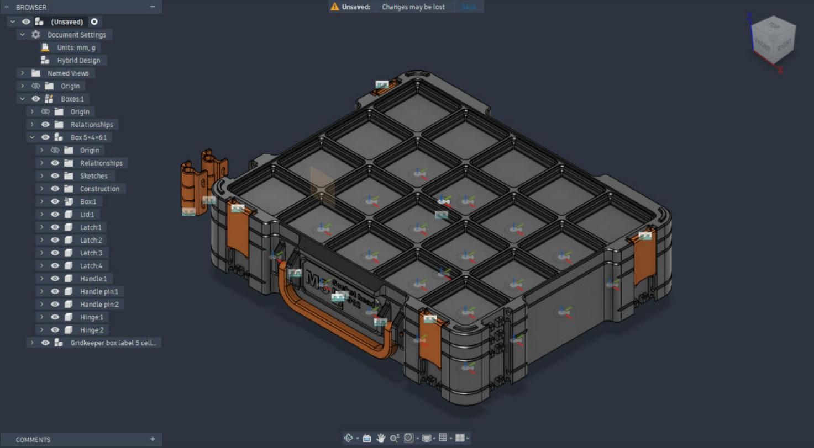
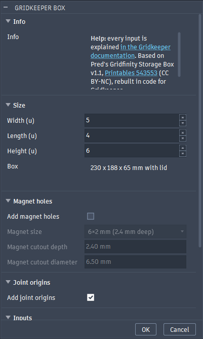

# Storage boxes

**Solid › Create › Gridkeeper box** builds a storage box with a lid after
[Pred's parametric Gridfinity Storage Box v1.1](https://www.printables.com/model/543553-gridfinity-storage-box-by-pred-now-parametric)
(CC BY-NC). The box holds Gridfinity bins in its floor, carries a Gridfinity grid on its lid, and stacks and latches
with boxes printed from Pred's own file: outer size, grooves, latch catches, hinge slots, handle and label holders
and the stacking rim are Pred's to the millimetre.

Every new box is a component of its own in the container *Boxes*, holding the components *Box* and *Lid* and the
small parts (latches, handle, handle pins, hinges, see [Small parts](#small-parts)); the lid is jointed shut on the
box, see [Components and joints](working/components.md).



!!! note "Magnet holes"
    Magnet holes are for 6 × 2 mm magnets only: 6 × 3 mm ones would break through the floor.

## Info



A link to this page, the credit to Pred and the version of the add-in. When the dialog was opened by
**Gridkeeper rebuild**, it says which box is rebuilt in place.

## Size

| Input | Default | What it does |
|---|---|---|
| **Width (u)** | 5 | Grid cells of 42 mm across, at least 4 |
| **Length (u)** | 4 | Grid cells of 42 mm from front to back, at least 3 |
| **Height (u)** | 6 | Height units of 7 mm, at least 6 for now (Pred's file goes down to 5, that comes later); the lid adds 10 mm |

The line below shows the outer size: width and length are the cells plus a 10 mm rim on every side
(5 × 4 → 230 × 188 mm).

## Magnet holes

| Input | Default | What it does |
|---|---|---|
| **Add magnet holes** | off | A hole in the pad at each corner of every cell |
| **Magnet size** | 6×2 mm (2.4 mm deep) | Sets the depth for 6 × 2 mm magnets, or *Custom* to type it |
| **Magnet cutout depth** | 2.4 mm | Up to 2.6 mm: the pad under the hole is 2.8 mm thick, 6 × 3 mm magnets would go through the floor |
| **Magnet cutout diameter** | 6.5 mm | 3 to 8.5 mm, the pad around the hole grows with it |

## Joint origins

**Add joint origins** puts a joint origin in every cell of the floor, *Cell joint origin column-row*, to joint bins
into the box like onto a baseplate. These are always there:

| Joint origin | Where |
|---|---|
| *Stack bottom joint origin* | Middle of the box's underside |
| *Stack top joint origin* | Middle of the lid's top: joint the bottom of another box onto it to stack them |
| *Lid joint origin* | In box and lid at the middle of the joint between them, used by the joint *Lid on box* |
| *Label joint origin* | In the label holder at the front, the middle of the label's back; **Gridkeeper box label** joints the label there |

*Lid on box* is part of the box: a rebuild makes it anew as a rigid joint, changes of yours to it are not kept.

## Small parts

Each set holds Pred's small parts as components of their own, each with its bodies ready to print:

| Part | How many | Where |
|---|---|---|
| *Latch* | 4 | Jointed in place: two at the front, one on each side at the back |
| *Handle* | 1 | Jointed at the front, between the handle holders |
| *Handle pin* | 2 | Jointed in the handle holders, the right one turned round |
| *Hinge* | 2 | Jointed beside the box, lying as they are printed |

Every part sits on a joint origin of the box, *Latch front left joint origin*, *Hinge 1 joint origin* and so on; the
rigid joints are named after the set and the seat, *Box 5×4×6 Latch front left*. The parts move with the box when
its size changes or when it is moved or stacked. The handle is as wide as the label holder space allows: the label width plus 28.5 mm, so 57 mm at a
width of 4, 99 mm at 5 and at most 113.5 mm from a width of 6 on. The hinges keep their place beside the box at every
size, the second 5 mm beside the first.

**Hinge** in the group *Small parts* picks one of Pred's three hinges; the box is the same for all three:

| Hinge | What it is |
|---|---|
| **M3x30** (default) | Pred's *Hinge_M3x30*, held by an M3 × 30 mm screw |
| **Pinned** | Pred's *Hinge_Pined*, with a printed pin as a third body |
| **Plain** | Pred's *Hinge*, the one Pred's file shows |

The parts are taken from Pred's file (`resources/predBox`, see its README): the same shape, with joint origins added,
sketches fully constrained and Pred's parameters turned into their values.

## Label

**Solid › Create › Gridkeeper box label** makes the label for the holder at the front of the box: Pred's flat plate,
0.85 mm thick and 24.5 mm high, as wide as the holder of the box (the label width less 3 mm: 25.5 mm at a width of 4,
67.5 mm at 5, 82 mm from 6 on). It is a command of its own, so a label can be swapped without touching the box.

```
+--------------------------------------------+
|  large  |  Line 1                          |
|  text   |  Line 2                          |
|         |  up to five symbols              |
+--------------------------------------------+
```

| Input | Default | What it does |
|---|---|---|
| **Box** | none | Pick the *Label joint origin* of a box: the label gets the box's width and is jointed into its holder (joint *… in holder*). Without, the label lies beside the parts there are |
| **Box width (u)** | 5 | The width of the box in grid cells, when no box is picked |
| **Large text** | M3 | One line in large letters (up to 12 mm) at the left, a little over a third of the width; empty leaves the room to the lines |
| **Line 1**, **Line 2** | Socket head, DIN 912 | Two lines at the right, 4 mm high, smaller when they are long |
| **Text style**, **Text and symbols**, **Text color** | Heavy, Raised, none | As for the [Cullenect inserts](cullenect/inserts.md): raised 0.4 mm like Pred's own labels, set in 0.4 mm or flush, as bodies of their own to print in another colour |
| **Symbol 1** … **Symbol 5** | Socket Hex, None … | Cullenect symbols in a row under the lines, 6 mm high: machine screws with full thread by head and driver, and every hardware symbol. The ones the width has no room for are left out from the right, the dialog says how many |

A 2.5 mm rim stays free all round, so the holder's lips don't cover text or symbols. The plate lies flat in its
component as it is printed, the text up; the label joint origin at the middle of its back turns it upright into the
holder. Each text is driven by a text parameter `gfBoxLabel1_bigText`, `gfBoxLabel1_text1`, `gfBoxLabel1_text2`;
a longer text is not fitted again. For another box width or other symbols, delete the label and make a new one.

## Parameters

The size is in three user parameters, see [Changing parameters](working/parameters.md):

| Parameter | What it is |
|---|---|
| `gfBox1_baseWidth` | Width in grid cells |
| `gfBox1_baseLength` | Length in grid cells |
| `gfBox1_heightU` | Height in height units |

Change them in **Modify › Change Parameters**, box and lid follow. The joint origins in the floor keep the cells
the box was built with; **Gridkeeper rebuild** places them anew.

## Settings, rebuild and clone

Right-click the box, the lid or the set's component (*Box 5×4×6* in the browser) for the settings, **Gridkeeper rebuild** and **Gridkeeper clone**, see
[Settings, rebuild and clone](working/settings-rebuild-clone.md). A rebuild replaces box, lid and small parts together; joints of
yours on its joint origins move over to the joint origins of the same name.

## Credits

Pred's Gridfinity Storage Box v1.1 is licensed CC BY-NC. The small parts are Pred's, taken over from Pred's file
with the changes listed in `resources/predBox/README.md`. Gridkeeper rebuilds its box and lid in code, with fully
constrained sketches and parameters, and changes it where noted on this page (the magnet holes, the floor pads and
the stacking rim drawn from circles, the joint origins). The timeline follows Pred's steps, except that the right
handle and label holders are built directly instead of mirrored from the left ones; the shape stays Pred's.
The label is Pred's plate with Gridkeeper text and the Cullenect symbols by CullenJWebb
([Cullenect-Labels](https://github.com/CullenJWebb/Cullenect-Labels), MIT) instead of Pred's text.
