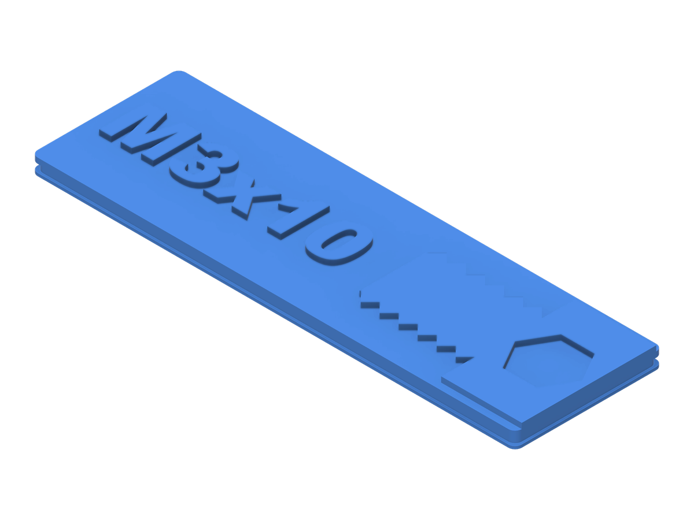

# Einleger { #label-inserts }

**Volumenkörper › Erstellen › Gridkeeper Einleger** erstellt einen Cullenect-Einleger: bis zu zwei Textzeilen und ein
Schrauben- oder Befestigungsmaterial-Symbol an seinem rechten Rand. Jeder Einleger ist eine eigene Komponente im
Container *Label*.

## Informationen { #info }

Ein Link zu dieser Seite, die Nennung von Cullenect und die Version des Add-ins. Wurde der Dialog über **Gridkeeper neu
erstellen** geöffnet, steht dort, welcher Einleger an Ort und Stelle neu erstellt wird.

## Größe { #size }

| Eingabe | Vorgabe | Was sie bewirkt |
|---|---|---|
| **Breite** | Rastereinheiten | *Rastereinheiten* oder *Breite in mm* |
| **Breite (u)** | 1 | Wird bei *Rastereinheiten* angezeigt: Breite der Aufnahme, in die er passt, 0,5 bis 7 Rastereinheiten in halben Schritten; 1u sind 36 mm bei 42-mm-Einheiten, wie bei Cullenect |
| **Breite** (in mm) | 25 mm | Wird bei *Breite in mm* angezeigt: eine freie Breite von 10 bis 300 mm, z. B. für die Aufnahme einer Fachlasche; der Behälter-Dialog zeigt die Breite seines Einlegers |
| **Rastereinheit Breite (mm)** | 42 mm | Das Raster der Behälter, in dem die Breite in Rastereinheiten gezählt wird; nur bei *Rastereinheiten* |
| **Korrektur Breite** | 0 mm | Wird zur Breite addiert, für Drucker, die zu breit oder zu schmal drucken, Cullenects `offset_xy`, höchstens 1 mm in jede Richtung |
| **Korrektur Höhe** | 0 mm | Wird zur Höhe von 11 mm addiert, höchstens 1 mm in jede Richtung |
| **Einleger** | | Zeigt die Größe, die der Einleger haben wird, z. B. `36.00 x 11.00 mm`, und in Rot, warum er nicht erstellt werden kann |

## Text

| Eingabe | Vorgabe | Was sie bewirkt |
|---|---|---|
| **Zeile 1** | M3x10 | Erste Textzeile |
| **Zeile 2** | leer | Zweite Zeile; bei zwei Zeilen werden beide kleiner gesetzt |
| **Textstil** | Extrafett | *Normal*, *Fett* oder *Extrafett*. Extrafett ist Arial Black, seine Striche lassen sich mit einer 0,4-mm-Düse drucken. Normal und Fett sind Arial, bei kleiner Schrift dünn |
| **Text und Symbol** | Erhaben | *Erhaben* 0,4 mm, *Vertieft* 0,4 mm oder *Bündig*, siehe unten |
| **Textfarbe** | Keine | Eine Farbe für Text und Symbol, siehe [Farben und Mehrfarbdruck](../working/colors.md) |
| **Benutzerdefinierte Farbe** | | Wird bei *Textfarbe* *Benutzerdefiniert* angezeigt: `#rrggbb`, z. B. `#D02020` |

Text und Symbol sind immer eigene Körper, zwei Schichten (0,4 mm) dick, damit sie in einer anderen Farbe gedruckt werden
können:

- **Erhaben** steht 0,4 mm über dem Einleger.
- **Vertieft** wird 0,4 mm in den Einleger geschnitten; der Textkörper füllt den Schnitt aus und bleibt verborgen,
  blenden Sie ihn ein, um ihn farbig zu drucken. Ein vertieftes Symbol hält 0,4 mm Abstand zu den Kanten, damit die
  Rastung weiter hält.
- **Bündig** wird genauso geschnitten, und der Textkörper wird angezeigt, bündig mit der Oberfläche.

<picture><source media="(prefers-color-scheme: dark)" srcset="../../../assets/gif/cullenect-insert-text-dark.gif"></picture>

### Textgröße { #text-size }

Der Text wird beim Erstellen an den Einleger angepasst: eine Zeile bis 5 mm hoch, zwei Zeilen bis je 3,5 mm, bei langem
Text kleiner. Er hält 1 mm Platz zum rechten Rand und vor dem Symbol, sodass ein später bis zu 1 mm schmaler gemachter
Einleger ihn weiter aufnimmt.

Ein langer Text wird verkleinert, bis er passt. Unterhalb der Höhe, bei der sein dünnster Strich nur noch eine
0,4-mm-Düsenlinie breit ist (Normal 4,43 mm, Fett 3,42 mm, Extrafett 3,05 mm, gemessen), beginnt ein Slicer,
Teile der Buchstaben wegzulassen; nach dem Erstellen schlägt dann eine Meldung vor, den Text zu kürzen, den Einleger breiter zu
machen oder den Stil Extrafett zu verwenden.

Zwei Zeilen auf einem durch seine Höhenkorrektur niedriger gemachten Einleger werden so verkleinert, dass Unterlängen
(g, j, p, y) auf dem Einleger bleiben, aber nicht unter diese Druckgrenze; reicht das nicht aus, und wo das Symbol keinen
Platz für Text lässt, sagt der Dialog es, und **OK** bleibt gesperrt.

## Symbol

| Eingabe | Vorgabe | Was sie bewirkt |
|---|---|---|
| **Schraube** | ein | Eine aus Kopf, Schaft, Gewinde und Antrieb zusammengesetzte Schraube am rechten Rand |
| **Kopf**, **Schaft**, **Gewinde**, **Antrieb** | Zylinderkopf, Metrisch, Vollgewinde, Innensechskant | Die Teile der Schraube; ohne **Schraube** gesperrt |
| **Flansch**, **Sicherheitsstift** | aus | Gesperrt, wo kein Symbol sie hat |
| **Befestigungsmaterial** | Keine | Eine Unterlegscheibe, Mutter, ein Einsatz, Magnet oder Kabelschuh statt einer Schraube; schalten Sie **Schraube** aus, um es zu wählen |
| **Symbol** | | Zeigt die SVG-Datei des Symbols, *Ohne* oder *Keine SVG-Datei für dieses Symbol* |

Alle Auswahlmöglichkeiten siehe [Symbole](symbols.md).

## Aufnahme { #pocket }

Optional: Klicken Sie auf den Gelenkursprung einer Cullenect-Aufnahme eines Behälters, und der Einleger wird bündig und
zentriert dort eingesetzt. Ein Einleger, der breiter oder höher ist als diese Aufnahme, wird nicht erstellt, der Dialog
verlangt eine passende Aufnahme. Ohne Aufnahme kommt der Einleger neben die vorhandenen Behälter, Grundplatten und
Einleger.

Wird ein Einleger in einer Aufnahme neu erstellt, ist seine Aufnahme bereits wieder ausgewählt. Lehnt Fusion sie ab,
sagt der Dialog es; wählen Sie sie erneut aus, sonst wird der Einleger ohne Gelenk dort erstellt, wo er war.

Die richtige Aufnahme finden und auswählen und das Gelenk rückgängig machen, Schritt für Schritt:
[Gelenkursprung in einem Dialog auswählen](../working/components.md#picking-a-joint-origin-in-a-dialog).

## Eingaben und Vorschau { #inputs-and-preview }

**Eingaben** enthält die Schaltflächen für Vorgaben und Einstellungsdateien, siehe
[Einstellungen speichern und laden](../working/save-load.md). **Vorschau anzeigen (langsam)** erstellt den Einleger,
während Sie die Eingaben ändern; **Letzte Vorschau** zeigt, wie lange es gedauert hat.

## Nach dem Erstellen { #after-building }

Die Breite und die Textzeilen sind [Benutzerparameter](../working/parameters.md) des Einlegers: `gfLabel1_width`,
`gfLabel1_text1` und `gfLabel1_text2`, bei einer Breite in Rastereinheiten zusätzlich `gfLabel1_baseWidth`. Das Symbol
bleibt am rechten Rand, wenn sich die Breite ändert. Ein über seinen Parameter länger gemachter Text wird nicht erneut
angepasst: Er läuft nach rechts weiter, kürzen Sie ihn oder erstellen Sie den Einleger neu.
