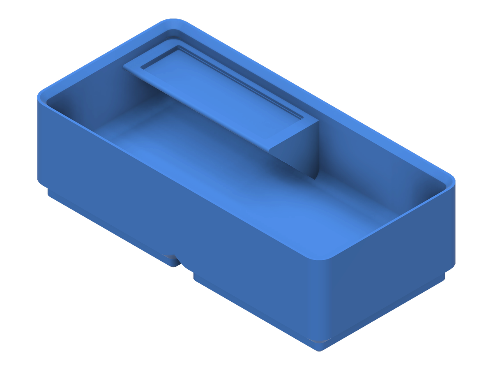

# Aufnahmen in Behältern { #pockets-in-bins }

Im Behälter-Dialog unter **Fächer des Behälters › Beschriftungslasche**: Schalten Sie **Beschriftungslasche hinzufügen
(entlang der Behälterbreite)** ein und wählen Sie als **Beschriftungsstil** **Cullenect**. Jede Beschriftungslasche
erhält statt einer gedruckten Beschriftung eine Aufnahme, bei mehreren Fächern jede Fachlasche.


## Größe der Aufnahme { #pocket-size }

Die Aufnahme erhält die größte Standardbreite von Cullenect, in halben Einheiten (1U, 1,5U, 2U …), die mit 1 mm Luft an
jedem Ende auf die Lasche passt. Mit Standardbreiten passen Original-Cullenect-Einleger auch in Fachlaschen. Ein Fach,
das selbst für eine Aufnahme von einer halben Einheit zu schmal oder von vorne nach hinten für die Lasche zu kurz ist,
erhält keine.

Die zweite Zeile der Tabelle **Tatsächliche Maße** nennt jede Aufnahmegröße, die der Behälter erhält, mit der passenden
Breite des Einlegers, zum Beispiel:

```
Cullenect: 1U: Aufnahme 36,3 mm, Einleger 36 mm; 2U: Aufnahme 78,3 mm, Einleger 78 mm
```

Dieselbe Liste, mit der Anzahl der Aufnahmen jeder Größe im Behälter, steht in seinen **Gridkeeper Einstellungen** unter
*Cullenect*.

<picture><source media="(prefers-color-scheme: dark)" srcset="../../../assets/gif/cullenect-pocket-dark.gif"></picture>

## Die Lasche mit Aufnahme { #the-tab-with-a-pocket }



- Die Lasche wird auf mindestens 14 mm verbreitert, unter steilen Überhängen mehr, und bleibt eben: Der **Winkel der
  Laschenoberseite** wird abgeschaltet.
- **Beschriftungstext**, **Beschriftungssymbol**, **Beschriftungstext fett** und **Beschriftungsfarbe** sind ebenfalls
  abgeschaltet, der Text kommt auf den Einleger. Sie behalten ihre Werte für den Fall, dass Sie wieder einen anderen Stil
  wählen.
- Eine hohle Lasche behält unter der Aufnahme eine 0,4 mm dicke Haut.
- **Steckplatzspiel (mm)** (0,3 mm wie bei Cullenect, bis 1 mm) gibt an, um wie viel die Aufnahme in Breite und
  Höhe größer ist als der Einleger. Die Einleger selbst werden maßgenau erzeugt; sitzen Ihre Einleger zu fest oder zu
  locker, ändern Sie das Spiel hier oder die Korrektur des Einlegers, siehe [Einleger](inserts.md#size).

## Voraussetzungen { #requirements }

- **Wände von mindestens 1,2 mm**, dem Cullenect-Standard. Darunter bleibt **OK** gesperrt, und die Cullenect-Zeile der
  Maßtabelle nennt den Grund.
- Hohle Behälter und Behälter vom Typ Schale mit Körper. Volle Behälter und [eigene Formen](../bins/size.md#custom-shape)
  erhalten keine Aufnahmen.

## Gelenkursprünge { #joint-origins }

Jede Aufnahme erhält einen Gelenkursprung in der Mitte ihres Bodens, Z nach oben und X entlang der Aufnahme. Wählen Sie
ihn im Feld **Aufnahme** des [Einleger-Dialogs](inserts.md#pocket) aus, und der Einleger wird bündig und zentriert in die
Aufnahme eingesetzt.

## Nach dem Erstellen { #after-building }

Die Aufnahmen folgen den [Parametern](../working/parameters.md) für Rastereinheit und Höhe des Behälters. Ihre Größe (1U,
2U …) wird beim Erstellen des Behälters festgelegt: Würde eine Parameteränderung eine andere Größe erfordern, erstellen
Sie den Behälter über sein Kontextmenü neu. Wird ein Behälter mit Einlegern in seinen Aufnahmen neu erstellt, werden
deren Gelenke auf die gleichnamigen Aufnahmen übertragen; ein Gelenk, dessen Aufnahme der neue Behälter nicht hat, wird
in den Hinweisen zur Neuerstellung genannt.
