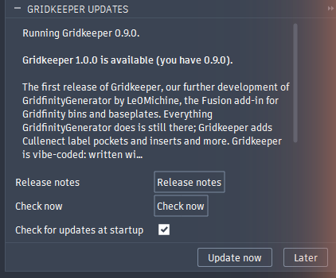
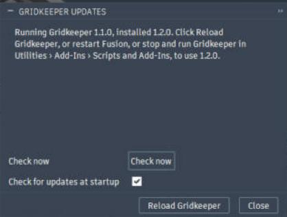
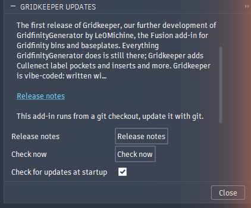

# Installation und Updates { #installation-and-updates }

Gridkeeper wird aus der ZIP-Datei eines GitHub-Releases installiert. Es ist **nicht** im Autodesk App Store, der
GridfinityGenerator, den Sie dort finden, ist das Original-Zusatzmodul von Le0Michine.

## Installieren { #install }

1. Laden Sie die ZIP-Datei des neuesten Releases von der
   [Release-Seite](https://github.com/Eifel-Joe/Gridkeeper/releases) herunter.
2. Entpacken Sie sie an einen Ort, der dauerhaft bleibt, zum Beispiel `Documents\Fusion add-ins`. Die ZIP-Datei enthält einen Ordner
   `Gridkeeper` mit `Gridkeeper.manifest` und `Gridkeeper.py`; behalten Sie diesen Ordnernamen bei, Fusion lädt ein Zusatzmodul nur
   aus einem Ordner, der wie sein Manifest heißt. Fusion lädt es bei jedem Start von dort.
3. Öffnen Sie in Fusion **Dienstprogramme › Zusatzmodule › Skripte und Zusatzmodule** (oder drücken Sie <kbd>Umschalt</kbd>+<kbd>S</kbd>).
4. Klicken Sie auf der Registerkarte **Zusatzmodule** auf das **+** neben *Meine Zusatzmodule* und wählen Sie den Ordner `Gridkeeper` aus Schritt 2.
5. Wählen Sie Gridkeeper in der Liste aus, aktivieren Sie **Beim Start ausführen** und klicken Sie auf **Ausführen**.

**Gridkeeper Behälter**, **Gridkeeper Grundplatte** und **Gridkeeper Einleger** erscheinen nun unter **Volumenkörper › Erstellen** im Arbeitsbereich
„Konstruktion“.

## Aktualisieren { #update }

Gridkeeper sucht von selbst nach einer neuen Version, einmal am Tag beim Start von Fusion. Gibt es eine, zeigt ein Fenster
**Gridkeeper Updates** die neue Version, ein paar Zeilen dazu und einen Link zu ihren **Versionshinweisen**, sodass Sie wissen,
was Sie bekommen, bevor Sie sie installieren.

- **Jetzt aktualisieren** lädt die Release-ZIP-Datei von GitHub herunter, prüft sie und ersetzt den Ordner `Gridkeeper`. Danach fragt es
  **Gridkeeper jetzt neu laden, um es zu verwenden?** Bei **Ja** wird Gridkeeper beendet und mit der neuen Version neu gestartet, sobald
  seine Fenster geschlossen sind. Bei **Nein** läuft die alte weiter; beenden Sie Ihre Arbeit damit und laden Sie die neue später:
  **Gridkeeper Updates** bietet dann **Gridkeeper neu laden** an, oder starten Sie Fusion neu, oder beenden und starten Sie Gridkeeper unter
  **Dienstprogramme › Zusatzmodule › Skripte und Zusatzmodule**.

  

- **Später** lässt alles, wie es ist; das Fenster kommt am nächsten Tag wieder.

Was erhalten bleibt: Ihre gespeicherten Dialogvorgaben, die Update-Einstellung und Symbole, die Sie zu den Symbolordnern hinzugefügt haben. Gridkeeper
kopiert jede Datei des alten Ordners, die die neue Version nicht hat, in den neuen; nur die Programmdateien
(`.py`) der alten Version bleiben zurück. Ein Bild oder Symbol, das eine neue Version absichtlich entfernt hat, bleibt also aus der alten
erhalten; löschen Sie es von Hand, wenn es Sie stört.

So wird der Ordner ersetzt: Die neue Version wird neben dem Zusatzmodul-Ordner, in
`.gridkeeper-update`, entpackt und geprüft, bevor etwas geändert wird. Dann wird der alte Ordner nach `.gridkeeper-update\backup-<Datum>` verschoben
und der neue nimmt seinen Platz ein. Lässt Windows das Verschieben des Ordners nicht zu, weil Fusion eine Datei daraus geöffnet hat, wird die neue
Version stattdessen darüber kopiert, nachdem der alte Ordner vollständig in die Sicherung kopiert wurde. Schlägt ein Schritt fehl, wird die alte
Version wiederhergestellt und eine Meldung nennt den Grund. Lässt sie sich im seltenen Fall auch nicht wiederherstellen, sagt die Meldung das
und nennt den Sicherungsordner: Schließen Sie Fusion und setzen Sie den Ordner `Gridkeeper` dieser Sicherung an die Stelle des Zusatzmodul-Ordners.
Die neueste Sicherung bleibt erhalten, sodass Sie auf dieselbe Weise zur Version vor dem letzten Update zurückkehren können.

### Von Hand aktualisieren { #update-by-hand }

Laden Sie die ZIP-Datei des neuen Releases herunter und entpacken Sie sie über den alten Ordner `Gridkeeper`, wobei dessen Dateien ersetzt werden. Klicken Sie auf
**Gridkeeper neu laden** unter **Dienstprogramme › Zusatzmodule › Gridkeeper Updates**, starten Sie Fusion neu, oder beenden und starten Sie das Zusatzmodul
erneut unter **Skripte und Zusatzmodule**. Ihre gespeicherten Dialogvorgaben bleiben erhalten, sie liegen im Zusatzmodul-Ordner und gehören nicht zur ZIP-Datei.

### Aus einem Git-Checkout { #from-a-git-checkout }

Läuft Gridkeeper aus einem Git-Checkout (der Zusatzmodul-Ordner hat einen Ordner `.git`), ersetzt es ihn nie. Das Fenster
weist nur auf die neue Version hin und verlinkt ihre Versionshinweise; aktualisieren Sie mit Git. Fusion lädt den neuen Code nach einem Pull oder einem Branch-Wechsel nicht von
selbst: Hat sich die Version in `Gridkeeper.manifest` geändert, bietet **Gridkeeper Updates**
**Gridkeeper neu laden** an, andernfalls beenden und starten Sie Gridkeeper unter **Skripte und Zusatzmodule**.

### Nach Updates suchen und Ihre Privatsphäre { #checking-for-updates-and-your-privacy }

Öffnen Sie **Dienstprogramme › Zusatzmodule › Gridkeeper Updates**, um die laufende und die installierte Version zu sehen (sie unterscheiden sich
nach einem Update, bis Gridkeeper neu geladen wird), um **Jetzt suchen** zu klicken und um **Beim Start prüfen** aus- oder einzuschalten.
Die Einstellung wird im Zusatzmodul-Ordner gespeichert (`updateConfig\update.json`).

Die Suche fragt die öffentliche API von GitHub nach den Releases von
[Eifel-Joe/Gridkeeper](https://github.com/Eifel-Joe/Gridkeeper/releases), höchstens einmal am Tag. Sie sendet nichts über
Sie, Ihren Computer oder Ihre Konstruktionen, nur die Anfrage selbst mit dem User-Agent `Gridkeeper-update-check`. Wie bei
jeder Webseite, die Sie öffnen, sieht GitHub Ihre IP-Adresse. Ohne Netzwerk schlägt die Suche still fehl und Fusion startet wie
immer; sie läuft im Hintergrund und verzögert den Start nie.

## Neben dem Original { #beside-the-original }

Gridkeeper läuft neben dem ursprünglichen GridfinityGenerator: Seine Befehle haben eigene Namen, sodass beide gleichzeitig geladen
sein können. **Volumenkörper › Erstellen** listet dann *Gridfinity bin* und *Gridfinity baseplate* des Originals neben
*Gridkeeper Behälter*, *Gridkeeper Grundplatte* und *Gridkeeper Einleger*.

- Modelle funktionieren weiter, egal welches Zusatzmodul sie erzeugt hat; es sind gewöhnliche Fusion-Körper und -Komponenten.
- Klicken Sie mit der rechten Maustaste auf ein Modell, um die Befehle jedes geladenen Zusatzmoduls zu sehen. Verwenden Sie **Gridkeeper Einstellungen**, **Gridkeeper neu erstellen**
  und **Gridkeeper klonen** für Modelle, die von Gridkeeper erzeugt wurden.
- Einstellungsdateien, die vom GridfinityGenerator v2.4 gespeichert wurden, lassen sich in den Dialogen von Gridkeeper laden; Einstellungen, die Gridkeeper hinzugefügt hat, behalten
  den Wert des Dialogs, siehe [Einstellungen speichern und laden](../working/save-load.md#loading-older-or-other-files).
- Jedes Zusatzmodul behält seine eigenen Dialogvorgaben.

Wenn Sie das Original nicht mehr brauchen, beenden und entfernen Sie es wie unten beschrieben oder deinstallieren Sie es so, wie Sie es installiert haben (die
App-Store-Version über das Installationsprogramm von Autodesk).

## Einheiten { #units }

Die Dialoge akzeptieren jede Längeneinheit, die Fusion versteht; eine Zahl ohne Einheit gilt in den Einheiten des Dokuments. Alle Längen
in dieser Dokumentation sind in Millimetern angegeben.

## Entfernen { #remove }

1. Wählen Sie in **Skripte und Zusatzmodule** Gridkeeper aus und klicken Sie auf **Beenden**; deaktivieren Sie **Beim Start ausführen**.
2. Entfernen Sie es über das Menü seiner Zeile aus der Liste.
3. Löschen Sie seinen Ordner. Damit werden auch Ihre gespeicherten Dialogvorgaben gelöscht.

Mit Gridkeeper erzeugte Modelle bleiben, wie sie sind, mit ihren Benutzerparametern; nur die Rechtsklick-Befehle zum Anzeigen,
Neuerstellen oder Klonen fehlen, bis Sie es erneut installieren.
