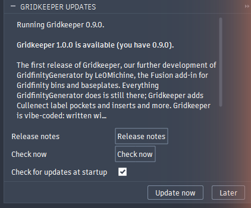
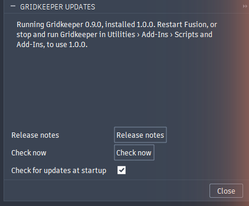
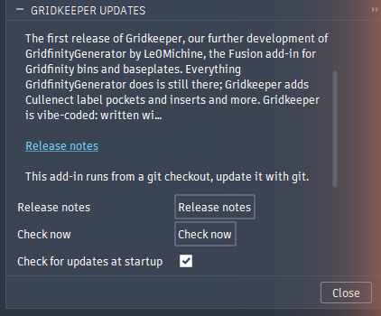

# Installation and updates

Gridkeeper is installed from the ZIP file of a GitHub release. It is **not** in the Autodesk App Store, the
GridfinityGenerator you may find there is the original add-in by Le0Michine.

## Install

1. Download the ZIP file of the latest release from the
   [releases page](https://github.com/Eifel-Joe/Gridkeeper/releases).
2. Unpack it to a place that stays where it is, for example `Documents\Fusion add-ins`. The ZIP holds a folder
   `Gridkeeper` with `Gridkeeper.manifest` and `Gridkeeper.py`; keep that folder name, Fusion loads an add-in only
   from a folder named like its manifest. Fusion loads it from there every time it starts.
3. In Fusion open **Utilities › Add-Ins › Scripts and Add-Ins** (or press <kbd>Shift</kbd>+<kbd>S</kbd>).
4. On the **Add-Ins** tab click the **+** next to *My Add-Ins* and pick the `Gridkeeper` folder from step 2.
5. Select Gridkeeper in the list, tick **Run on Startup** and click **Run**.

**Gridkeeper bin**, **Gridkeeper baseplate** and **Gridkeeper label** now show in **Solid › Create** of the Design
workspace.

## Update

Gridkeeper looks for a new version by itself, once a day when Fusion starts. When there is one, a window
**Gridkeeper updates** shows the new version, a few lines about it and a link to its **release notes**, so you know
what you get before you install it.

- **Update now** downloads the release ZIP from GitHub, checks it and replaces the `Gridkeeper` folder. To load the
  new version, restart Fusion, or stop and run Gridkeeper in **Utilities › Add-Ins › Scripts and Add-Ins**. Until
  then the old one keeps running; finish your work with it or load the new one first.

  

- **Later** leaves everything as it is; the window comes again the next day.

What stays: your saved dialog defaults, the update setting and symbols you added to the symbol folders. Gridkeeper
copies every file of the old folder that the new version doesn't have into the new one, only the program files
(`.py`) of the old version stay behind. So a picture or symbol a new version removed on purpose is kept from the old
one; delete it by hand if it bothers you.

How the folder is replaced: the new version is unpacked and checked next to the add-in folder, in
`.gridkeeper-update`, before anything is changed. Then the old folder moves to `.gridkeeper-update\backup-<date>`
and the new one takes its place. If Windows won't move the folder because Fusion has a file of it open, the new
version is copied over it instead, after a full copy of the old one into the backup. If any step fails, the old
version is put back and a message says why. In the rare case it can't be put back either, the message says so and
names the backup folder: close Fusion and put the `Gridkeeper` folder of that backup in place of the add-in folder.
The newest backup is kept, so you can go back to the version before the last update the same way.

### Update by hand

Download the ZIP of the new release and unpack it over the old `Gridkeeper` folder, replacing its files. Restart Fusion, or stop
and run the add-in again in **Scripts and Add-Ins**. Your saved dialog defaults are kept, they are stored in the add-in folder and not part of the ZIP.

### From a git checkout

When Gridkeeper runs from a git checkout (the add-in folder has a `.git`), it never replaces it. The window only
tells you about the new version and links its release notes; update with git.

### Checking for updates and your privacy

Open **Utilities › Add-Ins › Gridkeeper updates** to see the version running and the one installed (they differ
after an update until Gridkeeper is loaded again), to **Check now** and to turn **Check for updates at startup** off or on.
The setting is kept in the add-in folder (`updateConfig\update.json`).

The check asks GitHub's public API for the releases of
[Eifel-Joe/Gridkeeper](https://github.com/Eifel-Joe/Gridkeeper/releases), at most once a day. It sends nothing about
you, your computer or your designs, only the request itself with the user agent `Gridkeeper-update-check`. As with
any web page you open, GitHub sees your IP address. Without network the check fails quietly and Fusion starts as
always; it runs in the background and never holds up the start.

## Beside the original

Gridkeeper runs beside the original GridfinityGenerator: its commands have names of their own, so both can be loaded
at the same time. **Solid › Create** then lists *Gridfinity bin* and *Gridfinity baseplate* of the original next to
*Gridkeeper bin*, *Gridkeeper baseplate* and *Gridkeeper label*.

- Models keep working whichever add-in built them; they are ordinary Fusion bodies and components.
- Right-click a model for the commands of each loaded add-in. Use **Gridkeeper settings**, **rebuild** and **clone**
  for models built by Gridkeeper.
- Settings files saved by GridfinityGenerator v2.4 load in Gridkeeper's dialogs; settings Gridkeeper added keep the
  dialog's value, see [Saving and loading settings](../working/save-load.md#loading-older-or-other-files).
- Each add-in keeps its own dialog defaults.

If you don't need the original any more, stop and remove it as below, or uninstall it the way you installed it (the
App Store version through Autodesk's installer).

## Units

The dialogs take any length unit Fusion understands; a number without a unit is in the document's units. All lengths
in this documentation are in millimeters.

## Remove

1. In **Scripts and Add-Ins** select Gridkeeper and click **Stop**; untick **Run on Startup**.
2. Remove it from the list with the menu of its row.
3. Delete its folder. This also deletes your saved dialog defaults.

Models built with Gridkeeper stay as they are, with their user parameters; only the right-click commands to show,
rebuild or clone them are gone until you install it again.
