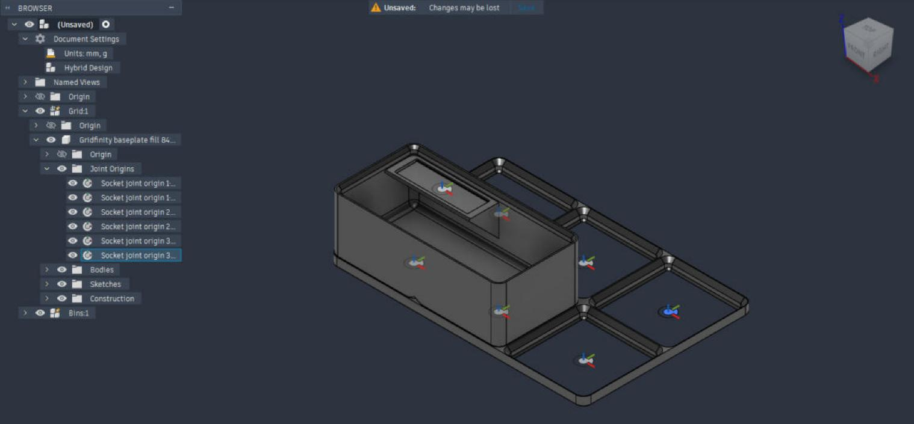
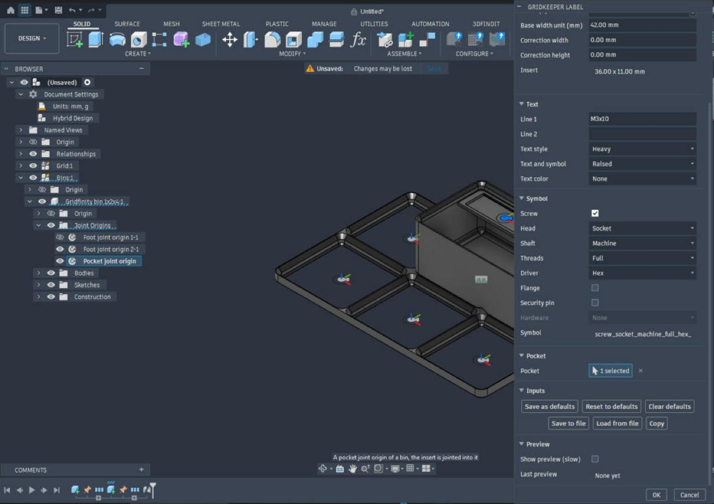
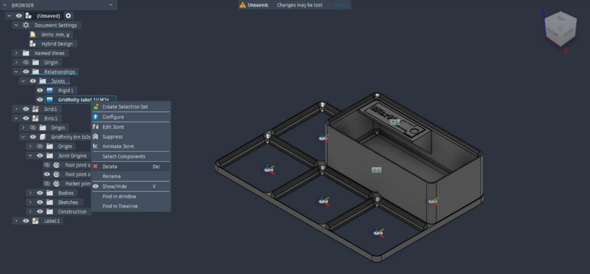
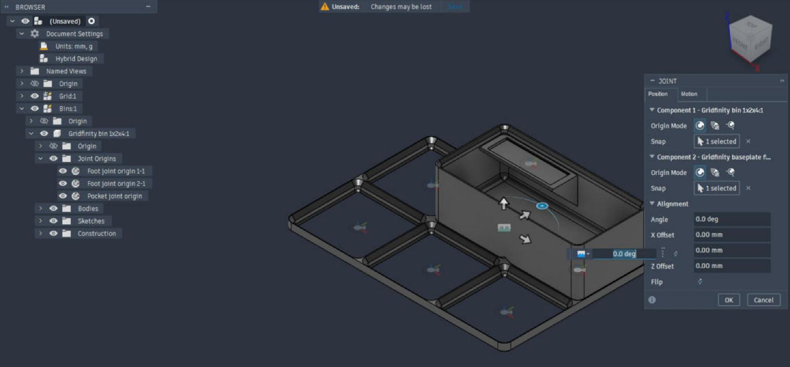

# Komponenten und Gelenke { #components-and-joints }

## Container { #containers }

Jede neue Grundplatte, jeder neue Behälter und jeder neue Einleger ist eine eigene Komponente, in einem Container
ihrer Art direkt in der Wurzel der Konstruktion:

| Container | Enthält |
|---|---|
| **Grid** | Grundplatten |
| **Bins** | Behälter |
| **Label** | Cullenect-Einleger |
| **Boxes** | Aufbewahrungsboxen, jede eine Komponente mit den Komponenten *Box* und *Lid*, der Deckel per Gelenk geschlossen auf der Box |

Die Container werden über ein Tag gefunden, Sie dürfen sie also umbenennen. Sie sind fixiert, sodass ein Gelenk eines
Teils in ihnen nur dieses Teil bewegt, nicht den Container mit allem darin. Die farbigen Buchstaben eines Behälters
oder Einlegers liegen in einer Komponente **Text** darin, siehe [Farben und mehrfarbiger Druck](colors.md).

## Bauteilkonstruktionen { #part-designs }

Eine Bauteilkonstruktion nimmt nur eine einzige Komponente auf. Wenn das erste Modell in einer Bauteilkonstruktion
gebaut wird (bei **OK**, nicht für die Vorschau), schaltet Gridkeeper sie auf eine hybride Konstruktion um und sagt
es. Das Umschalten behält die Körper, die Zeitachse und die Parameter, aber eine Konstruktion mit Komponenten kann
nicht zu einer Bauteilkonstruktion zurückkehren.

## Gelenkursprünge { #joint-origins }

Ein **Gelenkursprung** ist ein kleines Koordinatenkreuz, das Gridkeeper an einem Modell anbringt: ein Punkt mit einer
Richtung. Die Gelenke von Fusion verwenden sie, um ein Teil genau auf ein anderes zu setzen und dort zu halten, wenn
sich das darunterliegende Teil bewegt oder seine Größe ändert. Gridkeeper verwendet Gelenkursprünge auf zwei Arten:
Manche Dialoge verlangen, dass Sie einen *auswählen*, um festzulegen, wohin ein neues Teil kommt, und andere sind
dazu da, dass Sie Teile von Hand per Gelenk verbinden.

### Wo Gridkeeper sie anbringt { #where-gridkeeper-puts-them }

| Modell | Gelenkursprung | Wo | Wann |
|---|---|---|---|
| Grundplatte | *Socket joint origin column-row* | Mitte des Bodens jedes Steckplatzes | **Gelenkursprünge hinzufügen** |
| Behälter | *Foot joint origin column-row* | Mitte der Unterseite jedes Fußes | **Gelenkursprünge hinzufügen** |
| In eine Zelle gesetzter Behälter | *Cell placement joint origin* | Mitte der Unterseite der vorderen linken Zelle des Behälters, verwendet von seinem Gelenk *… in cell* | wenn im Behälter-Dialog eine **Zelle** gewählt wurde |
| Behälter mit Cullenect-Aufnahmen | *Pocket joint origin*; bei Fächern *Compartment 1 pocket joint origin*, *Compartment 2 …* | Mitte jedes Aufnahmebodens, Z nach oben, X entlang der Aufnahme | immer |
| Cullenect-Einleger | *Insert joint origin* | Mitte seiner Unterseite | immer |
| Aufbewahrungsbox | *Cell joint origin column-row* | Boden jeder Zelle | immer |
| Aufbewahrungsbox | *Stack bottom joint origin*, *Stack top joint origin* | Mitte der Unterseite der Box, Mitte der Oberseite des Deckels | immer |
| Aufbewahrungsbox | *Label joint origin* | Im Etikett-Halter vorne | immer |
| Aufbewahrungsbox | *Lid joint origin*, *Latch front left joint origin* und die übrigen Sitze | Wo Deckel, Verschlüsse, Griff, Stifte und Scharniere sitzen | immer, von der Box selbst verwendet |
| Box-Etikett | *Label joint origin* | Mitte der Rückseite des Etiketts | immer |

Spalte und Zeile zählen ab 1, beginnend vorne links: *Cell joint origin 1-1* ist die vordere linke Zelle einer Box.
Alle Gelenkursprünge folgen den Größenparametern ihres Modells.

**Sehen:** Gelenkursprünge sind im Browser unter jeder Komponente im Ordner *Gelenkursprünge* aufgeführt. Wenn Sie sie
in der Zeichenfläche nicht sehen, öffnen Sie diesen Ordner und schalten Sie seine Glühbirne ein (oder die der
Komponente). Halten Sie die Maus in der Zeichenfläche über einen Gelenkursprung: Fusion zeigt seinen Namen. In einem
Dialog können Sie statt in der Zeichenfläche auch im Browser auf einen Gelenkursprung klicken.

### Einen Gelenkursprung in einem Dialog auswählen { #picking-a-joint-origin-in-a-dialog }

Drei Gridkeeper-Dialoge platzieren ihr Teil über einen Gelenkursprung, den Sie auswählen. Nur die passende Art von
Gelenkursprung lässt sich auswählen; andere leuchten nicht auf.

**Ein neuer Behälter in eine Zelle einer Grundplatte oder einer Box**

1. Bauen Sie die Grundplatte mit **Gelenkursprünge hinzufügen**; eine Box hat ihre Zellen-Gelenkursprünge ohnehin.
2. Öffnen Sie **Gridkeeper Behälter**. Der Abschnitt **Platzierung** hat **Zelle** nur, wenn die Konstruktion eine
   Grundplatte oder eine Box enthält, und nur für einen neuen Behälter, nicht beim Neuerstellen eines Behälters.
   Klicken Sie in **Zelle**; **Position** ist ausgegraut, solange eine Zelle gewählt ist.
3. Klicken Sie auf einen *Socket joint origin* einer Grundplatte oder einen *Cell joint origin* im Boden einer Box,
   in der Zeichenfläche oder im Browser. Füße, Aufnahmen und die übrigen Gelenkursprünge der Box lassen sich nicht
   auswählen; der Deckel hat keine Zellen.
4. **OK**: Der Behälter wird mit seiner vorderen linken Zelle in die gewählte Zelle per Gelenk verbunden (Gelenk
   *… in cell*). Ein Behälter, der größer ist als 1 × 1, reicht von dort nach rechts und nach hinten. Ob er in die
   Grundplatte oder Box passt, wird nicht geprüft.

**Ein Cullenect-Einleger in die Aufnahme eines Behälters**

1. Bauen Sie den Behälter mit Cullenect-Aufnahmen; jede Aufnahme erhält einen Aufnahme-Gelenkursprung.
2. Öffnen Sie **Gridkeeper Einleger** (den Cullenect-Einleger) und klicken Sie in **Aufnahme**.
3. Klicken Sie in der Zeichenfläche auf den Gelenkursprung der Aufnahme oder im Browser auf *Pocket joint origin*
   unter dem Behälter. Bei Fächern hat jede Aufnahme ihren eigenen: *Compartment 1 pocket joint origin*,
   *Compartment 2 …* und so weiter.
4. Die Größenzeile sagt, ob der Einleger in diese Aufnahme passt; ein Einleger, der breiter oder höher ist als die
   Aufnahme, wird nicht gebaut.
5. **OK**: Der Einleger wird bündig und zentriert per Gelenk in die Aufnahme gesetzt (Gelenk *… in pocket*).

**Das Box-Etikett in seinen Halter**

1. Öffnen Sie **Gridkeeper Box-Etikett** und klicken Sie in **Box**.
2. Klicken Sie auf den *Label joint origin* vorne an der Box, in der Zeichenfläche oder im Browser unter der
   Komponente *Box* der Box.
3. **Etikettbreite** wird auf die Breite der Box gesetzt (*Box 5 cells*, *Box 6+ cells* …). Die Breite wird einmal
   übernommen, beim Auswählen: Wird die Box später breiter, erstellen Sie ein neues Etikett.
4. **OK**: Das Etikett wird per Gelenk in den Halter gesetzt (Gelenk *… in holder*).

Ohne Auswahl bauen die Dialoge das Teil neben den anderen, ohne Gelenk, z. B. für einen Nachdruck.

**Was danach geschieht**

- *Bewegen:* Ein verbundenes Teil bewegt sich mit dem Teil, mit dem es verbunden ist: Verschieben Sie den Behälter,
  kommt der Einleger mit; stapeln oder verschieben Sie die Box, kommt das Etikett mit.
- *Neu erstellen:* Einleger in den Aufnahmen eines neu erstellten Behälters werden wieder mit den gleichnamigen
  Aufnahmen per Gelenk verbunden. Bei einem neu erstellten Einleger ist seine Aufnahme schon wieder gewählt, ein neu
  erstellter Behälter kommt wieder in seine Zelle. Eine neu erstellte Box oder Grundplatte überträgt Gelenke an ihren
  Gelenkursprüngen auf die gleichnamigen Gelenkursprünge, darunter die des Etiketts und der Behälter. Siehe
  [Einstellungen, Neuerstellung und Klonen](settings-rebuild-clone.md).
- *Klonen:* Ein Klon ist ein neues Teil ohne Gelenk; wählen Sie im Dialog eine Aufnahme, eine Box oder eine Zelle
  dafür.
- *Das Gelenk aufheben:* Öffnen Sie im Browser oben *Beziehungen › Gelenke*, klicken Sie mit der rechten Maustaste auf
  das Gelenk (*… in pocket*, *… in holder*, *… in cell*) und wählen Sie **Löschen**. Das Teil bleibt in der
  Konstruktion und lässt sich bewegen oder neu per Gelenk verbinden.

### Von Hand per Gelenk verbinden { #jointing-by-hand }

Alles andere wird mit **Zusammenfügen › Gelenk** von Fusion (Tastenkürzel **J**) verbunden. Schalten Sie für
Behälter und Grundplatten zuerst **Gelenkursprünge hinzufügen** ein; eine Box hat ihre Zellen-Gelenkursprünge
ohnehin.

**Ein Behälter in eine Grundplatte oder eine Boxzelle**

1. **Zusammenfügen › Gelenk**.
2. *Komponente 1*: Klicken Sie auf einen Fuß-Gelenkursprung des Behälters, z. B. *Foot joint origin 1-1*.
3. *Komponente 2*: Klicken Sie auf den Gelenkursprung des Steckplatzes, in den er kommt, *Socket joint origin 3-2*
   einer Grundplatte oder *Cell joint origin 3-2* einer Box.
4. *Bewegung*: **Starr**. **OK**. Fusion nennt das Gelenk *Starr 1*, *Starr 2* …; es ist unter
   *Beziehungen › Gelenke* aufgeführt.

Der Behälter-Dialog erledigt das für einen neuen Behälter, siehe oben; von Hand wählen Sie den Fuß selbst aus.

**Eine Box auf eine andere Box**

1. **Zusammenfügen › Gelenk**.
2. *Komponente 1*: der *Stack bottom joint origin* der Box, die oben aufgesetzt wird.
3. *Komponente 2*: der *Stack top joint origin* auf dem Deckel der Box darunter.
4. *Bewegung*: **Starr**. **OK**. Die obere Box sitzt auf dem Stapelrand der unteren.

Ein neu erstellter Behälter gibt nur den Aufnahme-Gelenken und seinem eigenen Gelenk in eine Zelle ihre neuen
Gelenkursprünge; ein Gelenk, das Sie von Hand an seinen Fuß-Gelenkursprüngen erstellt haben, muss neu erstellt
werden. Eine neu erstellte Grundplatte oder Box überträgt Gelenke an ihren Gelenkursprüngen nach Namen.

### Wenn es nicht funktioniert { #when-it-doesnt-work }

| Was Sie sehen | Warum, und was zu tun ist |
|---|---|
| Keine Gelenkursprünge in der Zeichenfläche | Ihre Glühbirne ist aus: Öffnen Sie im Browser den Ordner *Gelenkursprünge* der Komponente und schalten Sie sie ein. Füße eines Behälters und Steckplätze einer Grundplatte brauchen **Gelenkursprünge hinzufügen**, die Zellen einer Box sind immer da |
| Der Gelenkursprung lässt sich im Dialog nicht anklicken | Er ist nicht die Art, die der Dialog annimmt: **Aufnahme** nimmt nur Aufnahme-Gelenkursprünge, **Box** nur den *Label joint origin* einer Box, **Zelle** nur Steckplätze einer Grundplatte und Zellen eines Boxbodens, von Teilen in eigenen Komponenten (nicht Körpern in der Wurzel einer Bauteilkonstruktion) |
| Der Browser zeigt keine Gelenkursprünge | Der Ordner oder die Komponente ist eingeklappt: Öffnen Sie den Pfeil der Komponente, dann *Gelenkursprünge* |
| Das Teil sitzt an der falschen Stelle | Es wurde ein anderer Gelenkursprung gewählt, eine benachbarte Aufnahme oder Zelle. Halten Sie die Maus darüber, um seinen Namen zu sehen; löschen Sie das Gelenk (*Beziehungen › Gelenke*) und wählen Sie erneut |
| Der Einleger wird nicht gebaut | Er ist breiter oder höher als die Aufnahme, die Größenzeile im Dialog sagt es: Wählen Sie eine passende Aufnahme oder machen Sie den Einleger kleiner |

## Die aktive Komponente { #the-active-component }

Nach dem Bauen ist wieder die Wurzelkomponente aktiv, sodass Fusion die anderen Komponenten nicht halbtransparent
anzeigt.
