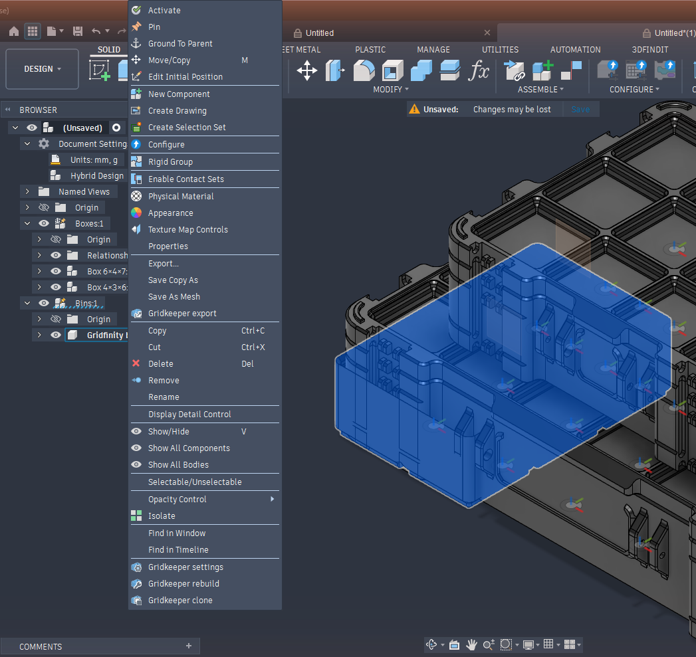

# Für den Druck exportieren { #exporting-for-printing }

**Gridkeeper Export** schreibt die Teile einer Konstruktion für den Slicer in Dateien: eine **3MF**-Datei mit allen
Teilen oder je eine **STL**- oder **STEP**-Datei pro Teil. Er stammt aus GridfinityGenerator (Le0Michine); Gridkeeper
erweitert ihn auf jedes Teil, das es erzeugt, und auf farbigen Text.

## Den Export starten { #starting-the-export }

- Klicken Sie mit der **rechten Maustaste** auf einen Behälter, eine Grundplatte, einen Cullenect-Einleger oder eine
  Aufbewahrungsbox, auf einen Buchstaben oder ein Symbol davon, auf die zugehörige Komponente im Browser oder auf
  einen Container (*Grid*, *Bins*, *Label*, *Boxes*) und wählen Sie **Gridkeeper Export**. Der Befehl steht unter
  *Als Netz speichern*.
- Klicken Sie mit der rechten Maustaste auf die Wurzelkomponente der Konstruktion, um mit eingeschaltetem
  **Alle Gridkeeper-Teile** zu starten.

## Der Dialog { #the-dialog }

| Eingabe | Was sie bewirkt |
|---|---|
| **Alle Gridkeeper-Teile** | Wählt jeden sichtbaren Behälter, jede Grundplatte, jeden Cullenect-Einleger und jede Box der Konstruktion samt Kleinteilen aus. Ausgeschaltet geht es zurück zur ursprünglichen Auswahl |
| **Körper** | Was ausgegeben wird. Ein ausgewählter Buchstabe oder ein ausgewähltes Symbol steht für sein Teil; jeder andere gewählte Körper wird unverändert ausgegeben |
| **Format** | **3MF**: die Teile in Druckausrichtung auf dem Druckbett angeordnet, ein Bambu-Studio-Projekt mit allen Druckplatten für einen Bambu-Lab-Drucker oder eine Datei je Druckplatte, siehe unten. **STL** oder **STEP**: je eine Datei pro Teil, nach dem Teil benannt (bei einer Box *Base*, *Lid* und Kleinteile mit dem Namen der Box davor, etwa *Box 5×4×6 Base*, *Box 5×4×6 Latch*), am Ursprung, mit der Unterseite bei null. STL-Dateien liegen in Druckausrichtung, STEP-Dateien wie konstruiert |
| **Ordner**, **Ordner wählen...** | Wohin die Dateien kommen; der zuletzt verwendete Ordner wird gemerkt |
| **Dateiname** | Name der 3MF-Datei, bei einem einzelnen Teil der Name des Teils; bei einer Datei je Druckplatte und mehreren Druckplatten wird *, plate 1*, *, plate 2* … angehängt |
| **Text einfärben** | Nur 3MF: Jede Beschriftungsfarbe erhält ein Filament, in dem der Slicer sie druckt, siehe unten |
| **Filamente Beschriftung** | Bei eingeschaltetem **Text einfärben**: eine Liste mit je einer Beschriftungsfarbe der ausgewählten Teile, etwa *Rot*, *Blau* oder *Text ohne Farbe*, um das Filament des Slicers zu wählen, in dem sie gedruckt wird, 1 bis 18, gezählt ab 1 wie im Slicer aufgelistet. Die Teile werden mit Filament 1 gedruckt. Jede Farbe beginnt mit einem eigenen Filament, 2, 3 …; eine geänderte Nummer wird für den nächsten Export gemerkt |
| **Druckbett** › **Drucker** | Nur 3MF: Ihr Drucker, siehe [Den Drucker wählen](#choosing-the-printer); Druckbettgröße, die Stelle, an der sein Slicer den Reinigungsturm platziert, und der freizuhaltende Bereich gehören dazu. Der zuletzt gewählte Drucker, hier oder im Grundplatten-Dialog, ist die Vorgabe beider Dialoge |
| **Dateien** | Nur 3MF mit einem Bambu-Lab-Drucker: **Ein Bambu-Studio-Projekt mit allen Druckplatten** (Vorgabe) oder **Eine Datei je Druckplatte**, siehe [Ein Bambu-Studio-Projekt mit allen Druckplatten](#a-bambu-studio-project-with-all-plates) |
| **Druckbettbreite, X**, **Druckbettlänge, Y** | Die nutzbare Größe des Druckbetts; wenn Sie eine Größe eingeben, wechselt der Drucker auf *Benutzerdefiniert* |
| **Abstand** | Abstand zwischen den Teilen und zum Rand des Druckbetts, Vorgabe 5 mm |
| **Fläche für den Reinigungsturm** | Bei eingeschaltetem **Text einfärben** und Text zum Einfärben: ein Quadrat, das auf jeder Druckplatte für den Reinigungsturm frei bleibt, Vorgabe 50 mm, 0 für keines |

Der Dialog merkt sich seine Eingaben für den nächsten Export. Vorhandene Dateien werden nur nach Rückfrage ersetzt.
3MF- und STL-Netze werden in der höchsten Qualität von Fusion erzeugt.

## Den Drucker wählen { #choosing-the-printer }

**Druckbett › Drucker** teilt dem Export mit, auf welchem Druckbett die Teile angeordnet werden. Wählen Sie Ihren
Drucker oder *Benutzerdefiniert* und geben Sie **Druckbettbreite, X** und **Druckbettlänge, Y** selbst
ein. Die Liste ist dieselbe wie im Grundplatten-Dialog:

| Drucker | Druckbett (mm) | Quadrat für den Reinigungsturm, bei farbigem Text | Freigehalten |
|---|---|---|---|
| Bambu Lab A1 mini | 180 × 180 | hinten links | – |
| Bambu Lab A1 | 256 × 256 | hinten links | – |
| Bambu Lab A2L | 330 × 320 | hinten links | – |
| Bambu Lab P1P, P1S, X1, X1 Carbon, X1E | 256 × 256 | hinten, bei etwa zwei Dritteln der Breite | vorne links 18 × 28 mm, wo die Düse abgestreift wird |
| Bambu Lab P2S, X2D | 256 × 256 | hinten, bei etwa zwei Dritteln der Breite | – |
| Bambu Lab H2C | 330 × 320 | hinten, bei etwa zwei Dritteln der Breite | – |
| Bambu Lab H2D, H2D Pro | 350 × 320 | hinten, bei etwa zwei Dritteln der Breite | – |
| Bambu Lab H2S | 340 × 320 | hinten, bei etwa zwei Dritteln der Breite | – |
| Bambu Lab H3C | 330 × 320 | vorne rechts | – |
| Prusa MINI, MK3/MK4, CORE One, XL; Creality Ender-3, K1/K1C, K1 Max; Elegoo Neptune 4; Voron 0, 250, 300, 350 | das Druckbett des Druckers | hinten rechts | – |
| *Benutzerdefiniert* | wie eingegeben | hinten rechts | – |

Bei den Bambu-Lab-Druckern stammen das Quadrat für den Reinigungsturm und der freigehaltene Bereich aus den eigenen
Druckerprofilen von Bambu Studio. Der Reinigungsturm des Slicers landet daher ohne Verschieben auf dem freien Quadrat,
und es erscheint keine Kollisionswarnung. Bei jedem anderen Drucker und bei *Benutzerdefiniert* liegt das Quadrat
hinten rechts: Verschieben Sie den Reinigungsturm des Slicers darauf und beachten Sie selbst jeden Bereich, den Ihr
Drucker freihält. Wenn Sie eine Größe des Druckbetts eingeben, wechselt der Drucker auf *Benutzerdefiniert*.

Jeder Bambu-Lab-Drucker hat einen eigenen Eintrag (bis 1.3.0 teilten sich mehrere einen, etwa *P1P, P1S, X1, X1C,
X1E*), da das Bambu-Studio-Projekt seinen Drucker nennt. Ein früher gespeicherter gemeinsamer Eintrag öffnet sich als
X1 Carbon, P2S oder H2D.

## Welche Teile { #which-parts }

| Teil | Wird exportiert mit |
|---|---|
| Behälter | seinem farbigen Beschriftungstext und seinen Symbolkörpern |
| Grundplatte | – |
| Cullenect-Einleger | seinen Text- und Symbolkörpern |
| Box und Deckel (Pred-Box) | – |
| Kleinteile einer Box: Verschlüsse, Griff, Griffstifte, Scharniere | – (jedes platzierte Teil ist ein eigenes Teil: die vier Verschlüsse ergeben vier Dateien) |

Jedes Teil ist ein Objekt in der 3MF-Datei und eine STL- oder STEP-Datei, einschließlich seiner Text- und
Symbolkörper, damit das Teil vollständig ausgegeben wird. Die Textkörper eines Teils in einer eigenen Komponente sind
nie ein eigenes Teil.

## Druckausrichtung und Anordnung in der 3MF-Datei { #print-orientation-and-layout-in-the-3mf }

Jedes Teil der 3MF-Datei liegt so, wie es gedruckt wird, unabhängig von seinem Platz in der Konstruktion:

| Teil | Liegt auf dem Druckbett |
|---|---|
| Behälter, Grundplatte | stehend, wie konstruiert |
| Cullenect-Einleger, Box-Etikett | auf seiner Unterseite, wie es gebaut wird; ein Einleger mit **Bündig** auf seinem Text |
| Box | auf ihrem Boden |
| Deckel | so, wie er auf der Box sitzt |
| Verschluss | flach |
| Griff | flach, 7 mm hoch |
| Griffstift | auf seiner flachen Seite |
| Scharnier | stehend, beide Hälften zusammen wie gedruckt; der Stift des Scharniers *Mit Stift* auf seiner flachen Seite |

Die Druckausrichtung der Boxteile folgt
[Preds Aufbewahrungsbox](https://www.printables.com/model/543553-gridfinity-storage-box-by-pred-now-parametric) (CC BY-NC).

Die Teile werden dann in Reihen angeordnet, das größte zuerst, mit dem **Abstand** untereinander und zum Rand, als
kompakte, etwa quadratische Gruppe in der Mitte jeder Druckplatte statt über ihre ganze Breite; die Reihen werden nur
dann breiter, wenn dadurch eine Druckplatte gespart wird oder das Quadrat des Reinigungsturms oder ein
ausgeschlossener Bereich frei bleibt. Ein Teil, das nur quer passt, wird um 90° gedreht. Was nicht passt, kommt auf
weitere Druckplatten. Bei einem Bambu-Lab-Drucker kommen sie alle in **ein Bambu-Studio-Projekt**, siehe unten.
Andernfalls oder mit **Dateien** › *Eine Datei je Druckplatte* ist **jede Druckplatte eine eigene 3MF-Datei**:
*Gridkeeper parts, plate 1.3mf*, *Gridkeeper parts, plate 2.3mf* und so weiter, nur *Gridkeeper parts.3mf*, wenn eine
Druckplatte alles aufnimmt. Ein Teil, das größer ist als das Druckbett, liegt allein auf einer eigenen Druckplatte und
wird in der Meldung nach dem Export genannt. Dateien je Druckplatte aus einem früheren Export desselben Namens, die
der neue nicht schreibt, werden entfernt, nach Rückfrage zusammen mit den Dateien, die er ersetzt.

Bei eingeschaltetem **Text einfärben** und Beschriftungstext zum Einfärben bleibt auf jeder Druckplatte
ein Quadrat für den Reinigungsturm frei. Bei einem Bambu-Lab-Drucker liegt es dort, wo Bambu Studio den Turm
platziert (aus seinen Druckerprofilen): hinten, bei etwa zwei Dritteln der Breite, bei den Druckern P1, X1, P2S, X2D
und H2; hinten links beim A1, A1 mini und A2L; vorne rechts beim H3C. Bei den anderen Druckern und bei
*Benutzerdefiniert* ist es die hintere rechte Ecke: Verschieben Sie den Reinigungsturm des Slicers dorthin. Die
Meldung nennt eine Druckplatte, auf der das Quadrat nicht frei gehalten werden konnte, etwa eine Box, die so breit
ist wie das Druckbett.

Ein Satz Aufbewahrungsbox kommt auf eigene Druckplatten: die Box auf eine, der Deckel auf eine, die Verschlüsse, der
Griff, die Stifte und die Scharniere auf eine dritte, auf weitere, wenn sie nicht passen. Andere, mit ihm exportierte
Teile teilen sich eigene Druckplatten.

Ist ein Bambu-Lab-Drucker gewählt, bleibt auch der Bereich frei, den er freihält: Die Drucker **P1P, P1S, X1, X1C und
X1E** streifen die Düse in der vorderen linken Ecke ab (18 × 28 mm), und Bambu Studio warnt vor Kollisionen, wenn ein
Teil in ihre Nähe kommt. Ein großes Teil wie eine Box füllt dann seine Druckplatte allein. Die Meldung nennt eine
Druckplatte, auf der ein Teil nicht freibleiben konnte. Bei *Benutzerdefiniert* oder einem anderen Drucker müssen Sie
solche Bereiche selbst beachten.

Die Teile jeder Druckplatte werden auf dem Druckbett zentriert: Bambu Studio, OrcaSlicer und PrusaSlicer verschieben
die Teile einer anderswo erstellten 3MF-Datei als Gruppe in die Mitte des Druckbetts, sodass die Anordnung beim
Öffnen der Datei unverändert bleibt. Drücken Sie im Slicer nicht auf **Anordnen** („Arrange“), das würde sie neu
verteilen. Eine Datei je Druckplatte funktioniert in jedem Slicer, ohne dessen Drucker-, Filament- oder
Prozesseinstellungen zu ändern.

## Ein Bambu-Studio-Projekt mit allen Druckplatten { #a-bambu-studio-project-with-all-plates }

Mit einem Bambu-Lab-Drucker und **Dateien** › *Ein Bambu-Studio-Projekt mit allen Druckplatten* ist die 3MF-Datei ein
Bambu-Studio-Projekt: Öffnen Sie es, und alle Druckplatten sind da, wie oben angeordnet, mit den Beschriftungsfarben
auf ihren Filamenten. Bambu Studio übernimmt die Druckplatten nur aus einem Projekt mit eigenen Einstellungen, daher
nennt das Projekt die Standardprofile von Bambu Studio für den gewählten Drucker:

- den Drucker mit der **0,4-mm-Düse**, etwa *Bambu Lab X1 Carbon 0.4 nozzle*;
- den Prozess **0.20mm Standard**, etwa *0.20mm Standard @BBL X1C*;
- **Bambu PLA Basic** für jedes Filament, Filament 1 grau, jedes Beschriftungsfilament in der Farbe seiner
  Beschriftung, Text ohne Farbe schwarz;
- die **Textured PEI Plate**.

In der Datei stehen nur ihre Namen, Bambu Studio übernimmt die Einstellungen aus seinen eigenen Systemprofilen: In
Bambu Studio erscheint jedes Filament als *Bambu PLA Basic*, nicht als eine nach der Datei benannte Kopie. Vor dem
Speichern weist der Export darauf hin und fragt nach: **OK** speichert das Projekt, **Abbrechen** speichert nichts.
Ändern Sie in Bambu Studio Drucker, Düse, Filamente und Druckplatte auf Ihre, wo sie abweichen. Wenn Bambu Studio
anbietet, mit einem angeschlossenen Drucker eines anderen Modells zu synchronisieren, behält *Abbrechen* den Drucker
des Projekts bei.

Das Projekt ist für Bambu Studio gemacht (getestet mit 02.09.01.70); ein älteres Bambu Studio meldet möglicherweise
zuerst eine neuere Datei. Wählen Sie für OrcaSlicer, PrusaSlicer und die anderen Drucker eine Datei je Druckplatte.

### Spülvolumen { #purging-volumes }

Das Projekt bringt die **Spülvolumen** („purging volumes“) für jeden Bambu-Lab-Drucker mit (seit 1.3.2; für die
Drucker mit zwei Düsen seit 1.3.1): wie viel Filament jeder Wechsel von einer Farbe zur anderen ausspült. Bambu Studio
berechnet sie beim Öffnen eines Projekts nicht selbst; ohne sie spült ein Drucker mit einer Düse bei jedem Wechsel
pauschal 280 mm³, unabhängig von den Farben, und einer mit zwei Düsen erhält einige auf 0 gesetzte Werte und die
Warnung *Partial purging volume set to 0*. Der Export berechnet sie mit der Farbformel von Bambu Studio und addiert
das Volumen jeder Düse, abzüglich dessen, was der Drucker beim Abschneiden des Filaments zurückzieht, wie es Bambu
Studio tut. Für Wechsel zwischen zwei eigenen Filamentfarben von Bambu Studio (Schwarz, Weiß, Rot, Blau …) hat Bambu
Studio stattdessen eigene Werte aus einer Tabelle, die der Export nicht hat: **Re-calculate** unter **Purging
volumes** in Bambu Studio liefert sie Ihnen. Der Hinweis vor dem Speichern sagt das.

Für die Drucker mit zwei Düsen, **H2C, H2D, H2D Pro und X2D**, gibt es Spülvolumen für jede Düse. Bambu Studio
verteilt die Filamente so auf die Düsen, dass es am wenigsten spült: Bei zwei Farben erhält jede eine eigene Düse, und
es wird kaum etwas gespült. Ob und wie viel gespült wird, bestimmen Sie in Bambu Studio: Ändern Sie die Volumen, oder
legen Sie die Filamente von Hand auf die Düsen.

Der **H3C** wechselt zwischen mehreren Hotends an einem Extruder; für die Spülvolumen gilt er als Drucker mit einer
Düse.

## Farbiger Beschriftungstext in der 3MF-Datei { #colored-label-text-in-the-3mf }

Bei eingeschaltetem **Text einfärben** werden die Dreiecke des Beschriftungstexts mit dem Filament ihrer
Farbe aus **Filamente Beschriftung** bemalt, so wie das Malwerkzeug der Slicer es speichert. Bambu Studio,
OrcaSlicer und PrusaSlicer drucken sie in diesem Filament, ohne dass Sie von Hand malen müssen:

- **Umriss-Beschriftungen ohne Farbe:** Die Oberseiten der Buchstaben werden bemalt.
- **Farbige Beschriftungen** von Behältern und **Text und Symbole von Einlegern** (eigene Körper, siehe
  [Farben und mehrfarbiger Druck](colors.md)): Alle ihre Dreiecke werden bemalt.

### Welches Filament jede Farbe erhält { #which-filament-each-color-gets }

Die Teile selbst werden mit Filament 1 gedruckt. Jede in den ausgewählten Teilen gefundene Beschriftungsfarbe erhält
ein eigenes Filament, in der Reihenfolge, in der die Farben gefunden werden: roter Text auf 2, blauer Text auf 3 und so
weiter; Beschriftungstext ohne Farbe (die Buchstaben von Umriss-Beschriftungen, Text mit der Einstellung *Ohne*) zählt
als eine weitere eigene Farbe. Eine Farbe, die Sie schon einmal exportiert haben, behält ihr Filament, die anderen
erhalten das nächste freie. Stellen Sie zwei Farben auf dieselbe Nummer, um sie in einem Filament zu drucken. Der
Dialog merkt sich das Filament jeder Farbe für den nächsten Export, auch für Farben, die nicht in der aktuellen
Auswahl sind.

Die Farbe ist die, die Gridkeeper dem Text in Fusion gegeben hat (*Beschriftungsfarbe* eines Behälters, *Textfarbe*
eines Einlegers oder Box-Etiketts). Text, den Sie in Fusion von Hand mit einer anderen Darstellung umgefärbt haben,
wird nicht unterschieden: Er zählt als Text ohne Farbe.

In der Datei wird das Filament so geschrieben, wie das Malwerkzeug der Slicer es kodiert, nicht als einfache Zahl:
Filament 1 ist `4`, Filament 2 ist `8`, ab Filament 3 `0C`, `1C`, … (in `paint_color`,
`slic3rpe:mmu_segmentation` und in `Metadata/Slic3r_facets_annotation.json` von PrusaSlicer). Der Slicer zeigt es als
die von Ihnen gewählte Filamentnummer an.

Ohne **Text einfärben** ist der Text trotzdem in der Datei, im Filament des Teils.

!!! note "Bekannte Einschränkungen"
    - Ein Behälter, der als Körper in der Wurzelkomponente ohne eigene Komponente gebaut wurde (ältere
      Konstruktionen), hat keine Komponente *Text*; seine farbigen Beschriftungskörper werden nicht gefunden und fehlen
      im Export. Eine Neuerstellung belässt ihn in der Wurzel; **Gridkeeper klonen** baut eine Kopie in einer eigenen
      Komponente, löschen Sie dann den alten Behälter.
    - Ein Einleger in der Wurzelkomponente exportiert seine Text- und Symbolkörper als eigene, unbemalte Teile. Klonen
      Sie ihn auf dieselbe Weise in eine Komponente.
    - STL- und STEP-Dateien haben keine Farben. In STEP sind die Textkörper eigene Körper neben dem Teil.
    - In Fusion von Hand umgefärbter Beschriftungstext behält in der 3MF-Datei keine eigene Farbe, er wird im Filament
      von *Text ohne Farbe* gedruckt. Geben Sie ihm stattdessen im Dialog des Behälters, des Einlegers oder des
      Box-Etiketts eine Farbe.

## Im Slicer { #in-the-slicer }

1. Öffnen Sie die 3MF-Datei in Bambu Studio, OrcaSlicer oder PrusaSlicer.
2. Stellen Sie sicher, dass die Filamentliste bei jeder Nummer aus **Filamente Beschriftung** ein Filament in der
   gewünschten Farbe hat. Ein Bambu-Studio-Projekt bringt sie als Bambu PLA Basic in den Beschriftungsfarben mit;
   wählen Sie dort Ihre eigenen Filamente.
3. Slicen Sie und prüfen Sie in der Vorschau, dass die Buchstaben jeder Farbe in ihrem Filament gedruckt werden.
