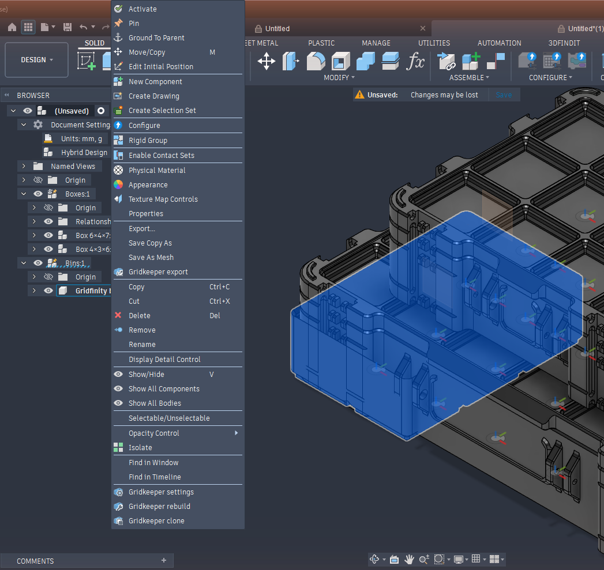

# Exporting for printing

**Gridkeeper export** writes the parts of a design to files for the slicer: one **3MF** with all of them, or an **STL**
or **STEP** file of each part. It comes from GridfinityGenerator (Le0Michine), Gridkeeper extends it to every part it
builds and to colored text.

## Starting the export

- **Right-click** a bin, baseplate, Cullenect insert or storage box, a letter or symbol of one, its component in the
  browser, or a container (*Grid*, *Bins*, *Label*, *Boxes*), and pick **Gridkeeper export**. It sits below *Save As Mesh*.
- Right-click the design's root component to start with **All Gridkeeper parts** on.

## The dialog

| Input | What it does |
|---|---|
| **All Gridkeeper parts** | Selects every visible bin, baseplate, Cullenect insert and box with its small parts of the design. Off goes back to what was selected |
| **Bodies** | What goes out. A selected letter or symbol stands for its part; any other body picked goes out as it is |
| **Format** | **3MF**: the parts in print orientation laid out on the print bed, one Bambu Studio project with all plates for a Bambu Lab printer or a file per plate, see below. **STL** or **STEP**: a file of each part, named after it (a box's *Base*, *Lid* and small parts with the box's name in front, such as *Box 5×4×6 Base*, *Box 5×4×6 Latch*), at the origin with its bottom at zero. STL files come in print orientation, STEP files as designed |
| **Folder**, **Choose folder...** | Where the files go, the last folder is kept |
| **File name** | Name of the 3MF file, the part's name for one part; with a file per plate and several plates *, plate 1*, *, plate 2* … is added |
| **Color label text** | 3MF only: each label color gets a filament the slicer prints it in, see below |
| **Label filaments** | With **Color label text** on: a list per label color of the selected parts, such as *Red text*, *Blue text* or *Text without color*, to pick the slicer's filament it prints in, 1 to 18, counting from 1 as the slicer lists them. The parts print on filament 1. Each color starts on a filament of its own, 2, 3 …; a number you change is kept for the next export |
| **Print bed** › **Printer** | 3MF only: your printer, see [Choosing the printer](#choosing-the-printer); its bed size, where its slicer puts the purge tower and the area it keeps free come with it. The printer chosen last, here or in the baseplate dialog, is where both dialogs start |
| **Files** | 3MF with a Bambu Lab printer only: **One Bambu Studio project with all plates** (to start with) or **A file per plate**, see [A Bambu Studio project with all plates](#a-bambu-studio-project-with-all-plates) |
| **Bed width, X**, **Bed length, Y** | The bed's usable size; typing a size switches the printer to *Custom* |
| **Spacing** | Space between the parts and to the bed's edge, 5 mm to start with |
| **Purge tower area** | With **Color label text** on and text to color: a square kept free on every plate for the purge tower, 50 mm to start with, 0 for none |

The dialog keeps its choices for the next export. Existing files are only replaced after asking. 3MF and STL meshes are made at Fusion's very high quality.

## Choosing the printer

**Print bed › Printer** tells the export which bed to lay the parts out on. Pick your printer, or *Custom* and type
**Bed width, X** and **Bed length, Y** yourself. The list is the same as in the baseplate dialog:

| Printer | Bed (mm) | Purge tower square, with colored text | Kept free |
|---|---|---|---|
| Bambu Lab A1 mini | 180 × 180 | back left | – |
| Bambu Lab A1 | 256 × 256 | back left | – |
| Bambu Lab A2L | 330 × 320 | back left | – |
| Bambu Lab P1P, P1S, X1, X1 Carbon, X1E | 256 × 256 | back, at about two thirds of the width | front left 18 × 28 mm, where the nozzle is wiped |
| Bambu Lab P2S, X2D | 256 × 256 | back, at about two thirds of the width | – |
| Bambu Lab H2C | 330 × 320 | back, at about two thirds of the width | – |
| Bambu Lab H2D, H2D Pro | 350 × 320 | back, at about two thirds of the width | – |
| Bambu Lab H2S | 340 × 320 | back, at about two thirds of the width | – |
| Bambu Lab H3C | 330 × 320 | front right | – |
| Prusa MINI, MK3/MK4, CORE One, XL; Creality Ender-3, K1/K1C, K1 Max; Elegoo Neptune 4; Voron 0, 250, 300, 350 | the printer's bed | back right | – |
| *Custom* | as typed | back right | – |

For the Bambu Lab printers the purge tower square and the area kept free come from Bambu Studio's own printer
profiles, so the slicer's purge tower lands on the free square without moving it and no collision warning comes up.
For every other printer and *Custom* the square is at the back right: move the slicer's purge tower onto it, and mind
any area your printer keeps free yourself. Typing a bed size switches the printer to *Custom*.

Each Bambu Lab printer has an entry of its own (until 1.3.0 several shared one, such as *P1P, P1S, X1, X1C, X1E*),
since the Bambu Studio project names its printer. A shared entry saved before opens as the X1 Carbon, P2S or H2D.

## Which parts

| Part | Exported with |
|---|---|
| Bin | its colored label text and symbol bodies |
| Baseplate | – |
| Cullenect insert | its text and symbol bodies |
| Box and lid (Pred box) | – |
| Small parts of a box: latches, handle, handle pins, hinges | – (each placed one is a part of its own: the four latches give four files) |

Each part is one object in the 3MF and one STL or STEP file, its text and symbol bodies included, so the part comes
out whole. The text bodies of a part in its own component are never a part of their own.

## Print orientation and layout in the 3MF

Every part of the 3MF lies the way it is printed, whatever its place in the design:

| Part | Lies on the bed |
|---|---|
| Bin, baseplate | standing, as designed |
| Cullenect insert, box label | on its underside, as it is built in; a **Flush** insert on its text |
| Box | on its bottom |
| Lid | as it sits on the box |
| Latch | flat |
| Handle | flat, 7 mm high |
| Handle pin | on its flat side |
| Hinge | standing, both halves together as printed; the pin of the *Pinned* hinge on its flat side |

The print orientation of the box's parts follows
[Pred's storage box](https://www.printables.com/model/543553-gridfinity-storage-box-by-pred-now-parametric) (CC BY-NC).

The parts are then laid out in rows, the largest first, with the **Spacing** between them and to the edge, as a
compact, roughly square group in the middle of each plate rather than across its whole width; the rows only widen
when that saves a plate or keeps the purge tower's square or an excluded area free. A part that only fits across is turned by 90°. What doesn't fit goes on further plates. For a Bambu Lab printer they all go in **one Bambu Studio
project**, see below. Otherwise, or with **Files** › *A file per plate*, **each plate is a
3MF file of its own**: *Gridkeeper parts, plate 1.3mf*, *Gridkeeper parts, plate 2.3mf* and so on, just *Gridkeeper
parts.3mf* when one plate holds all. A part larger than the bed lies alone on a plate of its own and is named in the
message after the export. Plate files of an earlier export of the same name that the new one doesn't write are
removed, after asking together with the files it replaces.

With **Color label text** on and label text to color, a square stays free for the purge tower on every plate. For a
Bambu Lab printer it lies where Bambu Studio puts the tower (from its printer profiles): at the back, at about two
thirds of the width, for the P1, X1, P2S, X2D and H2 printers; back left for the A1, A1 mini and A2L; front right for
the H3C. For the other printers and *Custom* it is the back right corner: move the slicer's purge tower there. The
message names a plate where the square couldn't be kept free, a box as wide as the bed for one.

A storage box set goes on plates of its own: the box on one, the lid on one, the latches, handle, pins and hinges on
a third, more if they don't fit. Other parts exported with it share their own plates.

With a Bambu Lab printer chosen, the area it keeps free stays free too: the **P1P, P1S, X1, X1C and X1E** wipe the
nozzle in the front left corner (18 × 28 mm), and Bambu Studio warns of collisions when a part comes near it. A large
part such as a box then fills its plate alone. The message names a plate where a part couldn't keep clear. With
*Custom* or another printer such areas are yours to mind.

The parts of each plate are centered on the bed: Bambu Studio, OrcaSlicer and PrusaSlicer move the parts of a 3MF
made elsewhere to the middle of the bed as a group, so the layout stays as it is when the file is opened. Don't press
**Arrange** in the slicer, it would spread them anew. A file per plate works in every slicer without changing its
printer, filament or process settings.

## A Bambu Studio project with all plates

With a Bambu Lab printer and **Files** › *One Bambu Studio project with all plates* the 3MF is a Bambu Studio project:
open it and every plate is there, laid out as above, with the label colors on their filaments. Bambu Studio takes the
plates only from a project with its own settings, so the project names Bambu Studio's standard profiles of the
printer chosen:

- the printer with the **0.4 mm nozzle**, such as *Bambu Lab X1 Carbon 0.4 nozzle*;
- the process **0.20mm Standard**, such as *0.20mm Standard @BBL X1C*;
- **Bambu PLA Basic** for every filament, filament 1 grey, each label filament in its label's color, text without a
  color black;
- the **Textured PEI Plate**.

Only their names are in the file, Bambu Studio takes the settings from its own system profiles: in Bambu Studio each
filament shows as *Bambu PLA Basic*, not as a copy named after the file. Before saving the
export says so and asks: **OK** saves the project, **Cancel** saves nothing. In Bambu Studio change the printer,
nozzle, filaments and plate to yours where they differ. When Bambu Studio offers to sync with a connected printer of
another model, *Cancel* keeps the project's printer.

The project is made for Bambu Studio (tested with 02.09.01.70); an older Bambu Studio may tell of a newer file
first. For OrcaSlicer, PrusaSlicer and the other printers choose a file per plate.

## Colored label text in the 3MF

With **Color label text** on, the triangles of the label text are painted with the filament of their color from
**Label filaments**, the way the slicers' paint tool stores it. Bambu Studio, OrcaSlicer and PrusaSlicer print them in
that filament without painting by hand:

- **Outline labels without a color:** the tops of the letters are painted.
- **Colored labels** of bins and the **text and symbols of inserts** (bodies of their own, see
  [Colors and multicolor printing](colors.md)): all their triangles are painted.

### Which filament each color gets

The parts themselves print on filament 1. Every label color found in the selected parts gets a filament of its own,
in the order the colors are found: red text on 2, blue text on 3, and so on; label text without a color (the letters of
outline labels, text left at *None*) counts as one more color of its own. A color you exported before keeps the
filament it had, the others take the next free one. Set two colors to the same number to print them in one filament.
The dialog remembers each color's filament for the next export, also for colors not in the current selection.

The color is the one Gridkeeper gave the text in Fusion (*Label color* of a bin, *Text color* of an insert or box
label). Text you recolored by hand in Fusion with another appearance is not told apart: it counts as text without a
color.

In the file the filament is written the way the slicers' paint tool codes it, not as a plain number: filament 1 is
`4`, filament 2 is `8`, from filament 3 on `0C`, `1C`, … (in `paint_color`, `slic3rpe:mmu_segmentation` and
PrusaSlicer's `Metadata/Slic3r_facets_annotation.json`). The slicer shows it as the filament number you picked.

Without **Color label text** the text is still in the file, in the part's filament.

!!! note "Known limits"
    - A bin built as bodies in the root component, without a component of its own (older designs), has no *Text*
      component; its colored label bodies are not found and are missing from the export. A rebuild keeps it in the
      root; **Gridkeeper clone** builds a copy in a component of its own, then delete the old bin.
    - An insert in the root component exports its text and symbol bodies as parts of their own, unpainted. Clone it
      into a component the same way.
    - STL and STEP files have no colors. In STEP the text bodies are bodies of their own beside the part.
    - Label text recolored by hand in Fusion keeps no color of its own in the 3MF, it prints on the filament of
      *Text without color*. Give it a color in the bin, insert or box label dialog instead.

## In the slicer

1. Open the 3MF in Bambu Studio, OrcaSlicer or PrusaSlicer.
2. Make sure the filament list has a filament at each number of **Label filaments**, in the color you want there. A
   Bambu Studio project brings them along as Bambu PLA Basic in the label colors; pick your own filaments there.
3. Slice and check in the preview that the letters of each color print in their filament.
