# Shape snapshot tests

Each case is a JSON file in [cases](cases) holding the settings of a bin, baseplate or label that differ from the dialog's
defaults in [lib/defaultSettings.py](../../lib/defaultSettings.py), lengths in mm and angles in degrees. Its snapshot in
[snapshots](snapshots), a folder named after the case, has the shapes it built, their fingerprints, every setting they
were built with and a preview picture. A run tells when the settings changed, a default changing among them, even
when the shapes stay the same.

Run them in Fusion from Utilities > Add-ins with **Gridkeeper tests: run**, record new snapshots with **Gridkeeper
tests: update snapshots**. The commands are there when the add-in runs from a git checkout.

A case with parameters sets those user parameters once built, the snapshot is of the bodies Fusion recomputed,
and a run also compares them with the case built with the new values from the start.

This page is written from the case files, run `python3 tests/e2e/write_readme.py` after adding or changing one.

## Bins

| Preview | Case | Description |
| --- | --- | --- |
|  | [bin_1_5x2_5x3_half_grid](cases/bin_1_5x2_5x3_half_grid.json) | 1.5x2.5x3 bin on the half grid, half size feet throughout |
| 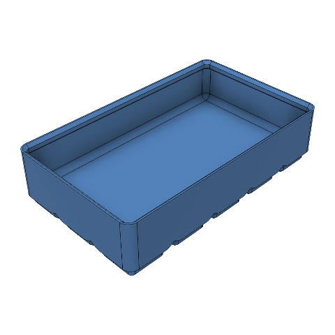 | [bin_1_5x2_5x3_half_grid_params_base_40](cases/bin_1_5x2_5x3_half_grid_params_base_40.json) | Half grid bin, base units lowered to 40 mm. Sets `gfBin1_baseWidth` 40 mm, `gfBin1_baseLength` 40 mm once built, a run compares that with a build using those values from the start |
| 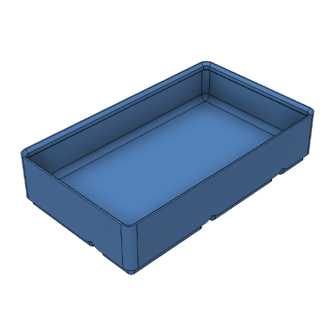 | [bin_1_5x2_5x3_half_size](cases/bin_1_5x2_5x3_half_size.json) | 1.5x2.5x3 bin on the whole grid, a row of half feet along two sides, with magnet and screw holes |
| 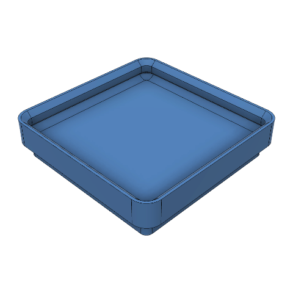 | [bin_1x1x1_lowest](cases/bin_1x1x1_lowest.json) | 1x1x1 bin, the lowest there is, with its lip |
|  | [bin_1x1x2_cullenect](cases/bin_1x1x2_cullenect.json) | 1x1x2 bin, the lowest with a Cullenect socket |
| 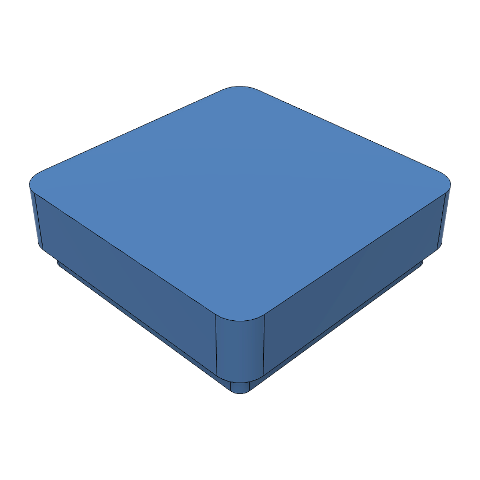 | [bin_1x1x2_solid_no_lip](cases/bin_1x1x2_solid_no_lip.json) | 1x1x2 solid bin without a lip |
| 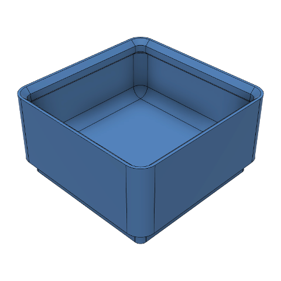 | [bin_1x1x3_40mm_6mm_units](cases/bin_1x1x3_40mm_6mm_units.json) | 1x1x3 bin on a 40 mm grid with 6 mm height units |
|  | [bin_1x1x3_cullenect](cases/bin_1x1x3_cullenect.json) | 1x1x3 bin with a Cullenect socket in its label tab, the baseline of the Cullenect cases |
|  | [bin_1x1x3_cullenect_half_grid](cases/bin_1x1x3_cullenect_half_grid.json) | 1x1x3 bin on the half grid, its Cullenect socket still counts in 42 mm units, 1U |
|  | [bin_1x1x3_cullenect_params_length_50_height_10](cases/bin_1x1x3_cullenect_params_length_50_height_10.json) | 1x1x3 bin with a Cullenect socket, base length 50 mm and height unit 10 mm after building, the socket stays on the tab. Sets `gfBin1_baseLength` 50 mm, `gfBin1_heightUnit` 10 mm once built, a run compares that with a build using those values from the start |
| 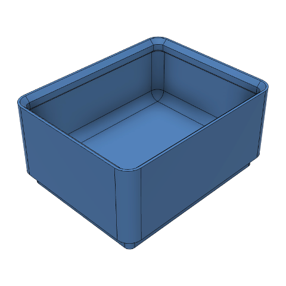 | [bin_1x1x3_params_base_40x50](cases/bin_1x1x3_params_base_40x50.json) | Plain 1x1x3 bin, base units changed to 40 by 50 mm. Sets `gfBin1_baseWidth` 40 mm, `gfBin1_baseLength` 50 mm once built, a run compares that with a build using those values from the start |
| 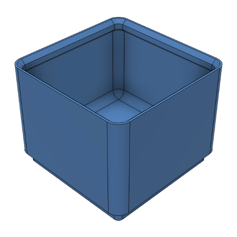 | [bin_1x1x3_params_height_unit_10](cases/bin_1x1x3_params_height_unit_10.json) | Plain 1x1x3 bin, height unit raised to 10 mm. Sets `gfBin1_heightUnit` 10 mm once built, a run compares that with a build using those values from the start |
| 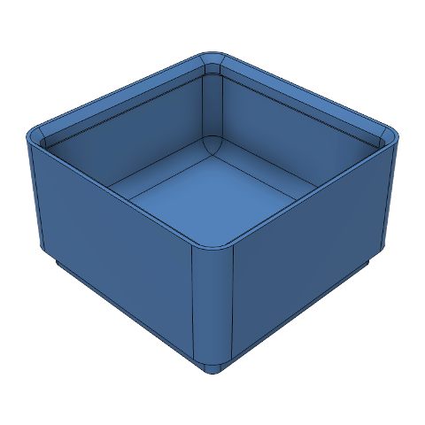 | [bin_1x1x3_plain](cases/bin_1x1x3_plain.json) | 1x1x3 hollow bin with a lip and nothing else, the baseline the other bin cases change one thing of |
| 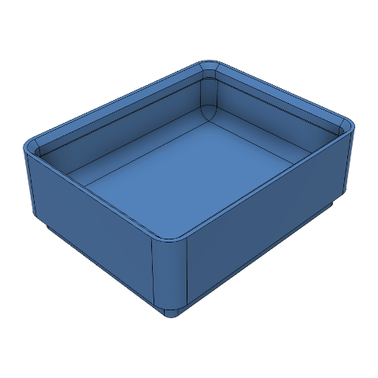 | [bin_1x1x3_units_40x50_5mm](cases/bin_1x1x3_units_40x50_5mm.json) | 1x1x3 bin on a 40 by 50 mm grid of 5 mm height units, base units of different sides |
| 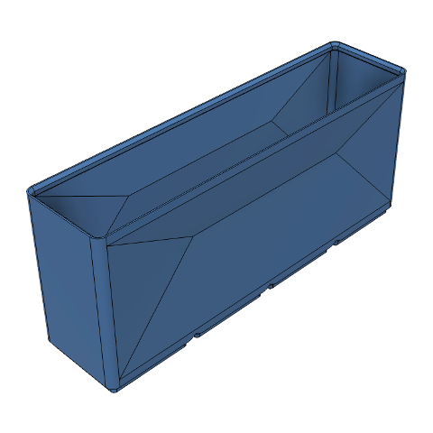 | [bin_1x4x10_creases](cases/bin_1x4x10_creases.json) | 1x4x10 bin, tall and long enough for its long walls to fold in along creases |
|  | [bin_1x4x10_creases_tuned](cases/bin_1x4x10_creases_tuned.json) | 1x4x10 bin with 3.5 mm deep creases folding its long walls in panels of at most 2 units |
|  | [bin_1x4x10_cullenect_creases](cases/bin_1x4x10_cullenect_creases.json) | 1x4x10 bin with folded walls and a Cullenect socket in its tab |
| 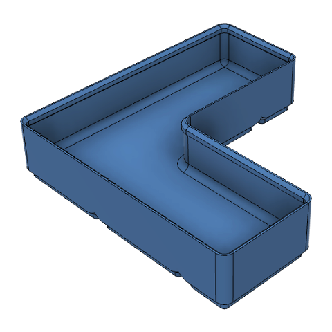 | [bin_2_5x2_5x3_l_shape_half_size](cases/bin_2_5x2_5x3_l_shape_half_size.json) | 2.5x2.5x3 L shaped bin on the whole grid, its arms end in half feet |
| 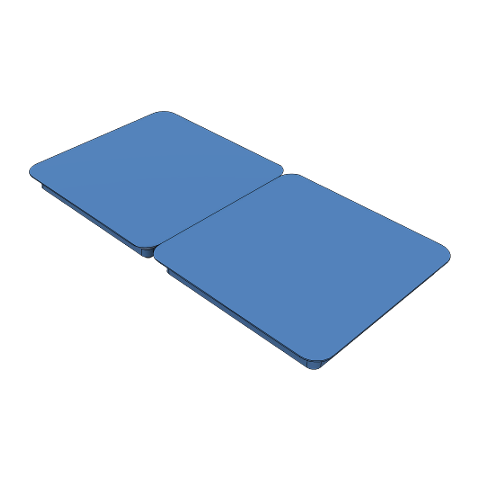 | [bin_2x1_base_only](cases/bin_2x1_base_only.json) | 2x1 bin base alone, no body |
| 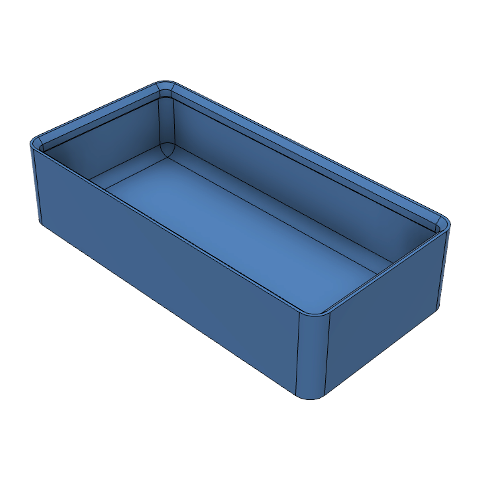 | [bin_2x1x3_body_only](cases/bin_2x1x3_body_only.json) | 2x1x3 bin body alone, no base |
|  | [bin_2x1x3_clearance_0_1](cases/bin_2x1x3_clearance_0_1.json) | 2x1x3 bin with the smallest clearance, 0.1 mm, magnet and screw holes placed from it |
|  | [bin_2x1x3_clearance_0_5](cases/bin_2x1x3_clearance_0_5.json) | 2x1x3 bin with the largest clearance, 0.5 mm, magnet and screw holes placed from it |
|  | [bin_2x1x3_cullenect_params_base_40](cases/bin_2x1x3_cullenect_params_base_40.json) | 2x1x3 bin with a 2U Cullenect socket, base width changed to 40 mm after building, the socket follows. Sets `gfBin1_baseWidth` 40 mm once built, a run compares that with a build using those values from the start |
|  | [bin_2x1x3_cullenect_shelled](cases/bin_2x1x3_cullenect_shelled.json) | 2x1x3 shelled bin with a 2U Cullenect socket in its tab |
| 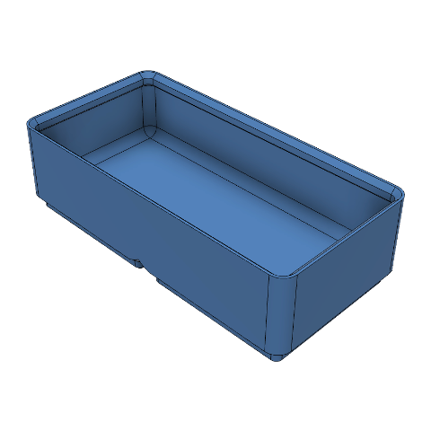 | [bin_2x1x3_deep_magnets_screws_no_grooves](cases/bin_2x1x3_deep_magnets_screws_no_grooves.json) | 2x1x3 bin with 4.5 mm deep magnet holes and screw holes, too deep for the printability groove to fit |
|  | [bin_2x1x3_holes_large](cases/bin_2x1x3_holes_large.json) | 2x1x3 bin with 10 mm by 4 mm magnet holes and 6 mm screw holes, wider than the printability groove |
|  | [bin_2x1x3_holes_small](cases/bin_2x1x3_holes_small.json) | 2x1x3 bin with 3 mm by 1 mm magnet holes and 1.5 mm screw holes |
| 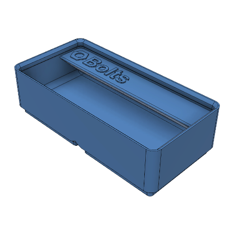 | [bin_2x1x3_label_icon_text_embossed](cases/bin_2x1x3_label_icon_text_embossed.json) | 2x1x3 bin with an embossed label of an icon and text |
|  | [bin_2x1x3_label_icon_text_embossed_colored](cases/bin_2x1x3_label_icon_text_embossed_colored.json) | 2x1x3 bin with a raised icon and text label in red (p86), the label bodies not joined to the bin |
| 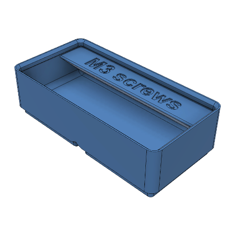 | [bin_2x1x3_label_text_engraved](cases/bin_2x1x3_label_text_engraved.json) | 2x1x3 bin with an engraved text label |
|  | [bin_2x1x3_label_text_engraved_colored](cases/bin_2x1x3_label_text_engraved_colored.json) | 2x1x3 bin with an engraved text label in blue (p86), the cut filled flush by label bodies of their own |
|  | [bin_2x1x3_magnets](cases/bin_2x1x3_magnets.json) | 2x1x3 bin with magnet holes only |
|  | [bin_2x1x3_magnets_3mm](cases/bin_2x1x3_magnets_3mm.json) | 2x1x3 bin with magnet holes for 6 x 3 mm magnets, 3.4 mm deep (p263) |
|  | [bin_2x1x3_magnets_pull_tabs](cases/bin_2x1x3_magnets_pull_tabs.json) | 2x1x3 bin with magnet holes opened to the side for pulling magnets out |
|  | [bin_2x1x3_magnets_pull_tabs_screws_grooves](cases/bin_2x1x3_magnets_pull_tabs_screws_grooves.json) | 2x1x3 bin with magnet holes opened to the side, screw holes and printability grooves |
|  | [bin_2x1x3_magnets_screws_grooves](cases/bin_2x1x3_magnets_screws_grooves.json) | 2x1x3 bin with magnet and screw holes, a printability groove bridges each magnet hole to its screw hole |
|  | [bin_2x1x3_screws](cases/bin_2x1x3_screws.json) | 2x1x3 bin with screw holes only |
| 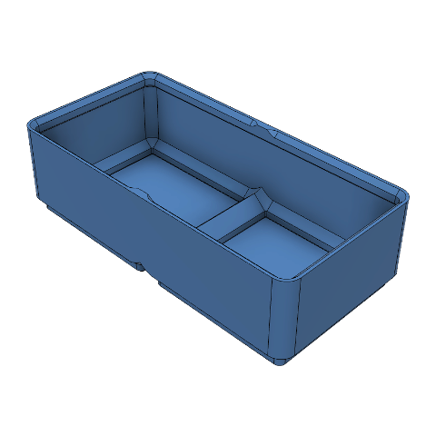 | [bin_2x1x3_shelled_notches](cases/bin_2x1x3_shelled_notches.json) | 2x1x3 shelled bin with lip notches, the sharp shell of Fusion instead of the rounded one |
|  | [bin_2x1x3_wall_0_4](cases/bin_2x1x3_wall_0_4.json) | 2x1x3 bin with the thinnest walls, 0.4 mm |
|  | [bin_2x1x3_wall_1_9](cases/bin_2x1x3_wall_1_9.json) | 2x1x3 bin with 1.9 mm walls, flush with the inside of the lip, still chamfered under it |
|  | [bin_2x1x3_wall_2_15](cases/bin_2x1x3_wall_2_15.json) | 2x1x3 bin with 2.15 mm walls, as thick as the lip wall, the first thickness without a chamfer under the lip |
|  | [bin_2x1x3_wall_3](cases/bin_2x1x3_wall_3.json) | 2x1x3 bin with 3 mm walls, thicker than the lip |
| 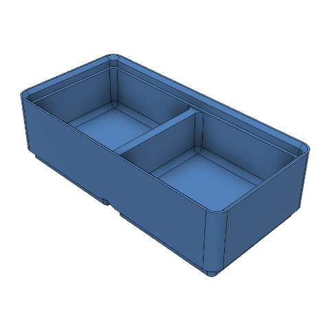 | [bin_2x1x3_wall_3_scoop_compartments](cases/bin_2x1x3_wall_3_scoop_compartments.json) | 2x1x3 bin with 3 mm walls, thicker than the lip, a scoop and 2 compartments, placed against the lip |
|  | [bin_2x1x4_cullenect_hollow_tab](cases/bin_2x1x4_cullenect_hollow_tab.json) | 2x1x4 bin with a hollow tab open through the side walls and a 2U Cullenect socket, its tilted top is kept flat |
| 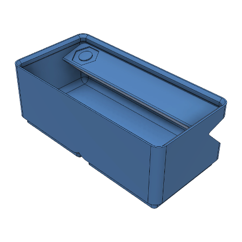 | [bin_2x1x4_hollow_tab_open_sides](cases/bin_2x1x4_hollow_tab_open_sides.json) | 2x1x4 bin with a hollow tilted tab open through the side walls, engraved icon label |
| 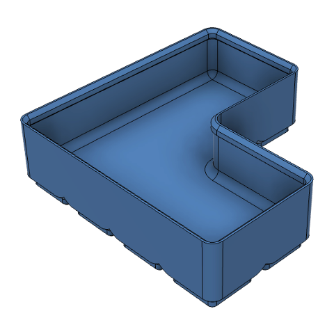 | [bin_2x2x3_l_shape_half_grid](cases/bin_2x2x3_l_shape_half_grid.json) | 2x2x3 L shaped bin on the half grid, drawn in half feet |
| 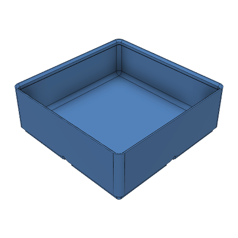 | [bin_2x2x4_scoop_radius_10](cases/bin_2x2x4_scoop_radius_10.json) | 2x2x4 bin with a scoop of at most 10 mm radius |
| 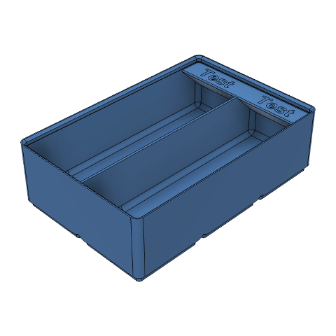 | [bin_2x3x5_features](cases/bin_2x3x5_features.json) | 2x3x5 hollow bin with a scoop, lip, labelled tab, 2 compartments, magnet and screw holes |
| 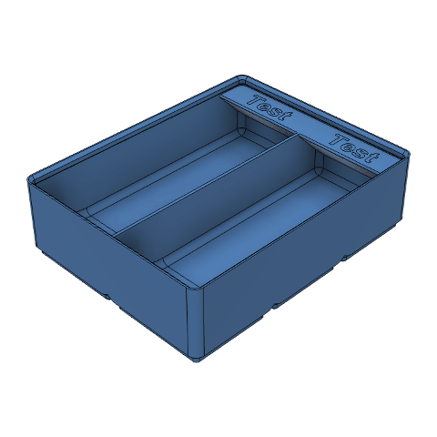 | [bin_2x3x5_features_params_all](cases/bin_2x3x5_features_params_all.json) | Bin with every feature, base and height units all changed. Sets `gfBin1_baseWidth` 45 mm, `gfBin1_baseLength` 38 mm, `gfBin1_heightUnit` 6 mm once built, a run compares that with a build using those values from the start |
|  | [bin_3x1x3_cullenect_compartments](cases/bin_3x1x3_cullenect_compartments.json) | 3x1x3 bin with 3 compartments, a Cullenect socket in every compartment tab |
| 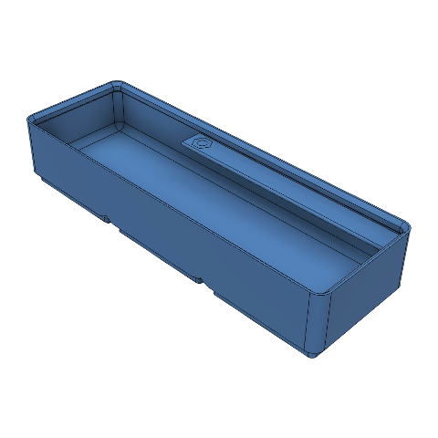 | [bin_3x1x3_tab_shallow_flat](cases/bin_3x1x3_tab_shallow_flat.json) | 3x1x3 bin with a two unit tab at the far end, 8 mm wide, the shallowest overhang, 65 degrees, and a flat top |
|  | [bin_3x2x3_dividers_to_top_3_columns](cases/bin_3x2x3_dividers_to_top_3_columns.json) | 3x2x3 bin with dividers up to the top on grid lines and 3 compartments side by side, two parallel raised dividers that don't touch, both go into the bin |
|  | [bin_3x2x3_dividers_to_top_3_columns_lip_notches](cases/bin_3x2x3_dividers_to_top_3_columns_lip_notches.json) | 3x2x3 bin with dividers up to the top on grid lines and lip notches, the raised dividers end where upstream's notches stand at the wall junctions (review of round 12) |
|  | [bin_3x2x3_dividers_to_top_3_columns_part](cases/bin_3x2x3_dividers_to_top_3_columns_part.json) | 3x2x3 bin with dividers up to the top and 3 compartments side by side, built in a part design: the document turns hybrid and the bin goes into Bins (round 13), no raised divider left loose |
|  | [bin_3x2x3_dividers_to_top_3_columns_tab_part](cases/bin_3x2x3_dividers_to_top_3_columns_tab_part.json) | 3x2x3 bin with dividers up to the top, 3 compartments side by side and a 1u Cullenect tab without a scoop, the user's bin of his p83 hand test, built in a part design, which turns hybrid for it (round 13). The raised divider corners carry on from the compartment corners below without a ledge |
|  | [bin_3x2x3_dividers_to_top_3_columns_tab_scoop_part](cases/bin_3x2x3_dividers_to_top_3_columns_tab_scoop_part.json) | 3x2x3 bin with dividers up to the top, 3 compartments side by side, a scoop and a 1u Cullenect tab, the user's bin of p83, built in a part design, which turns hybrid for it (round 13). The raised divider corners are rounded up to the top, the dividers are not notched by the sockets |
| 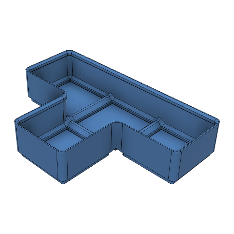 | [bin_3x2x3_t_shape_shelled](cases/bin_3x2x3_t_shape_shelled.json) | 3x2x3 T shaped shelled bin |
| 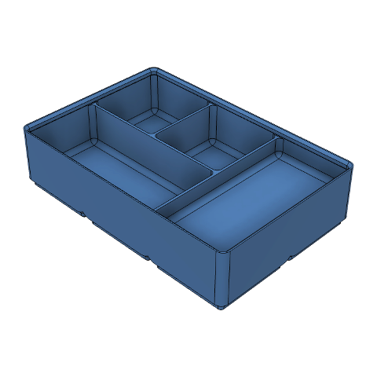 | [bin_3x2x4_merged_compartments](cases/bin_3x2x4_merged_compartments.json) | 3x2x4 bin with a 3x2 compartment grid, two merged pockets, one of them 10 mm shallower |
| 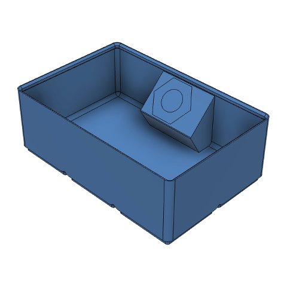 | [bin_3x2x6_tab_steep_tilted](cases/bin_3x2x6_tab_steep_tilted.json) | 3x2x6 bin with a one unit tab in the middle, 20 mm wide, the steepest overhang, 30 degrees, and the most tilted top, 45 degrees |
| 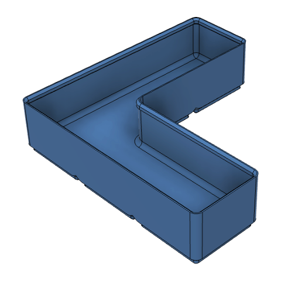 | [bin_3x3x4_l_shape](cases/bin_3x3x4_l_shape.json) | 3x3x4 L shaped hollow bin with a lip, no tab, one compartment, no holes |
|  | [bin_3x3x4_l_shape_lip_notches](cases/bin_3x3x4_l_shape_lip_notches.json) | 3x3x4 L shaped bin with lip notches |
| 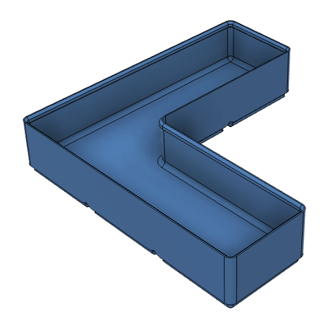 | [bin_3x3x4_l_shape_params_base_50](cases/bin_3x3x4_l_shape_params_base_50.json) | L-shaped bin, base units raised to 50 mm. Sets `gfBin1_baseWidth` 50 mm, `gfBin1_baseLength` 50 mm once built, a run compares that with a build using those values from the start |
| 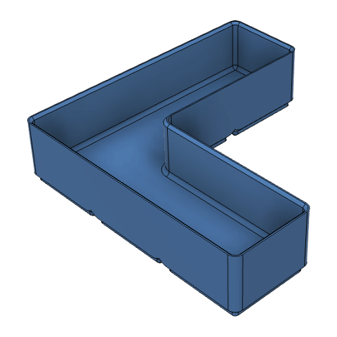 | [bin_3x3x4_l_shape_wall_1_9](cases/bin_3x3x4_l_shape_wall_1_9.json) | 3x3x4 L shaped bin with 1.9 mm walls, flush with the inside of the lip, its chamfer under the lip follows the shape |
| 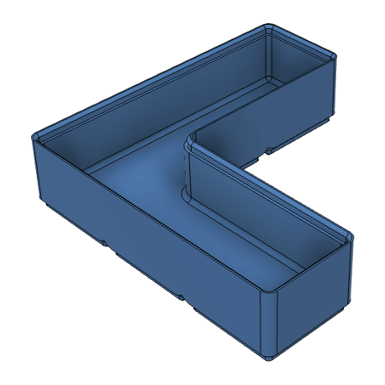 | [bin_3x3x4_l_shape_wall_3](cases/bin_3x3x4_l_shape_wall_3.json) | 3x3x4 L shaped bin with 3 mm walls, thicker than the lip |
|  | [bin_4x2x3_cullenect_mixed](cases/bin_4x2x3_cullenect_mixed.json) | 4x2x3 bin, a compartment over 4 cells in front, one over 2 cells and two single ones behind, 4 units long tabs with 4U, 2U and 1U Cullenect sockets |
|  | [bin_4x2x3_cullenect_mixed_dividers_to_top](cases/bin_4x2x3_cullenect_mixed_dividers_to_top.json) | the user's 4x2x3 bin with dividers up to the top on grid lines: a compartment over 4 cells in front, one over 2 cells and two single ones behind, every divider on a grid line, 4U, 2U and 1U Cullenect sockets |
|  | [bin_4x2x3_dividers_to_top_3x2_params_base_40](cases/bin_4x2x3_dividers_to_top_3x2_params_base_40.json) | 4x2x3 bin with dividers up to the top on grid lines and 3x2 compartments, no label tabs: the row divider rises, the two column dividers between grid lines stay below the lip. Base width changed to 40 mm after building, the raised divider follows. Sets `gfBin1_baseWidth` 40 mm once built, a run compares that with a build using those values from the start |
| 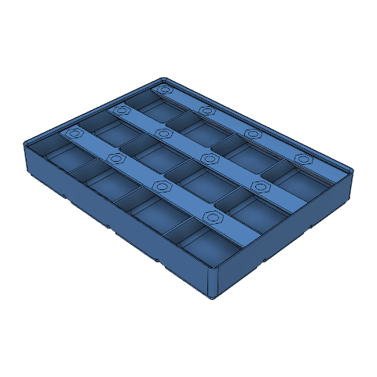 | [bin_4x3x3_compartments_4x3](cases/bin_4x3x3_compartments_4x3.json) | 4x3x3 bin with a 4x3 compartment grid, a scoop and a label tab along each row of compartments |
|  | [bin_6x4x12_cullenect](cases/bin_6x4x12_cullenect.json) | 6x4x12 bin with a 6 units long tab and a 6U Cullenect socket, the largest case |

## Baseplates

| Preview | Case | Description |
| --- | --- | --- |
| 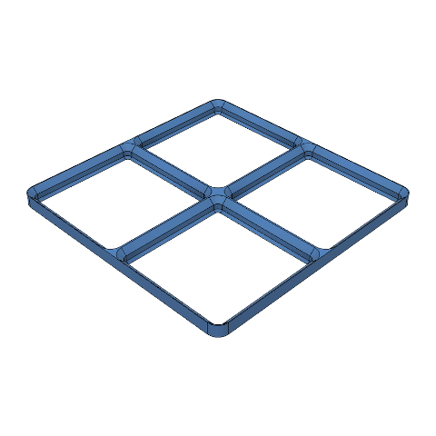 | [baseplate_2x2_light](cases/baseplate_2x2_light.json) | 2x2 light baseplate without holes, the baseline the other baseplate cases change one thing of |
|  | [baseplate_2x2_light_magnets_3mm](cases/baseplate_2x2_light_magnets_3mm.json) | 2x2 light baseplate with magnet sockets for 6 x 3 mm magnets, 3.4 mm deep (p263) |
| 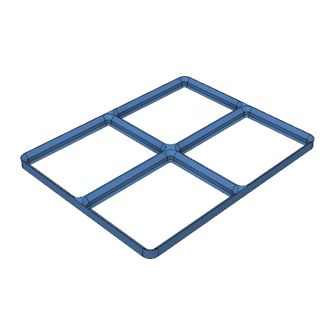 | [baseplate_2x2_light_params_base_40x50](cases/baseplate_2x2_light_params_base_40x50.json) | Light 2x2 baseplate, base units changed to 40 by 50 mm. Sets `gfPlate1_baseWidth` 40 mm, `gfPlate1_baseLength` 50 mm once built, a run compares that with a build using those values from the start |
| 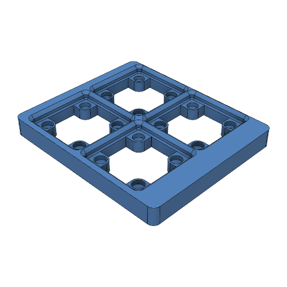 | [baseplate_2x2_skeletonized_padding](cases/baseplate_2x2_skeletonized_padding.json) | 2x2 skeletonized baseplate with magnet sockets and uneven padding |
| 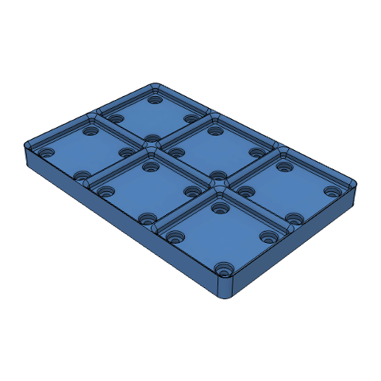 | [baseplate_3x2_full](cases/baseplate_3x2_full.json) | 3x2 full baseplate with magnet sockets, screw holes and connection holes |
| 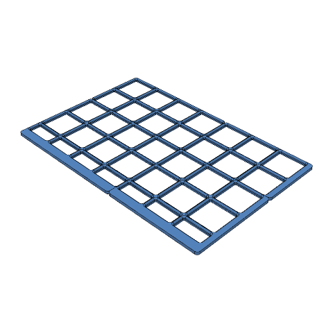 | [baseplate_fill_area_pieces](cases/baseplate_fill_area_pieces.json) | 300x200 mm area filled with a light baseplate, cut into pieces for a 180 mm print bed, half cells, aligned left and back |

## Labels

| Preview | Case | Description |
| --- | --- | --- |
|  | [label_1u_screw_text](cases/label_1u_screw_text.json) | 1U Cullenect insert with a socket head screw and one line of text, raised, the baseline the other label cases change things of |
|  | [label_1u_screw_text_colored](cases/label_1u_screw_text_colored.json) | The baseline insert with its text and symbol in red (p86), the bodies carry the label appearance |
|  | [label_1u_screw_text_part](cases/label_1u_screw_text_part.json) | 1U insert with a screw and text built in a part design: the document turns hybrid and the insert is a component of its own, as the bodies of label_1u_screw_text |
|  | [label_1u_set_screw_hex](cases/label_1u_set_screw_hex.json) | 1U insert with a hex set screw (p85), headless, and one line of text, raised |
|  | [label_1u_two_lines_heavy](cases/label_1u_two_lines_heavy.json) | 1U insert with two lines in the Heavy style, flush - lettering printable with a 0.4 mm nozzle (p130) |
|  | [label_1u_welle_6mm](cases/label_1u_welle_6mm.json) | the user's 1U insert "Welle 6mm", flush, no symbol: Fusion broke the line in two and hung it off the insert (p84), the text stays one line on it |
|  | [label_1u_welle_6mm_text_edited](cases/label_1u_welle_6mm_text_edited.json) | the user's 1U insert "Welle 6mm" with its text made longer once built (p70): the line isn't fitted again and stays one line, it runs on to the right past the insert. Sets `gfLabel1_text1` "Welle 6mm h6 lang" once built |
|  | [label_25mm_free](cases/label_25mm_free.json) | Insert 25 mm wide given in mm with a width correction of -0.1 mm, a flanged pan head screw, flush, bold text |
|  | [label_2u_hardware](cases/label_2u_hardware.json) | 2U insert with a nylon lock nut and two lines of text, set in, the filling kept as a hidden body |
|  | [label_6u_text](cases/label_6u_text.json) | 6U insert with text only, built on 42 mm units and set to a 40 mm base width after, the insert has to shrink with it. Sets `gfLabel1_baseWidth` 40 mm once built, a run compares that with a build using those values from the start |

## Boxes

| Preview | Case | Description |
| --- | --- | --- |
|  | [box_4x3x6](cases/box_4x3x6.json) | Smallest box, 4 x 3 cells, height 6 (the minimum, Nutzer 16.11.2026: "Mindesthöhe 6. vorerst.") |
|  | [box_4x3x6_magnets_custom](cases/box_4x3x6_magnets_custom.json) | Smallest box with the deepest custom magnet holes, 2.6 mm, 8 mm wide |
|  | [box_4x3x8](cases/box_4x3x8.json) | Narrow box 4 x 3, height 8 |
|  | [box_5x3x9](cases/box_5x3x9.json) | Box 5 x 3, height 9 |
|  | [box_5x4x6](cases/box_5x4x6.json) | Pred's own box 5 x 4 x 6 |
|  | [box_5x4x6_magnets](cases/box_5x4x6_magnets.json) | Box 5 x 4 x 6 with magnet holes for 6 x 2 mm magnets |
|  | [box_5x4x6_params_7x5x10](cases/box_5x4x6_params_7x5x10.json) | Box 5 x 4 x 6, its parameters changed to 7 x 5 x 10. Sets `gfBox1_baseWidth` 7 mm, `gfBox1_baseLength` 5 mm, `gfBox1_heightU` 10 mm once built, a run compares that with a build using those values from the start |
|  | [box_6x5x7](cases/box_6x5x7.json) | Box 6 x 5 x 7, the label holder at its widest (85 mm) |
|  | [box_6x5x7_params_4x3x6](cases/box_6x5x7_params_4x3x6.json) | Box 6 x 5 x 7, its parameters changed to 4 x 3 x 6. Sets `gfBox1_baseWidth` 4 mm, `gfBox1_baseLength` 3 mm, `gfBox1_heightU` 6 mm once built, a run compares that with a build using those values from the start |
|  | [box_7x5x10](cases/box_7x5x10.json) | Large box 7 x 5 x 10 |
